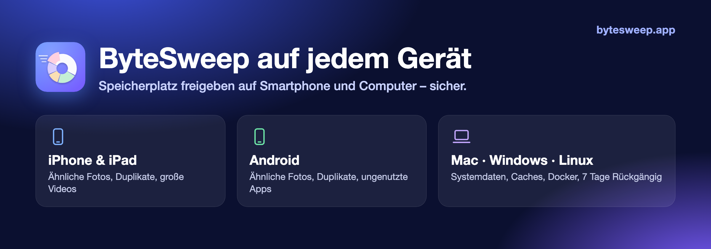

<p align="center">
  <a href="README.md">English</a> ·
  <b>Deutsch</b> ·
  <a href="README.es.md">Español</a> ·
  <a href="README.fr.md">Français</a> ·
  <a href="README.it.md">Italiano</a> ·
  <a href="README.nl.md">Nederlands</a> ·
  <a href="README.pl.md">Polski</a> ·
  <a href="README.pt-BR.md">Português (Brasil)</a> ·
  <a href="README.ru.md">Русский</a> ·
  <a href="README.tr.md">Türkçe</a> ·
  <a href="README.ja.md">日本語</a> ·
  <a href="README.ko.md">한국어</a> ·
  <a href="README.zh-Hans.md">简体中文</a> ·
  <a href="README.zh-Hant.md">繁體中文</a>
</p>

<h1 align="center">ByteSweep CLI: Speicherplatz analysieren und freigeben unter Linux, Mac und Windows</h1>

<p align="center">
  <b>Festplatte voll? Finde heraus, warum, und gib Speicherplatz sicher frei – in jedem Terminal.</b><br>
  Ein kostenloses Open-Source-Tool, das Speicherplatz analysiert und aufräumt – für Linux-Server, Mac, Windows und BSD.
</p>

<p align="center">
  <a href="https://bytesweep.app/cli"></a>
  <a href="https://github.com/bytesweepcleaner/bytesweep-cli/blob/main/LICENSE"></a>
  <a href="https://github.com/bytesweepcleaner/bytesweep-cli/actions/workflows/test.yml"></a>
  <a href="https://github.com/bytesweepcleaner/bytesweep-cli/blob/main/go.mod"></a>
  <a href="docs/platforms.md"></a>
  <a href="https://github.com/bytesweepcleaner/bytesweep/stargazers"></a>
</p>

<p align="center">
  
</p>

ByteSweep CLI (`bsweep`) zeigt dir, **warum eine Festplatte voll ist**, und gibt den Platz frei, **ohne etwas kaputt zu machen**.
Es wertet `df`, `du`, Docker, das systemd-Journal, Paket-Caches, alte Kernel, gelöschte, aber noch geöffnete
Dateien, Inodes und Snapshots aus und erklärt das Ergebnis in klaren Worten. Jede Bereinigung zeigt zuerst den
genauen Befehl, riskante warten, bis du sie dir angesehen hast, und entfernte Dateien landen 7 Tage lang in Undo (Rückgängig).

Es ist eine einzige statische Datei: keine Runtime, kein Agent, nichts läuft im Hintergrund weiter. **Kostenlos und Open Source (GPL-3.0):
jeder Befehl, auf jedem Rechner, ohne Lizenz, Schlüssel oder Testphase.**

## Funktionen

- **Warum die Festplatte voll ist, in einer Antwort.** `bsweep why` nennt die Ordner, Caches und Logs, die den Platz belegen, und die Lücke, die `du` nicht sieht.
- **"No space left on device" trotz freier Bytes.** Inodes pro Festplatte und die Ordner mit den meisten Dateien.
- **`df` und `du` zeigen Unterschiedliches.** Der Held-Bildschirm listet gelöschte Dateien, die noch offen gehalten werden, und den Dienst, der jede davon hält.
- **Docker-Speicherverbrauch.** Build-Cache, ungenutzte Images, gestoppte Container und Container-Logs; Volumes werden nie per Prune gelöscht.
- **Logs.** Das systemd-Journal verkleinern (vacuum), rotierte Logs löschen, riesige aktive Logs an Ort und Stelle leeren; täglich, wöchentlich oder monatlich planbar.
- **Eine volle Festplatte, jetzt sofort.** `bsweep rescue` gibt gerade genug frei, das Sicherste zuerst, und schreibt nichts auf die volle Festplatte.
- **Sicher von Grund auf.** Genaue Befehle werden zuerst gezeigt, `--dry-run` überall, Undo für 7 Tage, niemals deine Datenbanken oder der laufende Kernel.
- **Duplikate, große Dateien, Komprimieren und Archivieren.** Kopien anhand des Inhalts finden, alte Logs mit gzip packen, alte Projekte auf eine andere Festplatte verschieben und wieder zurückholen.
- **Zustand, Updates, Ports und Autostart.** Fehlgeschlagene Dienste, Out-of-Memory-Kills, sterbende Festplatten, abgelaufene Zertifikate, Backups, die nicht mehr laufen, und was auf welchem Port lauscht.
- **Viele Server.** `bsweep fleet` über SSH, ohne etwas zu installieren, `bsweep manage` für alle Server auf einem Bildschirm.
- **KI-Assistenten.** `bsweep mcp` ist ein Model-Context-Protocol-Server für Claude, Cursor, VS Code und jeden MCP-Client.
- **Skripte und Monitoring.** `--json` bei fast jedem Befehl, Exit-Codes für `bsweep check`, Webhooks.

## Installation

Linux, macOS und BSD:

```sh
curl -fsSL https://bytesweep.app/install-cli.sh | sudo sh
```

Windows (PowerShell als Administrator):

```powershell
irm https://bytesweep.app/install-cli.ps1 | iex
```

Beide prüfen die signierten Prüfsummen, bevor irgendetwas installiert wird. Mit Go 1.22 oder neuer kannst du es auch selbst bauen:

```sh
go install github.com/bytesweepcleaner/bytesweep-cli/cmd/bsweep@latest
```

`sudo bsweep update` holt die nächste Version. Alle Systeme und Prozessoren: [docs/platforms.md](docs/platforms.md).

## Unterstützte Systeme

Eine statische `bsweep`-Datei für jedes System und jeden Prozessor: 23 Builds insgesamt. Die Installationszeile wählt die passende.

| System | Prozessoren | Versionen |
|---|---|---|
| **Linux** | x86_64, ARM64, ARMv7, i386, RISC-V 64, ppc64le, s390x, LoongArch64 | Jede Distribution: Ubuntu, Debian, Fedora, RHEL, CentOS, AlmaLinux, Rocky Linux, openSUSE, Arch, Alpine und mehr |
| **Mac** | Apple silicon (ARM64), Intel (x86_64) | macOS 11 Big Sur und neuer |
| **Windows** | x64, ARM64, 32-Bit (i386) | Windows 10 und 11 |
| **FreeBSD** | x86_64, ARM64 |  |
| **OpenBSD** | x86_64, ARM64 |  |
| **NetBSD** | x86_64, ARM64 |  |
| **DragonFly BSD** | x86_64 |  |
| **Solaris** | x86_64 |  |
| **illumos** | x86_64 |  |
| **AIX** | ppc64 |  |
| **Android** (Termux) | ARM64 | Linux-ARM64-Build in Termux; nur zum Ansehen, da Android keinen Root-Zugriff gibt |

Läuft in jedem Terminal: Terminal, iTerm2, Windows Terminal, PowerShell, GNOME Terminal, Konsole, xterm, der Linux-Konsole, tmux, screen, PuTTY und über SSH. Was sich je System unterscheidet: [docs/platforms.md](docs/platforms.md).

## Schnellstart

```sh
sudo bsweep                        # die Vollbild-App
bsweep why                         # eine Antwort: warum diese Festplatte voll ist
sudo bsweep rescue                 # Festplatte bei 100 %: gerade genug freigeben, Sicherstes zuerst
bsweep clean --list                # alles, was weg kann, nach Gruppen
sudo bsweep clean --safe --dry-run # was eine sichere Bereinigung täte, ohne es zu tun
bsweep dupes /srv --dry-run        # doppelte Dateien und welche Kopie bleiben würde
bsweep check                       # Exit-Code für Monitoring und Cron
```

## ByteSweep für Smartphone und Computer

<p align="center">
  <a href="https://bytesweep.app/?ref=github"></a>
</p>

<p align="center">
  <a href="https://apps.apple.com/us/app/bytesweep-storage-cleaner/id6811826959"></a>
  <a href="https://play.google.com/store/apps/details?id=com.bytesweep.app"></a>
  <a href="https://apps.microsoft.com/detail/9N7WMJS8QCQX"></a>
  <a href="https://bytesweep.app/mac.html?ref=github"></a>
  <a href="https://bytesweep.app/linux.html?ref=github"></a>
</p>

Die CLI ist kostenlos und bleibt es. Für das Smartphone in deiner Tasche und den Computer auf deinem Schreibtisch gibt es die ByteSweep-Apps – mit derselben Regel: Du siehst alles, bevor es gelöscht wird.

<table>
  <tr>
    <td><b>iPhone &amp; iPad</b></td>
    <td>Findet ähnliche Fotos und Duplikate, verkleinert große Videos und lässt dich durch alte Monate wischen. Kostenlos für das erste 1 GB und 30 Elemente, danach einmal bezahlen.</td>
    <td><a href="https://apps.apple.com/us/app/bytesweep-storage-cleaner/id6811826959"></a></td>
  </tr>
  <tr>
    <td><b>Android</b></td>
    <td>Findet ähnliche Fotos, Duplikate, große Videos und ungenutzte Apps. Kostenlos für das erste 1 GB und 30 Elemente, danach einmal bezahlen, kein Abo.</td>
    <td><a href="https://play.google.com/store/apps/details?id=com.bytesweep.app"></a></td>
  </tr>
  <tr>
    <td><b>Mac</b></td>
    <td>Findet, was den Mac füllt, von Systemdaten bis Docker und Xcode, mit 7 Tagen Rückgängig für alles, was zurück kann. 3 Tage kostenlos testen. Auch im Mac App Store.</td>
    <td><a href="https://bytesweep.app/mac.html?ref=github"></a><br><a href="https://apps.apple.com/us/app/bytesweep-storage-transfer/id6822710125?mt=12"></a></td>
  </tr>
  <tr>
    <td><b>Windows</b></td>
    <td>Räumt Windows-Update-Reste, temporäre Dateien sowie Browser- und Spiele-Caches auf, mit 7 Tagen Rückgängig für alles, was zurück kann. 3 Tage kostenlos testen.</td>
    <td><a href="https://apps.microsoft.com/detail/9N7WMJS8QCQX"></a></td>
  </tr>
  <tr>
    <td><b>Linux</b></td>
    <td>Leert apt-, dnf- und pacman-Caches, alte Snaps, ungenutzte Flatpak-Runtimes und das Journal und findet Duplikate und große Dateien. 3 Tage kostenlos testen.</td>
    <td><a href="https://bytesweep.app/linux.html?ref=github"></a></td>
  </tr>
</table>

## Festplatte voll auf dem Linux-Server: jedes Problem, das es löst

| Problem auf einem echten Server | Was ByteSweep tut |
|---|---|
| `df` sagt voll, `du` sieht das anders | Held-Tab: gelöschte, noch offene Dateien und wer sie hält. Overview (Übersicht) nennt jede Lücke, die ein Scan nicht sieht |
| "No space left" trotz freier Bytes | Inodes pro Festplatte, Explore sortiert nach Dateianzahl (`i`) |
| Docker hat die Festplatte aufgefressen | Build-Cache, ungetaggte und ungenutzte Images, gestoppte Container, Container-Logs, die `docker system df` nicht zeigt; jede VM (Colima, Lima, Podman, Multipass, Vagrant, minikube, Android-Emulatoren...) mit Namen und dem Platz, den sie zurückgeben kann |
| Ein blindes Prune hat eine Datenbank gelöscht | Volumes werden nie per Prune gelöscht. Datenbanken und /var/lib/docker lassen sich auch von Hand nicht bereinigen |
| Journal, rotierte Logs, riesige aktive Logs | Vacuum über journalctl; aktive Logs werden an Ort und Stelle geleert, damit Dienste weiterschreiben |
| /boot voll, Upgrades schlagen fehl | Alte Kernel, nie der laufende |
| Paket- und Sprach-Caches, alte Snaps, Crash-Dumps, altes /tmp | Jeweils über das eigene Tool; der genaue Befehl wird zuerst gezeigt |
| Der Tarif wurde erweitert, die Festplatte nicht | Findet Speicherplatz außerhalb jeder Partition |
| Die versteckten 5 % von ext4 | Nennt den reservierten Platz und die tune2fs-Zeile |
| Nächsten Monat ist sie wieder voll | Prevent-Tab: Journal-Obergrenze, Docker-Log-Limit, tägliche Aufzeichnung |
| "Was hat sich über Nacht geändert?" | Was gewachsen ist und wann die Festplatte bei diesem Tempo voll sein wird |
| Der Scan bremst die Produktion aus | Läuft mit niedriger CPU-Priorität und Idle-Festplattenpriorität; bleibt auf einer Festplatte |
| Festplatte bei 100 % und alles schlägt fehl | `bsweep rescue` oder `R`: gibt gerade genug frei, Sicherstes zuerst, und nennt dann die Dienste, die gestoppt sind. Schreibt nichts auf die volle Festplatte |
| Podman- oder Kubernetes-Nodes | Dieselbe Bereinigung über podman und crictl; Volumes bleiben unangetastet |
| Snapshots belegen Platz | `bsweep snapshots`: Time Machine, Wiederherstellungspunkte, Schattenkopien, Timeshift, Snapper, ZFS, Btrfs und LVM, mit Größen, wo das Tool sie liefern kann. Entfernt nur, was du auswählst, und behält jeweils den neuesten |
| Dateien unter einem Mount versteckt | Schaut über einen schreibgeschützten Bind-Mount unter jeden Mount und zeigt, wie du an sie herankommst |
| Alte Deploys und Reste von Web-Apps | Alte Releases (behält das aktive + 3), WordPress-Cache, Laravel-Logs, PHP-Sessions |
| Logs müssen regelmäßig geleert werden | `bsweep logs clear` oder `bsweep schedule logs` täglich, wöchentlich oder monatlich |
| Ein Log, das niemand rotiert | Prevent schreibt eine logrotate-Regel und testet sie, bevor sie bleibt |
| Alte Projekte füllen eine vielgenutzte Festplatte | `bsweep archive /srv/old --to /mnt/backup`: auf eine andere Festplatte, jede Datei per Prüfsumme kontrolliert, dann freigegeben; `where` funktioniert auch, wenn sie abgesteckt ist, `bring-back` holt sie zurück |
| Alte Logs und Dumps belegen Platz | `bsweep compress /var/log --older 30d`: gzip, wo es etwas spart, zur Kontrolle zurückgelesen, bevor das Original in Undo geht; aktive Logs bleiben |
| Dieselben Dateien, gleich dreifach | `bsweep dupes`: Kopien nach Inhalt, Hardlinks und Klone nur einmal gezählt; eine behalten, der Rest in Undo |
| Downloads voller alter Installer und "(1)"-Kopien | `bsweep tidy`: die Regeln der Desktop-App, jede Datei in Undo; `organize`, `rename` und `convert` für den Rest, jeweils zuerst gezeigt und rückgängig zu machen |
| "Was läuft auf Port 3000?" | `bsweep ports`: Programm, Projekt oder Container, offen fürs Netzwerk oder nicht; ein Entwicklungsprojekt in einem Schritt stoppen |
| Welches Paket ist riesig, und was haben entfernte Apps hinterlassen? | `bsweep apps`: jedes Paket und jede App, die größten zuerst; entfernen über apt, dnf, pacman, snap, flatpak oder brew nach deren eigenem Dry-Run; nie, was das System braucht |
| Chat-Apps füllen still die Festplatte | Gruppe Chats and Mail: Caches von Slack, Teams, Discord, Element und Thunderbird zur Prüfung; Telegram-Dateien und Zoom-Aufnahmen nur einzeln, in Undo |
| Welche Apps dürfen Kamera, Mikrofon oder Bildschirm nutzen? | `bsweep permissions`: erlaubt und abgelehnt, zuletzt genutzt und gerade in Benutzung, wo das System es festhält (macOS TCC, Windows-Datenschutzeinstellungen, Flatpak, Snap, offene Geräte); liest nur und sagt, wo du jede Berechtigung abschaltest |
| Befehlsverlauf und andere Spuren | Gruppe Privacy traces (Datenschutzspuren): Shell- und REPL-Verlauf, zuletzt verwendete Dateien, Vorschauen, Editor-Backups; immer zur Prüfung, alles in Undo |
| Ausstehende Updates – und ist ein Neustart nötig? | `bsweep updates`: Sicherheitsupdates zuerst, über apt, dnf, zypper, pacman, apk, snap, flatpak, Homebrew, winget, das Software Update von macOS oder Windows Update; nennt, wer eine belegte Paketsperre hält; startet nie von selbst neu |
| Ein Programm, das sich nicht beenden lässt | `bsweep stop PID\|NAME` oder `s` in Live: bittet es, sich zu schließen, 10 Sekunden zum Speichern; nie sshd, PID 1 oder deine eigene Shell, und bei einem Dienst bekommst du stattdessen den passenden `systemctl`-Befehl |
| "Warum ist er um 3 Uhr nachts aufgewacht?" | `bsweep sleep`: jeder Ruhezustand und was ihn beendet hat (Deckel, USB, Bluetooth, Netzwerk, ein Timer), was ihn gerade wach hält, geplante Aufweckzeiten; nur Hinweise, keine Energieeinstellung wird geändert. Ein Server, der nie schläft, sagt das |
| "Was können andere sehen?" | `bsweep sharesafe`: freigegebene Ordner (Gastzugriff? dürfen sie Dateien ändern?), Datei- und Bildschirmfreigabe, SSH, Remotedesktop, offene Ports, veröffentlichte Docker-Ports, die Firewall; zu jedem ein Risiko und wo du es abschaltest. Liest nur |
| Was startet von selbst, und was ist fehlgeschlagen? | `bsweep startup`: systemd, cron @reboot, launchd, Windows-Dienste; die des Systems nur mit `--all`; exakt aus- und wieder einschalten |
| Dienst in der Nacht abgestürzt | Health-Tab: Out-of-Memory-Kills, fehlgeschlagene Dienste, Crash-Loops |
| Eine Festplatte kurz vor dem Ausfall | `bsweep drives`: jede physische Festplatte als Healthy, Worn oder Failing, und warum, in klaren Worten; `check` und Health warnen ebenfalls. Liest nur |
| "Laufen die Backups überhaupt?" | Health nennt das Tool (restic, borg, rsnapshot, duplicity, Timeshift, Snapper, vzdump, Time Machine, Windows Backup) und wann es zuletzt funktioniert hat oder fehlgeschlagen ist. Kein Repository-Passwort nötig |
| Zertifikat überraschend abgelaufen | Liest Zertifikate von nginx, Apache, Caddy und Let's Encrypt; meldet eine fehlerhafte Erneuerung |
| Updates, SSH, Firewall, Backups | Health liest unter macOS und Windows auch die Firewall, FileVault oder BitLocker, SIP und Gatekeeper bzw. den Virenschutz. Hinweise mit genauen Befehlen. ByteSweep ändert weder SSH noch Firewalls: Genau so sperren sich Leute aus |
| Viele Server | `bsweep fleet`: eine Tabelle über SSH, nichts installiert |
| Dateien verschieben ohne scp-Syntax | Einen Host einmal speichern, dann `bsweep copy-to office ./site /srv/site` |
| Eine abgebrochene Übertragung fängt von vorn an | Macht dort weiter, wo sie aufgehört hat, und sendet nur, was sich geändert hat |
| Ein Sync löscht den falschen Ordner | Zeigt Änderungen zuerst, behält entfernte Dateien 7 Tage, weigert sich, einen Ordner zu leeren |
| Einen Server vom Laptop aus prüfen | `bsweep connect office` öffnet dort die vollständige App |
| Zu viele Server, um den Überblick zu behalten | `bsweep manage`: alle Server auf einem Bildschirm, mit Monitor in Echtzeit und Sammelaktionen |
| Teil eines Monitoring-Setups | `bsweep check`-Exit-Codes, Webhook, `report --json`, `clean --safe --yes` |

Alle Befehle und Exit-Codes: [docs/cli.md](docs/cli.md). Beispiele für Cron, Ansible, CI und Fleet: [docs/recipes.md](docs/recipes.md).

## So funktionieren Clean und Undo

- **Clean** (Aufräumen) in Explore verschiebt die Datei für 7 Tage nach `<disk>/.bytesweep-undo`. Ein Verschieben auf
  derselben Festplatte gibt nichts frei, der Platz kommt also erst zurück, wenn Undo abläuft. Das steht auch auf dem Bildschirm.
- **Remove now** (Jetzt entfernen) gibt den Platz sofort frei, ohne Undo: `F` in der Rückfrage der App, `--now` bei
  jedem Befehl, der Undo nutzen würde (rm, dupes, clean, apps, tidy, compress). Das ist die richtige Wahl
  bei einer Festplatte mit 100 %. `bsweep undo free --all` leert Undo selbst.
- Regelbasierte Bereinigungen laufen über journalctl, docker, apt und Co. und lassen sich nicht rückgängig machen. Der
  Bestätigungsbildschirm listet jeden Befehl auf.

## Hosts, Übertragung und Sync

Richte einen Host einmal in `bsweep.yml` ein (`bsweep init`, dann `bsweep host add`) und nutze danach seinen Kurznamen,
auf einem Server oder in der Kommandozeile von Mac oder Windows. Siehe [docs/transfer.md](docs/transfer.md).

## KI-Assistenten (MCP)

Mit `bsweep mcp` können Claude Desktop, Claude Code, Cursor, VS Code und andere MCP-Clients einen Rechner untersuchen
und beim Aufräumen helfen, mit denselben Regeln wie auf der Kommandozeile. Siehe [docs/mcp.md](docs/mcp.md).

## Häufige Fragen (FAQ)

**Wie finde ich heraus, was unter Linux den Speicherplatz belegt?**
Führe `bsweep why` aus, um die Antwort auf einem Bildschirm zu bekommen, oder `sudo bsweep` und öffne Explore, um die Ordner durchzugehen,
die größten zuerst. Es zählt auch, was beim Durchgehen der Ordner nicht auftaucht: gelöschte, noch offene Dateien, Docker, Snapshots und reservierten Platz.

**Warum meldet `df` eine volle Festplatte, wenn `du` weniger ergibt?**
Meist hält ein Programm noch eine gelöschte Datei offen, oft ein Log. Der Held-Bildschirm listet jede davon und den
Dienst, der sie hält, und leert ein gehaltenes Log an Ort und Stelle, damit der Dienst weiterschreiben kann.

**Wie behebe ich "No space left on device" (kein Speicherplatz mehr auf dem Gerät), wenn `df` freien Platz anzeigt?**
Der Festplatte sind die Inodes ausgegangen: zu viele kleine Dateien. ByteSweep zeigt Inodes pro Festplatte, und Explore sortiert nach
Dateianzahl (`i`), damit du den Ordner findest, der sie enthält.

**Wie gebe ich Docker-Speicherplatz sicher frei?**
`bsweep clean --list --group containers` listet Build-Cache, ungenutzte Images, gestoppte Container und
Container-Logs. Volumes werden nie per Prune gelöscht, weil ein Volume eine Datenbank sein kann.

**Die Festplatte meines Servers ist zu 100 % voll. Was jetzt?**
`sudo bsweep rescue` oder `R` in der App. Es gibt gerade genug frei, das Sicherste zuerst, schreibt nichts auf die volle
Festplatte und nennt dann die Dienste, die gestoppt sind.

**Kann ich es sicher auf einem Produktivserver ausführen?**
Jede Bereinigung zeigt zuerst ihren genauen Befehl, `--dry-run` zeigt alles vorab, entfernte Dateien warten 7 Tage in Undo,
und Scans laufen mit niedriger CPU-Priorität und Idle-Festplattenpriorität. Es entfernt nie Datenbanken, Docker-Volumes
oder den laufenden Kernel, wählt nie einen Snapshot für dich aus und ändert nie SSH- oder Firewall-Einstellungen.

**Ist es kostenlos? Sendet es Daten irgendwohin?**
Kostenlos und Open Source unter GPL-3.0, ohne Konto, Analytics oder Testphase. Es geht nur online, wenn du es verlangst:
`bsweep update`, Warnungen an die Ziele, die du hinzufügst, und SSH für fleet, copy und sync.

## Datenschutz

Keine Analytics und kein Konto. Nichts über dich oder deine Dateien verlässt den Rechner. bsweep geht nur
online, wenn du es darum bittest: `bsweep update` lädt von bytesweep.app herunter (und prüft zuerst die
Signatur), Warnungen gehen nur an die Ziele, die du hinzufügst, und fleet, copy und sync nutzen dein eigenes SSH.

## Bauen und testen

Benötigt Go 1.22 oder neuer: `go test ./...`, dann `go build -o bsweep ./cmd/bsweep`.
`VERSION=1.0.1 ./build.sh` erstellt alle Release-Builds. Siehe [bytesweep-cli](https://github.com/bytesweepcleaner/bytesweep-cli) und
[SECURITY.md](SECURITY.md).

## Lizenz

GPL-3.0: frei nutzbar, veränderbar und weitergebbar. Eine veränderte Kopie, die du an andere weitergibst, muss unter
derselben Lizenz offen bleiben. Siehe [LICENSE](https://github.com/bytesweepcleaner/bytesweep-cli/blob/main/LICENSE).

---

ByteSweep gibt es auch als Desktop-App für Mac, Windows und Linux: [bytesweep.app](https://bytesweep.app/?ref=github)
