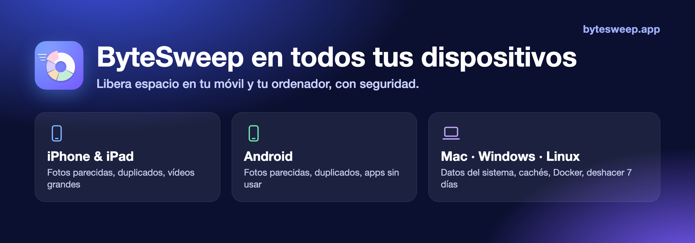

<p align="center">
  <a href="README.md">English</a> ·
  <a href="README.de.md">Deutsch</a> ·
  <b>Español</b> ·
  <a href="README.fr.md">Français</a> ·
  <a href="README.it.md">Italiano</a> ·
  <a href="README.nl.md">Nederlands</a> ·
  <a href="README.pl.md">Polski</a> ·
  <a href="README.pt-BR.md">Português (Brasil)</a> ·
  <a href="README.ru.md">Русский</a> ·
  <a href="README.tr.md">Türkçe</a> ·
  <a href="README.ja.md">日本語</a> ·
  <a href="README.ko.md">한국어</a> ·
  <a href="README.zh-Hans.md">简体中文</a> ·
  <a href="README.zh-Hant.md">繁體中文</a>
</p>

<h1 align="center">ByteSweep CLI: analizador y limpiador de espacio en disco para Linux, Mac y Windows</h1>

<p align="center">
  <b>¿Por qué está lleno mi disco? Descúbrelo y libera espacio de forma segura, en cualquier terminal.</b><br>
  Un analizador y limpiador de espacio en disco gratuito para servidores Linux, Mac, Windows y los BSD.
</p>

<p align="center">
  <a href="https://bytesweep.app/cli"></a>
  <a href="docs/platforms.md"></a>
  <a href="https://github.com/bytesweepcleaner/bytesweep/stargazers"></a>
</p>

<p align="center">
  
</p>

ByteSweep CLI (`bsweep`) te dice **por qué un disco está lleno** y libera el espacio **sin romper nada**.
Lee `df`, `du`, Docker, el journal de systemd, las cachés de paquetes, los kernels antiguos, los archivos borrados que
siguen abiertos, los inodos y las instantáneas, y te explica la respuesta con palabras sencillas. Cada limpieza muestra primero
el comando exacto, las arriesgadas esperan a que les eches un vistazo y los archivos que eliminas van a Undo (deshacer) durante 7 días.

Es un único archivo estático: sin runtime, sin agente, nada que se quede en ejecución. **Gratis:
todos los comandos, en todas las máquinas, sin licencia, clave ni periodo de prueba.**

## Características

- **Por qué está lleno, en una sola respuesta.** `bsweep why` nombra las carpetas, cachés y logs que ocupan el espacio, y la diferencia que `du` no puede ver.
- **"No space left on device" (no queda espacio en el dispositivo) con bytes libres.** Inodos por disco y las carpetas con más archivos.
- **`df` y `du` no coinciden.** La pantalla Held (retenidos) lista los archivos borrados que siguen abiertos y el servicio que retiene cada uno.
- **Uso de disco de Docker.** Caché de compilación, imágenes sin usar, contenedores detenidos y logs de contenedores; los volúmenes nunca se purgan.
- **Logs.** Compacta el journal de systemd, borra los logs rotados, vacía en su sitio los logs activos enormes; prográmalo a diario, semanal o mensualmente.
- **Un disco lleno ahora mismo.** `bsweep rescue` libera solo lo justo, empezando por lo más seguro, y no escribe nada en el disco lleno.
- **Seguro por diseño.** Primero se muestran los comandos exactos, `--dry-run` en todas partes, Undo durante 7 días, nunca tus bases de datos ni el kernel en ejecución.
- **Duplicados, archivos grandes, comprimir y archivar.** Encuentra copias por contenido, comprime con gzip los logs antiguos, mueve proyectos antiguos a otro disco y recupéralos.
- **Salud, actualizaciones, puertos y arranque.** Servicios fallidos, procesos matados por falta de memoria, discos a punto de morir, certificados caducados, copias de seguridad que dejaron de hacerse, qué escucha en cada puerto.
- **Muchos servidores.** `bsweep fleet` por SSH sin instalar nada, `bsweep manage` para todos los servidores en una sola pantalla.
- **Asistentes de IA.** `bsweep mcp` es un servidor Model Context Protocol para Claude, Cursor, VS Code y cualquier cliente MCP.
- **Scripts y monitorización.** `--json` en casi todos los comandos, códigos de salida para `bsweep check`, webhooks.

## Instalación

Linux, macOS y los BSD:

```sh
curl -fsSL https://bytesweep.app/install-cli.sh | sudo sh
```

O ejecuta el mismo script directamente desde GitHub:

```sh
curl -fsSL https://raw.githubusercontent.com/bytesweepcleaner/bytesweep/main/install-cli.sh | sudo sh
```

Windows (PowerShell como administrador):

```powershell
irm https://bytesweep.app/install-cli.ps1 | iex
```

Ambos comprueban las sumas de verificación firmadas antes de instalar nada.

`sudo bsweep update` obtiene la siguiente versión. Todos los sistemas y procesadores: [docs/platforms.md](docs/platforms.md).

## Sistemas compatibles

Un único archivo estático `bsweep` para cada sistema y procesador: 23 compilaciones en total. La línea de instalación elige la correcta.

| Sistema | Procesadores | Versiones |
|---|---|---|
| **Linux** | x86_64, ARM64, ARMv7, i386, RISC-V 64, ppc64le, s390x, LoongArch64 | Cualquier distribución: Ubuntu, Debian, Fedora, RHEL, CentOS, AlmaLinux, Rocky Linux, openSUSE, Arch, Alpine y más |
| **Mac** | Apple silicon (ARM64), Intel (x86_64) | macOS 11 Big Sur y posteriores |
| **Windows** | x64, ARM64, 32 bits (i386) | Windows 10 y 11 |
| **FreeBSD** | x86_64, ARM64 |  |
| **OpenBSD** | x86_64, ARM64 |  |
| **NetBSD** | x86_64, ARM64 |  |
| **DragonFly BSD** | x86_64 |  |
| **Solaris** | x86_64 |  |
| **illumos** | x86_64 |  |
| **AIX** | ppc64 |  |
| **Android** (Termux) | ARM64 | Compilación Linux ARM64 en Termux; solo para consultar, porque Android no da acceso root |

Funciona en cualquier terminal: Terminal, iTerm2, Windows Terminal, PowerShell, GNOME Terminal, Konsole, xterm, la consola de Linux, tmux, screen, PuTTY y por SSH. Qué cambia en cada sistema: [docs/platforms.md](docs/platforms.md).

## Inicio rápido

```sh
sudo bsweep                        # la app a pantalla completa
bsweep why                         # una respuesta: por qué este disco está lleno
sudo bsweep rescue                 # disco al 100 %: libera solo lo justo, lo más seguro primero
bsweep clean --list                # todo lo que se puede borrar, por grupo
sudo bsweep clean --safe --dry-run # lo que haría una limpieza segura, sin hacerlo
bsweep dupes /srv --dry-run        # archivos duplicados y qué copia se quedaría
bsweep check                       # código de salida para monitorización y cron
```

## ByteSweep para tu móvil y tu ordenador

<p align="center">
  <a href="https://bytesweep.app/?ref=github"></a>
</p>

<p align="center">
  <a href="https://apps.apple.com/us/app/bytesweep-storage-cleaner/id6811826959"></a>
  <a href="https://play.google.com/store/apps/details?id=com.bytesweep.app"></a>
  <a href="https://apps.microsoft.com/detail/9N7WMJS8QCQX"></a>
  <a href="https://bytesweep.app/mac.html?ref=github"></a>
  <a href="https://bytesweep.app/linux.html?ref=github"></a>
</p>

La CLI es gratis y lo seguirá siendo. Para el móvil que llevas en el bolsillo y el ordenador de tu mesa están las apps de ByteSweep, con la misma regla: ves todo antes de que se borre.

<table>
  <tr>
    <td><b>iPhone &amp; iPad</b></td>
    <td>Encuentra fotos parecidas y duplicadas, reduce vídeos grandes y repasa meses antiguos deslizando. Gratis para tu primer 1 GB y 30 elementos; después pagas una sola vez.</td>
    <td><a href="https://apps.apple.com/us/app/bytesweep-storage-cleaner/id6811826959"></a></td>
  </tr>
  <tr>
    <td><b>Android</b></td>
    <td>Encuentra fotos parecidas, duplicados, vídeos grandes y apps que no usas. Gratis para tu primer 1 GB y 30 elementos; después pagas una sola vez, sin suscripción.</td>
    <td><a href="https://play.google.com/store/apps/details?id=com.bytesweep.app"></a></td>
  </tr>
  <tr>
    <td><b>Mac</b></td>
    <td>Encuentra lo que llena tu Mac, desde Datos del sistema hasta Docker y Xcode, con 7 días para deshacer lo que se puede recuperar. Pruébalo gratis 3 días. También en la Mac App Store.</td>
    <td><a href="https://bytesweep.app/mac.html?ref=github"></a><br><a href="https://apps.apple.com/us/app/bytesweep-storage-transfer/id6822710125?mt=12"></a></td>
  </tr>
  <tr>
    <td><b>Windows</b></td>
    <td>Elimina restos de Windows Update, archivos temporales y cachés de navegadores y juegos, con 7 días para deshacer lo que se puede recuperar. Pruébalo gratis 3 días.</td>
    <td><a href="https://apps.microsoft.com/detail/9N7WMJS8QCQX"></a></td>
  </tr>
  <tr>
    <td><b>Linux</b></td>
    <td>Vacía las cachés de apt, dnf y pacman, snaps antiguos, runtimes de Flatpak sin uso y el journal, y encuentra duplicados y archivos grandes. Pruébalo gratis 3 días.</td>
    <td><a href="https://bytesweep.app/linux.html?ref=github"></a></td>
  </tr>
</table>

## Todos los problemas que resuelve

| Problema en un servidor real | Qué hace ByteSweep |
|---|---|
| `df` dice que está lleno, `du` no coincide | Pestaña Held: archivos borrados que siguen abiertos y quién los retiene. Overview (resumen) señala cualquier diferencia que un escaneo no puede ver |
| "No space left" con bytes libres | Inodos por disco; Explore (explorar) ordena por número de archivos (`i`) |
| Docker se ha comido el disco | Caché de compilación, imágenes sin etiqueta y sin usar, contenedores detenidos, logs de contenedores que `docker system df` no muestra; cada VM (Colima, Lima, Podman, Multipass, Vagrant, minikube, emuladores de Android...) por su nombre, con el espacio que puede devolver |
| Un prune a ciegas borró una base de datos | Los volúmenes nunca se purgan. Las bases de datos y /var/lib/docker tampoco se pueden limpiar a mano |
| Journal, logs rotados, logs activos enormes | Compactación con journalctl; los logs activos se vacían en su sitio para que los servicios sigan escribiendo |
| /boot lleno, las actualizaciones fallan | Kernels antiguos, nunca el que está en ejecución |
| Cachés de paquetes y de lenguajes, snaps antiguos, volcados de fallos, /tmp antiguo | Cada uno con su propia herramienta; primero se muestra el comando exacto |
| Se amplió el plan, pero no el disco | Encuentra espacio en disco fuera de cualquier partición |
| El 5 % oculto de ext4 | Señala el espacio reservado y la línea de tune2fs |
| Se vuelve a llenar el mes siguiente | Pestaña Prevent (prevenir): límite del journal, límite de logs de Docker, registro diario |
| "¿Qué ha cambiado esta noche?" | Qué ha crecido y cuándo se llenará el disco a este ritmo |
| El escaneo ralentiza producción | Se ejecuta con poca CPU y prioridad de disco idle; se queda en un solo disco |
| Disco al 100 % y todo está fallando | `bsweep rescue` o `R`: libera solo lo justo, lo más seguro primero, y luego nombra los servicios que se detuvieron. No escribe nada en el disco lleno |
| Nodos de Podman o Kubernetes | La misma limpieza mediante podman y crictl; los volúmenes no se tocan |
| Instantáneas que ocupan espacio | `bsweep snapshots`: Time Machine, puntos de restauración, instantáneas de volumen (shadow copies), Timeshift, Snapper, ZFS, Btrfs y LVM, con tamaños cuando la herramienta los da. Elimina solo lo que eliges y conserva la más reciente de cada uno |
| Archivos ocultos bajo un punto de montaje | Mira debajo de cada punto de montaje mediante un bind de solo lectura y muestra cómo llegar a ellos |
| Despliegues antiguos y restos de apps web | Releases antiguas (conserva la activa + 3), caché de WordPress, logs de Laravel, sesiones de PHP |
| Hay que limpiar los logs con regularidad | `bsweep logs clear`, o `bsweep schedule logs` a diario, semanal o mensualmente |
| Un log que nadie rota | Prevent escribe una regla de logrotate, probada antes de dejarla |
| Proyectos antiguos llenando un disco muy usado | `bsweep archive /srv/old --to /mnt/backup`: a otro disco, cada archivo comprobado por checksum y luego liberado; `where` funciona con el disco desconectado, `bring-back` lo devuelve a su sitio |
| Logs y volcados antiguos ocupando espacio | `bsweep compress /var/log --older 30d`: gzip donde ahorra, se relee antes de que el original vaya a Undo; los logs activos no se tocan |
| Los mismos archivos, tres veces | `bsweep dupes`: copias por contenido, enlaces duros y clones contados una sola vez; conservas uno y el resto va a Undo |
| Descargas llenas de instaladores antiguos y copias "(1)" | `bsweep tidy`: las reglas de la app de escritorio, cada archivo a Undo; `organize`, `rename` y `convert` para el resto, cada uno mostrado primero y reversible |
| "¿Qué hay en el puerto 3000?" | `bsweep ports`: programa, proyecto o contenedor, abierto a la red o no; detén un proyecto de desarrollo de una vez |
| Qué paquete es enorme y qué dejaron las apps desinstaladas | `bsweep apps`: todos los paquetes y apps, de mayor a menor; desinstala mediante apt, dnf, pacman, snap, flatpak o brew tras su propio dry run; nunca lo que necesita el sistema |
| Apps de chat que llenan el disco sin avisar | Grupo Chats and Mail (chats y correo): cachés de Slack, Teams, Discord, Element y Thunderbird para revisar; archivos de Telegram y grabaciones de Zoom solo uno a uno, a Undo |
| ¿Qué apps pueden usar la cámara, el micrófono o la pantalla? | `bsweep permissions`: permitidas y denegadas, último uso y uso actual cuando el sistema lo registra (TCC de macOS, ajustes de privacidad de Windows, Flatpak, Snap, dispositivos abiertos); solo lee y te dice dónde desactivar cada uno |
| Historial de comandos y otros rastros | Grupo Privacy traces (rastros de privacidad): historial de shell y REPL, archivos recientes, vistas previas, copias de seguridad del editor; siempre para revisar, cada uno a Undo |
| Actualizaciones pendientes, ¿hace falta reiniciar? | `bsweep updates`: primero las correcciones de seguridad, mediante apt, dnf, zypper, pacman, apk, snap, flatpak, Homebrew, winget, Actualización de software de macOS o Windows Update; nombra quién retiene un bloqueo de paquetes ocupado; nunca reinicia por su cuenta |
| Un programa que no se cierra | `bsweep stop PID\|NAME`, o `s` en Live (en directo): le pide que se cierre, con 10 segundos para guardar; nunca sshd, el PID 1 ni tu propia shell, y para un servicio te da en su lugar su comando `systemctl` |
| "¿Por qué se despertó a las 3 de la madrugada?" | `bsweep sleep`: cada suspensión y qué despertó al equipo (tapa, USB, Bluetooth, red, un temporizador), qué lo mantiene despierto ahora, despertares programados; solo consejos, no cambia ningún ajuste de energía. Un servidor que nunca se suspende lo indica |
| "¿Qué puede ver la gente?" | `bsweep sharesafe`: carpetas compartidas (¿invitados? ¿pueden modificar archivos?), compartir archivos y pantalla, SSH, escritorio remoto, puertos abiertos, puertos publicados de Docker, el firewall; un riesgo para cada uno y dónde desactivarlo. Solo lee |
| Qué se inicia solo y qué ha fallado | `bsweep startup`: systemd, cron @reboot, launchd, servicios de Windows; los del propio sistema solo con `--all`; desactiva y vuelve a activar exactamente igual |
| Un servicio murió por la noche | Pestaña Health (salud): procesos matados por falta de memoria, servicios fallidos, bucles de fallos |
| Un disco a punto de morir | `bsweep drives`: cada disco físico Healthy (sano), Worn (desgastado) o Failing (fallando), y por qué con palabras sencillas; `check` y Health también avisan. Solo lee |
| "¿Se están haciendo siquiera las copias de seguridad?" | Health nombra la herramienta (restic, borg, rsnapshot, duplicity, Timeshift, Snapper, vzdump, Time Machine, Windows Backup) y cuándo funcionó o falló por última vez. No hace falta la contraseña del repositorio |
| Un certificado caducado por sorpresa | Lee los certificados de nginx, Apache, Caddy y Let's Encrypt; avisa si la renovación está rota |
| Actualizaciones, SSH, firewall, copias de seguridad | En macOS y Windows, Health también lee el firewall, FileVault o BitLocker, SIP y Gatekeeper o el antivirus. Consejos con comandos exactos. ByteSweep no cambia SSH ni firewalls: así es como la gente se queda sin acceso |
| Muchos servidores | `bsweep fleet`: una tabla por SSH, sin instalar nada |
| Mover archivos sin la sintaxis de scp | Guarda un host una vez y luego `bsweep copy-to office ./site /srv/site` |
| Una transferencia cortada empieza de cero | Reanuda donde se quedó y envía solo lo que ha cambiado |
| Una sincronización borra la carpeta equivocada | Muestra primero los cambios, conserva los archivos eliminados 7 días, se niega a vaciar una carpeta |
| Revisar un servidor desde tu portátil | `bsweep connect office` abre en él la app completa |
| Demasiados servidores que controlar | `bsweep manage`: todos los servidores en una pantalla, con Monitor en directo y acciones en bloque |
| Parte de un sistema de monitorización | Códigos de salida de `bsweep check`, webhook, `report --json`, `clean --safe --yes` |

Todos los comandos y códigos de salida: [docs/cli.md](docs/cli.md). Ejemplos de cron, Ansible, CI y fleet: [docs/recipes.md](docs/recipes.md).

## Cómo funcionan Clean y Undo

- **Clean** (limpiar) en Explore mueve el archivo a `<disk>/.bytesweep-undo` durante 7 días. Un movimiento en el
  mismo disco no libera nada, así que el espacio vuelve cuando termina Undo. La pantalla lo indica.
- **Remove now** (eliminar ahora) devuelve el espacio al instante, sin Undo: `F` en la pregunta de la app, `--now` en
  todos los comandos que usarían Undo (rm, dupes, clean, apps, tidy, compress). Esa es la opción
  en un disco al 100 %. `bsweep undo free --all` vacía el propio Undo.
- Las limpiezas por reglas pasan por journalctl, docker, apt y compañía, y no se pueden deshacer. La
  pantalla de confirmación lista cada comando.

## Hosts, transferencia y sincronización

Configura un host una vez en `bsweep.yml` (`bsweep init` y luego `bsweep host add`) y, a partir de ahí, usa su nombre corto,
desde un servidor o desde la línea de comandos de un Mac o de Windows. Consulta [docs/transfer.md](docs/transfer.md).

## Asistentes de IA (MCP)

`bsweep mcp` permite que Claude Desktop, Claude Code, Cursor, VS Code y otros clientes MCP examinen una máquina
y te ayuden a limpiarla, con las mismas reglas que la línea de comandos. Consulta [docs/mcp.md](docs/mcp.md).

## Preguntas frecuentes

**¿Cómo saber qué ocupa espacio en disco en Linux?**
Ejecuta `bsweep why` para obtener la respuesta en una sola pantalla, o `sudo bsweep` y abre Explore para recorrer las carpetas,
de mayor a menor. También cuenta lo que un recorrido de carpetas no puede ver: archivos borrados que siguen abiertos, Docker, instantáneas y espacio reservado.

**¿Por qué `df` dice que el disco está lleno si `du` suma menos?**
Normalmente un programa sigue teniendo abierto un archivo borrado, a menudo un log. La pantalla Held lista cada uno y el
servicio que lo retiene, y vacía en su sitio un log retenido para que el servicio siga escribiendo.

**¿Cómo soluciono "No space left on device" si `df` muestra espacio libre?**
El disco se ha quedado sin inodos: demasiados archivos pequeños. ByteSweep muestra los inodos por disco, y Explore ordena por
número de archivos (`i`) para encontrar la carpeta que los contiene.

**¿Cómo liberar espacio en disco de Docker de forma segura?**
`bsweep clean --list --group containers` lista la caché de compilación, las imágenes sin usar, los contenedores detenidos y
los logs de contenedores. Los volúmenes nunca se purgan, porque un volumen puede ser una base de datos.

**El disco de mi servidor está al 100 %. ¿Y ahora qué?**
`sudo bsweep rescue`, o `R` en la app. Libera solo lo justo, lo más seguro primero, no escribe nada en el disco
lleno y luego nombra los servicios que se detuvieron.

**¿Es seguro usarlo en un servidor de producción?**
Cada limpieza muestra primero su comando exacto, `--dry-run` te deja previsualizar cualquier cosa, los archivos eliminados esperan en Undo
durante 7 días y los escaneos se ejecutan con poca CPU y prioridad de disco idle. Nunca elimina bases de datos, volúmenes de Docker
ni el kernel en ejecución, nunca elige una instantánea por ti y nunca cambia los ajustes de SSH ni del firewall.

**¿Es gratis? ¿Envía datos a algún sitio?**
Gratis, sin cuenta, analíticas ni periodo de prueba. Solo se conecta a internet cuando tú lo pides:
`bsweep update`, alertas a los destinos que añadas y SSH para fleet, copy y sync.

## Privacidad

Sin analíticas y sin cuenta. Nada sobre ti ni sobre tus archivos sale de la máquina. bsweep solo se conecta
a internet cuando se lo pides: `bsweep update` descarga desde bytesweep.app (y antes comprueba la
firma), las alertas van solo a los destinos que añadas, y fleet, copy y sync usan tu propio SSH.

---

ByteSweep también está disponible como app de escritorio para Mac, Windows y Linux: [bytesweep.app](https://bytesweep.app/?ref=github)
