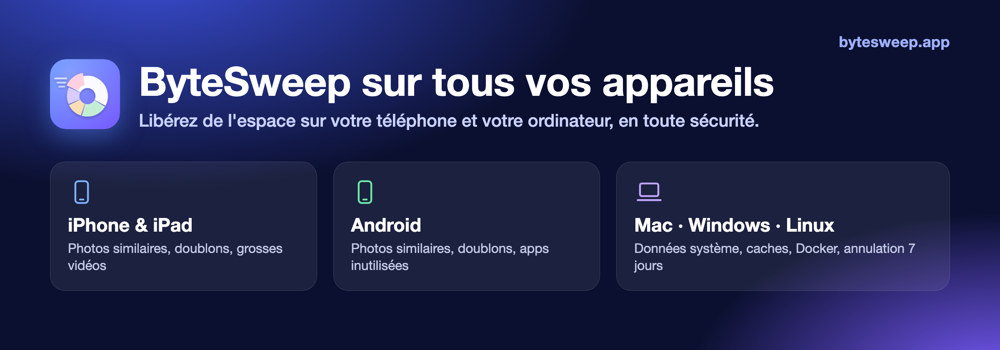

<p align="center">
  <a href="README.md">English</a> ·
  <a href="README.de.md">Deutsch</a> ·
  <a href="README.es.md">Español</a> ·
  <b>Français</b> ·
  <a href="README.it.md">Italiano</a> ·
  <a href="README.nl.md">Nederlands</a> ·
  <a href="README.pl.md">Polski</a> ·
  <a href="README.pt-BR.md">Português (Brasil)</a> ·
  <a href="README.ru.md">Русский</a> ·
  <a href="README.tr.md">Türkçe</a> ·
  <a href="README.ja.md">日本語</a> ·
  <a href="README.ko.md">한국어</a> ·
  <a href="README.zh-Hans.md">简体中文</a> ·
  <a href="README.zh-Hant.md">繁體中文</a>
</p>

<h1 align="center">ByteSweep CLI : analyseur et nettoyeur d'espace disque pour Linux, Mac et Windows</h1>

<p align="center">
  <b>Pourquoi mon disque est-il plein ? Découvrez-le et libérez de l'espace en toute sécurité, dans n'importe quel terminal.</b><br>
  Un analyseur et nettoyeur d'espace disque gratuit et open source pour les serveurs Linux, Mac, Windows et les BSD.
</p>

<p align="center">
  <a href="https://bytesweep.app/cli"></a>
  <a href="https://github.com/bytesweepcleaner/bytesweep-cli/blob/main/LICENSE"></a>
  <a href="https://github.com/bytesweepcleaner/bytesweep-cli/actions/workflows/test.yml"></a>
  <a href="https://github.com/bytesweepcleaner/bytesweep-cli/blob/main/go.mod"></a>
  <a href="docs/platforms.md"></a>
  <a href="https://github.com/bytesweepcleaner/bytesweep/stargazers"></a>
</p>

<p align="center">
  
</p>

ByteSweep CLI (`bsweep`) vous dit **pourquoi un disque est plein** et libère l'espace **sans rien casser**.
Il lit `df`, `du`, Docker, le journal systemd, les caches de paquets, les anciens noyaux, les fichiers supprimés
encore ouverts, les inodes et les snapshots, et vous explique la réponse en termes simples. Chaque nettoyage affiche d'abord
la commande exacte, les plus risqués attendent que vous y jetiez un œil, et les fichiers que vous supprimez vont dans Undo (annuler) pendant 7 jours.

C'est un seul fichier statique : pas de runtime, pas d'agent, rien qui reste en arrière-plan. **Gratuit et open source (GPL-3.0) :
toutes les commandes, sur toutes les machines, sans licence, clé ni période d'essai.**

## Fonctionnalités

- **Pourquoi il est plein, en une seule réponse.** `bsweep why` nomme les dossiers, caches et logs qui prennent la place, et l'écart que `du` ne voit pas.
- **"No space left on device" (plus d'espace disponible sur le périphérique) alors qu'il reste des octets libres.** Les inodes par disque, et les dossiers qui contiennent le plus de fichiers.
- **`df` et `du` ne sont pas d'accord.** L'écran Held (retenus) liste les fichiers supprimés encore ouverts, et le service qui retient chacun d'eux.
- **Espace disque utilisé par Docker.** Cache de build, images inutilisées, conteneurs arrêtés et logs des conteneurs ; les volumes ne sont jamais purgés.
- **Logs.** Compactez le journal systemd, effacez les logs archivés par la rotation, videz sur place les énormes logs actifs ; planifiez-le chaque jour, chaque semaine ou chaque mois.
- **Un disque plein, là, maintenant.** `bsweep rescue` libère juste ce qu'il faut, le plus sûr d'abord, et n'écrit rien sur le disque plein.
- **Sûr par conception.** Commandes exactes affichées d'abord, `--dry-run` partout, Undo pendant 7 jours, jamais vos bases de données ni le noyau en cours d'exécution.
- **Doublons, gros fichiers, compression et archivage.** Trouvez les copies par contenu, compressez les vieux logs avec gzip, déplacez d'anciens projets vers un autre disque et ramenez-les.
- **Santé, mises à jour, ports et démarrage.** Services en échec, processus tués faute de mémoire, disques en fin de vie, certificats expirés, sauvegardes qui se sont arrêtées, ce qui écoute sur chaque port.
- **Plusieurs serveurs.** `bsweep fleet` via SSH sans rien installer, `bsweep manage` pour tous les serveurs sur un seul écran.
- **Assistants IA.** `bsweep mcp` est un serveur Model Context Protocol pour Claude, Cursor, VS Code et tout client MCP.
- **Scripts et supervision.** `--json` sur presque toutes les commandes, codes de sortie pour `bsweep check`, webhooks.

## Installation

Linux, macOS et les BSD :

```sh
curl -fsSL https://bytesweep.app/install-cli.sh | sudo sh
```

Ou lancez le même script directement depuis GitHub :

```sh
curl -fsSL https://raw.githubusercontent.com/bytesweepcleaner/bytesweep/main/install-cli.sh | sudo sh
```

Windows (PowerShell en tant qu'administrateur) :

```powershell
irm https://bytesweep.app/install-cli.ps1 | iex
```

Les deux vérifient les sommes de contrôle signées avant toute installation. Avec Go 1.22 ou plus récent, vous pouvez aussi le compiler vous-même :

```sh
go install github.com/bytesweepcleaner/bytesweep-cli/cmd/bsweep@latest
```

`sudo bsweep update` récupère la version suivante. Tous les systèmes et processeurs : [docs/platforms.md](docs/platforms.md).

## Systèmes pris en charge

Un seul fichier statique `bsweep` par système et par processeur : 23 versions au total. La ligne d'installation choisit la bonne.

| Système | Processeurs | Versions |
|---|---|---|
| **Linux** | x86_64, ARM64, ARMv7, i386, RISC-V 64, ppc64le, s390x, LoongArch64 | Toutes les distributions : Ubuntu, Debian, Fedora, RHEL, CentOS, AlmaLinux, Rocky Linux, openSUSE, Arch, Alpine et d'autres |
| **Mac** | Apple silicon (ARM64), Intel (x86_64) | macOS 11 Big Sur et versions ultérieures |
| **Windows** | x64, ARM64, 32 bits (i386) | Windows 10 et 11 |
| **FreeBSD** | x86_64, ARM64 |  |
| **OpenBSD** | x86_64, ARM64 |  |
| **NetBSD** | x86_64, ARM64 |  |
| **DragonFly BSD** | x86_64 |  |
| **Solaris** | x86_64 |  |
| **illumos** | x86_64 |  |
| **AIX** | ppc64 |  |
| **Android** (Termux) | ARM64 | Version Linux ARM64 dans Termux ; consultation seulement, car Android ne donne pas l'accès root |

Fonctionne dans tous les terminaux : Terminal, iTerm2, Windows Terminal, PowerShell, GNOME Terminal, Konsole, xterm, la console Linux, tmux, screen, PuTTY et via SSH. Ce qui change selon le système : [docs/platforms.md](docs/platforms.md).

## Démarrage rapide

```sh
sudo bsweep                        # l'application plein écran
bsweep why                         # une seule réponse : pourquoi ce disque est plein
sudo bsweep rescue                 # disque à 100 % : libère juste ce qu'il faut, le plus sûr d'abord
bsweep clean --list                # tout ce qui peut partir, par groupe
sudo bsweep clean --safe --dry-run # ce que ferait un nettoyage sûr, sans le faire
bsweep dupes /srv --dry-run        # fichiers en double, et quelle copie serait conservée
bsweep check                       # code de sortie pour la supervision et cron
```

## ByteSweep pour votre téléphone et votre ordinateur

<p align="center">
  <a href="https://bytesweep.app/?ref=github"></a>
</p>

<p align="center">
  <a href="https://apps.apple.com/us/app/bytesweep-storage-cleaner/id6811826959"></a>
  <a href="https://play.google.com/store/apps/details?id=com.bytesweep.app"></a>
  <a href="https://apps.microsoft.com/detail/9N7WMJS8QCQX"></a>
  <a href="https://bytesweep.app/mac.html?ref=github"></a>
  <a href="https://bytesweep.app/linux.html?ref=github"></a>
</p>

La CLI est gratuite et le restera. Pour le téléphone dans votre poche et l'ordinateur sur votre bureau, il existe les apps ByteSweep, avec la même règle : vous voyez tout avant que quoi que ce soit ne parte.

<table>
  <tr>
    <td><b>iPhone &amp; iPad</b></td>
    <td>Trouve les photos similaires et les doublons, réduit les grosses vidéos et fait défiler les anciens mois. Gratuit pour votre premier 1 Go et 30 éléments, puis un seul paiement.</td>
    <td><a href="https://apps.apple.com/us/app/bytesweep-storage-cleaner/id6811826959"></a></td>
  </tr>
  <tr>
    <td><b>Android</b></td>
    <td>Trouve les photos similaires, les doublons, les grosses vidéos et les apps inutilisées. Gratuit pour votre premier 1 Go et 30 éléments, puis un seul paiement, sans abonnement.</td>
    <td><a href="https://play.google.com/store/apps/details?id=com.bytesweep.app"></a></td>
  </tr>
  <tr>
    <td><b>Mac</b></td>
    <td>Trouve ce qui remplit votre Mac, des Données système à Docker et Xcode, avec 7 jours d'annulation pour ce qui peut revenir. Essai gratuit de 3 jours. Aussi sur le Mac App Store.</td>
    <td><a href="https://bytesweep.app/mac.html?ref=github"></a><br><a href="https://apps.apple.com/us/app/bytesweep-storage-transfer/id6822710125?mt=12"></a></td>
  </tr>
  <tr>
    <td><b>Windows</b></td>
    <td>Supprime les restes de Windows Update, les fichiers temporaires et les caches des navigateurs et des jeux, avec 7 jours d'annulation pour ce qui peut revenir. Essai gratuit de 3 jours.</td>
    <td><a href="https://apps.microsoft.com/detail/9N7WMJS8QCQX"></a></td>
  </tr>
  <tr>
    <td><b>Linux</b></td>
    <td>Vide les caches apt, dnf et pacman, les anciens snaps, les runtimes Flatpak inutilisés et le journal, et trouve les doublons et les gros fichiers. Essai gratuit de 3 jours.</td>
    <td><a href="https://bytesweep.app/linux.html?ref=github"></a></td>
  </tr>
</table>

## Tous les problèmes qu'il résout

| Le problème sur un vrai serveur | Ce que fait ByteSweep |
|---|---|
| `df` dit plein, `du` n'est pas d'accord | Onglet Held : fichiers supprimés encore ouverts, et qui les retient. Overview (vue d'ensemble) signale tout écart qu'une analyse ne peut pas voir |
| "No space left" alors qu'il reste des octets libres | Inodes par disque, Explore (explorer) trie par nombre de fichiers (`i`) |
| Docker a dévoré le disque | Cache de build, images sans tag et inutilisées, conteneurs arrêtés, logs de conteneurs que `docker system df` n'affiche pas ; chaque VM (Colima, Lima, Podman, Multipass, Vagrant, minikube, émulateurs Android...) par son nom, avec l'espace qu'elle peut rendre |
| Un prune à l'aveugle a supprimé une base de données | Les volumes ne sont jamais purgés. Les bases de données et /var/lib/docker ne peuvent pas non plus être nettoyés à la main |
| Journal, logs archivés, énormes logs actifs | Compactage via journalctl ; les logs actifs sont vidés sur place pour que les services continuent d'écrire |
| /boot plein, les mises à jour échouent | Anciens noyaux, jamais celui en cours d'exécution |
| Caches de paquets et de langages, anciens snaps, dumps de plantage, vieux /tmp | Chacun via son propre outil ; la commande exacte est affichée d'abord |
| L'offre a été augmentée, pas le disque | Trouve l'espace disque situé hors de toute partition |
| Les 5 % cachés d'ext4 | Signale l'espace réservé et la ligne tune2fs |
| Il se remplit à nouveau le mois suivant | Onglet Prevent (prévenir) : plafond du journal, limite des logs Docker, relevé quotidien |
| "Qu'est-ce qui a changé cette nuit ?" | Ce qui a grossi, et quand le disque sera plein à ce rythme |
| L'analyse ralentit la production | Tourne avec peu de CPU et une priorité disque idle ; reste sur un seul disque |
| Disque à 100 % et plus rien ne marche | `bsweep rescue` ou `R` : libère juste ce qu'il faut, le plus sûr d'abord, puis nomme les services qui se sont arrêtés. N'écrit rien sur le disque plein |
| Nœuds Podman ou Kubernetes | Même nettoyage via podman et crictl ; les volumes restent intacts |
| Des snapshots qui occupent de l'espace | `bsweep snapshots` : Time Machine, points de restauration, clichés instantanés (shadow copies), Timeshift, Snapper, ZFS, Btrfs et LVM, avec leur taille quand l'outil peut la donner. Ne supprime que ce que vous choisissez et garde le plus récent de chacun |
| Des fichiers cachés sous un point de montage | Regarde sous chaque point de montage via un bind en lecture seule et montre comment y accéder |
| Anciens déploiements et restes d'applis web | Anciennes releases (garde l'active + 3), cache WordPress, logs Laravel, sessions PHP |
| Les logs doivent être vidés régulièrement | `bsweep logs clear`, ou `bsweep schedule logs` chaque jour, chaque semaine ou chaque mois |
| Un log que rien ne fait tourner | Prevent écrit une règle logrotate, testée avant d'être conservée |
| De vieux projets qui remplissent un disque très sollicité | `bsweep archive /srv/old --to /mnt/backup` : vers un autre disque, chaque fichier vérifié par checksum, puis libéré ; `where` fonctionne même disque débranché, `bring-back` le remet en place |
| De vieux logs et dumps qui prennent de la place | `bsweep compress /var/log --older 30d` : gzip là où ça fait gagner de la place, relu avant que l'original parte dans Undo ; les logs actifs restent |
| Les mêmes fichiers, en trois exemplaires | `bsweep dupes` : copies par contenu, liens physiques et clones comptés une seule fois ; gardez-en un, le reste va dans Undo |
| Un dossier Téléchargements plein de vieux installeurs et de copies "(1)" | `bsweep tidy` : les règles de l'application de bureau, chaque fichier dans Undo ; `organize`, `rename` et `convert` pour le reste, chacun affiché d'abord et annulable |
| "Qu'est-ce qui tourne sur le port 3000 ?" | `bsweep ports` : programme, projet ou conteneur, ouvert au réseau ou non ; arrêtez un projet de dev d'un coup |
| Quel paquet est énorme, et qu'ont laissé les applis supprimées | `bsweep apps` : tous les paquets et applis, du plus gros au plus petit ; désinstallez via apt, dnf, pacman, snap, flatpak ou brew après leur propre dry run ; jamais ce dont le système a besoin |
| Des applis de chat qui remplissent le disque en silence | Groupe Chats and Mail (discussions et mail) : caches de Slack, Teams, Discord, Element et Thunderbird à examiner ; fichiers Telegram et enregistrements Zoom un par un seulement, dans Undo |
| Quelles applis peuvent utiliser la caméra, le micro ou l'écran ? | `bsweep permissions` : autorisées et refusées, dernière utilisation et utilisation en cours quand le système l'enregistre (TCC de macOS, paramètres de confidentialité de Windows, Flatpak, Snap, périphériques ouverts) ; lecture seule, indique où désactiver chacune |
| Historique des commandes et autres traces | Groupe Privacy traces (traces de confidentialité) : historique du shell et des REPL, fichiers récents, aperçus, sauvegardes d'éditeur ; toujours à examiner, chacun dans Undo |
| Des mises à jour en attente, faut-il redémarrer ? | `bsweep updates` : correctifs de sécurité d'abord, via apt, dnf, zypper, pacman, apk, snap, flatpak, Homebrew, winget, la Mise à jour de logiciels de macOS ou Windows Update ; nomme qui détient un verrou de paquets occupé ; ne redémarre jamais de lui-même |
| Un programme qui refuse de quitter | `bsweep stop PID\|NAME`, ou `s` dans Live (en direct) : lui demande de se fermer, avec 10 secondes pour enregistrer ; jamais sshd, le PID 1 ni votre propre shell, et pour un service vous obtenez plutôt sa commande `systemctl` |
| "Pourquoi s'est-il réveillé à 3 h du matin ?" | `bsweep sleep` : chaque mise en veille et ce qui a réveillé la machine (capot, USB, Bluetooth, réseau, un minuteur), ce qui la maintient éveillée maintenant, les réveils programmés ; uniquement des conseils, aucun réglage d'énergie modifié. Un serveur qui ne se met jamais en veille le signale |
| "Que peuvent voir les autres ?" | `bsweep sharesafe` : dossiers partagés (invités ? peuvent-ils modifier des fichiers ?), partage de fichiers et d'écran, SSH, bureau à distance, ports ouverts, ports publiés de Docker, le pare-feu ; un risque pour chacun et où le désactiver. Lecture seule |
| Ce qui démarre tout seul, et ce qui a échoué | `bsweep startup` : systemd, cron @reboot, launchd, services Windows ; ceux du système uniquement avec `--all` ; désactivez et réactivez à l'identique |
| Un service est mort dans la nuit | Onglet Health (santé) : processus tués faute de mémoire, services en échec, boucles de plantage |
| Un disque sur le point de lâcher | `bsweep drives` : chaque disque physique Healthy (sain), Worn (usé) ou Failing (défaillant), et pourquoi en termes simples ; `check` et Health préviennent aussi. Lecture seule |
| "Les sauvegardes tournent-elles vraiment ?" | Health nomme l'outil (restic, borg, rsnapshot, duplicity, Timeshift, Snapper, vzdump, Time Machine, Windows Backup) et la dernière fois qu'il a fonctionné ou échoué. Aucun mot de passe de dépôt nécessaire |
| Un certificat expiré par surprise | Lit les certificats nginx, Apache, Caddy et Let's Encrypt ; signale un renouvellement cassé |
| Mises à jour, SSH, pare-feu, sauvegardes | Sur macOS et Windows, Health lit aussi le pare-feu, FileVault ou BitLocker, SIP et Gatekeeper ou l'antivirus. Des conseils avec les commandes exactes. ByteSweep ne modifie ni SSH ni les pare-feu : c'est comme ça qu'on se retrouve enfermé dehors |
| Plusieurs serveurs | `bsweep fleet` : un seul tableau via SSH, rien à installer |
| Déplacer des fichiers sans la syntaxe de scp | Enregistrez un hôte une fois, puis `bsweep copy-to office ./site /srv/site` |
| Un transfert interrompu repart de zéro | Reprend là où il s'est arrêté et n'envoie que ce qui a changé |
| Une synchro efface le mauvais dossier | Affiche d'abord les changements, garde les fichiers supprimés 7 jours, refuse de vider un dossier |
| Examiner un serveur depuis votre portable | `bsweep connect office` y ouvre l'application complète |
| Trop de serveurs à suivre | `bsweep manage` : tous les serveurs sur un seul écran, avec Monitor en direct et actions groupées |
| Intégré à une supervision | Codes de sortie de `bsweep check`, webhook, `report --json`, `clean --safe --yes` |

Toutes les commandes et tous les codes de sortie : [docs/cli.md](docs/cli.md). Exemples pour cron, Ansible, CI et fleet : [docs/recipes.md](docs/recipes.md).

## Comment fonctionnent Clean et Undo

- **Clean** (nettoyer) dans Explore déplace le fichier vers `<disk>/.bytesweep-undo` pendant 7 jours. Un déplacement sur le
  même disque ne libère rien : l'espace revient donc à la fin d'Undo. L'écran le précise.
- **Remove now** (supprimer maintenant) rend l'espace immédiatement, sans Undo : `F` dans la question de l'application, `--now` sur
  toutes les commandes qui utiliseraient Undo (rm, dupes, clean, apps, tidy, compress). C'est le bon choix
  sur un disque à 100 %. `bsweep undo free --all` vide Undo lui-même.
- Les nettoyages par règles passent par journalctl, docker, apt et consorts, et ne peuvent pas être annulés. L'écran
  de confirmation liste chaque commande.

## Hôtes, transfert et synchronisation

Configurez un hôte une seule fois dans `bsweep.yml` (`bsweep init`, puis `bsweep host add`), puis utilisez son nom court,
depuis un serveur ou depuis la ligne de commande d'un Mac ou d'un PC Windows. Voir [docs/transfer.md](docs/transfer.md).

## Assistants IA (MCP)

`bsweep mcp` permet à Claude Desktop, Claude Code, Cursor, VS Code et aux autres clients MCP d'examiner une machine
et de vous aider à la nettoyer, avec les mêmes règles que la ligne de commande. Voir [docs/mcp.md](docs/mcp.md).

## FAQ

**Comment savoir ce qui prend de la place sur le disque sous Linux ?**
Lancez `bsweep why` pour une réponse sur un seul écran, ou `sudo bsweep` et ouvrez Explore pour parcourir les dossiers,
du plus gros au plus petit. Il compte aussi ce qu'un parcours de dossiers ne voit pas : fichiers supprimés encore ouverts, Docker, snapshots et espace réservé.

**Pourquoi `df` indique-t-il que le disque est plein alors que le total de `du` est inférieur ?**
En général, un programme garde ouvert un fichier supprimé, souvent un log. L'écran Held liste chacun d'eux et le
service qui le retient, et vide sur place un log retenu pour que le service continue d'écrire.

**Comment corriger "No space left on device" alors que `df` affiche de l'espace libre ?**
Le disque n'a plus d'inodes : trop de petits fichiers. ByteSweep affiche les inodes par disque, et Explore trie par
nombre de fichiers (`i`) pour trouver le dossier qui les contient.

**Comment libérer de l'espace disque Docker en toute sécurité ?**
`bsweep clean --list --group containers` liste le cache de build, les images inutilisées, les conteneurs arrêtés et
les logs des conteneurs. Les volumes ne sont jamais purgés, car un volume peut être une base de données.

**Le disque de mon serveur est plein à 100 %. Que faire ?**
`sudo bsweep rescue`, ou `R` dans l'application. Il libère juste ce qu'il faut, le plus sûr d'abord, n'écrit rien sur le disque
plein, puis nomme les services qui se sont arrêtés.

**Peut-on l'utiliser sans risque sur un serveur de production ?**
Chaque nettoyage affiche d'abord sa commande exacte, `--dry-run` permet de tout prévisualiser, les fichiers supprimés attendent dans Undo
pendant 7 jours, et les analyses tournent avec peu de CPU et une priorité disque idle. Il ne supprime jamais les bases de données, les volumes Docker
ni le noyau en cours d'exécution, ne choisit jamais un snapshot à votre place, et ne modifie jamais les réglages SSH ou du pare-feu.

**Est-ce gratuit ? Envoie-t-il des données quelque part ?**
Gratuit et open source sous GPL-3.0, sans compte, sans outil d'analyse d'audience ni période d'essai. Il ne se connecte à Internet que lorsque vous le demandez :
`bsweep update`, les alertes vers les destinations que vous ajoutez, et SSH pour fleet, copy et sync.

## Confidentialité

Aucun outil d'analyse d'audience, aucun compte. Rien sur vous ni sur vos fichiers ne quitte la machine. bsweep ne se connecte
à Internet que lorsque vous le lui demandez : `bsweep update` télécharge depuis bytesweep.app (et vérifie d'abord la
signature), les alertes ne partent que vers les destinations que vous ajoutez, et fleet, copy et sync utilisent votre propre SSH.

## Compiler et tester

Nécessite Go 1.22 ou plus récent : `go test ./...`, puis `go build -o bsweep ./cmd/bsweep`.
`VERSION=1.0.1 ./build.sh` produit tous les builds de la release. Voir [bytesweep-cli](https://github.com/bytesweepcleaner/bytesweep-cli) et
[SECURITY.md](SECURITY.md).

## Licence

GPL-3.0 : libre d'utiliser, de modifier et de partager. Une copie modifiée que vous distribuez à d'autres doit rester ouverte
sous la même licence. Voir [LICENSE](https://github.com/bytesweepcleaner/bytesweep-cli/blob/main/LICENSE).

---

ByteSweep existe aussi en application de bureau pour Mac, Windows et Linux : [bytesweep.app](https://bytesweep.app/?ref=github)
