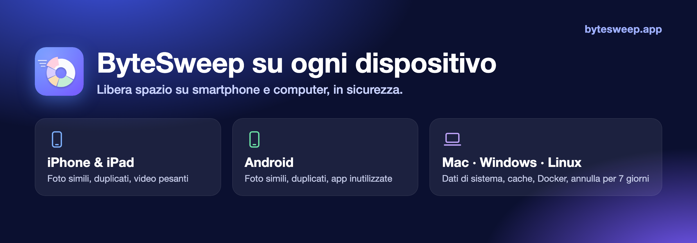

<p align="center">
  <a href="README.md">English</a> ·
  <a href="README.de.md">Deutsch</a> ·
  <a href="README.es.md">Español</a> ·
  <a href="README.fr.md">Français</a> ·
  <b>Italiano</b> ·
  <a href="README.nl.md">Nederlands</a> ·
  <a href="README.pl.md">Polski</a> ·
  <a href="README.pt-BR.md">Português (Brasil)</a> ·
  <a href="README.ru.md">Русский</a> ·
  <a href="README.tr.md">Türkçe</a> ·
  <a href="README.ja.md">日本語</a> ·
  <a href="README.ko.md">한국어</a> ·
  <a href="README.zh-Hans.md">简体中文</a> ·
  <a href="README.zh-Hant.md">繁體中文</a>
</p>

<h1 align="center">ByteSweep CLI: analizzatore e pulitore dello spazio su disco per Linux, Mac e Windows</h1>

<p align="center">
  <b>Perché il mio disco è pieno? Scoprilo e libera spazio in sicurezza, in qualsiasi terminale.</b><br>
  Un analizzatore e pulitore dello spazio su disco gratuito e open source per server Linux, Mac, Windows e i BSD.
</p>

<p align="center">
  <a href="https://bytesweep.app/cli"></a>
  <a href="https://github.com/bytesweepcleaner/bytesweep-cli/blob/main/LICENSE"></a>
  <a href="https://github.com/bytesweepcleaner/bytesweep-cli/actions/workflows/test.yml"></a>
  <a href="https://github.com/bytesweepcleaner/bytesweep-cli/blob/main/go.mod"></a>
  <a href="docs/platforms.md"></a>
  <a href="https://github.com/bytesweepcleaner/bytesweep/stargazers"></a>
</p>

<p align="center">
  
</p>

ByteSweep CLI (`bsweep`) ti dice **perché un disco è pieno** e libera lo spazio **senza rompere niente**.
Legge `df`, `du`, Docker, il journal di systemd, le cache dei pacchetti, i kernel vecchi, i file eliminati
ancora aperti, gli inode e gli snapshot, e ti spiega la risposta in parole semplici. Ogni pulizia mostra prima il comando
esatto, quelle rischiose aspettano che tu le controlli, e i file che rimuovi finiscono in Undo (annulla) per 7 giorni.

È un unico file statico: niente runtime, niente agent, niente che resti in esecuzione. **Gratuito e open source (GPL-3.0):
tutti i comandi, su ogni macchina, senza licenza, chiave o periodo di prova.**

## Funzionalità

- **Perché è pieno, in una sola risposta.** `bsweep why` indica le cartelle, le cache e i log che occupano lo spazio, e la differenza che `du` non vede.
- **"No space left on device" (spazio esaurito sul dispositivo) con byte liberi.** Inode per disco e le cartelle con più file.
- **`df` e `du` non coincidono.** La schermata Held (trattenuti) elenca i file eliminati ancora aperti e il servizio che tiene aperto ciascuno.
- **Spazio su disco usato da Docker.** Cache di build, immagini inutilizzate, container fermi e log dei container; i volumi non vengono mai eliminati.
- **Log.** Compatta il journal di systemd, cancella i log ruotati, svuota sul posto i log attivi enormi; pianificalo ogni giorno, ogni settimana o ogni mese.
- **Un disco pieno, proprio adesso.** `bsweep rescue` libera solo il necessario, partendo da ciò che è più sicuro, e non scrive nulla sul disco pieno.
- **Sicuro per progettazione.** Comandi esatti mostrati prima, `--dry-run` ovunque, Undo per 7 giorni, mai i tuoi database o il kernel in esecuzione.
- **Duplicati, file grandi, compressione e archiviazione.** Trova le copie per contenuto, comprimi con gzip i log vecchi, sposta i progetti vecchi su un altro disco e riportali indietro.
- **Salute, aggiornamenti, porte e avvio.** Servizi falliti, processi terminati per memoria esaurita, dischi in fin di vita, certificati scaduti, backup che si sono fermati, cosa è in ascolto su ogni porta.
- **Tanti server.** `bsweep fleet` via SSH senza installare nulla, `bsweep manage` per tutti i server in una sola schermata.
- **Assistenti IA.** `bsweep mcp` è un server Model Context Protocol per Claude, Cursor, VS Code e qualsiasi client MCP.
- **Script e monitoraggio.** `--json` su quasi tutti i comandi, codici di uscita per `bsweep check`, webhook.

## Installazione

Linux, macOS e i BSD:

```sh
curl -fsSL https://bytesweep.app/install-cli.sh | sudo sh
```

Windows (PowerShell come amministratore):

```powershell
irm https://bytesweep.app/install-cli.ps1 | iex
```

Entrambi verificano i checksum firmati prima di installare qualsiasi cosa. Con Go 1.22 o successivo puoi anche compilarlo da te:

```sh
go install github.com/bytesweepcleaner/bytesweep-cli/cmd/bsweep@latest
```

`sudo bsweep update` scarica la release successiva. Tutti i sistemi e i processori: [docs/platforms.md](docs/platforms.md).

## Sistemi supportati

Un solo file statico `bsweep` per ogni sistema e processore: 23 build in tutto. La riga di installazione sceglie quella giusta.

| Sistema | Processori | Versioni |
|---|---|---|
| **Linux** | x86_64, ARM64, ARMv7, i386, RISC-V 64, ppc64le, s390x, LoongArch64 | Qualsiasi distribuzione: Ubuntu, Debian, Fedora, RHEL, CentOS, AlmaLinux, Rocky Linux, openSUSE, Arch, Alpine e altre |
| **Mac** | Apple silicon (ARM64), Intel (x86_64) | macOS 11 Big Sur e successivi |
| **Windows** | x64, ARM64, 32 bit (i386) | Windows 10 e 11 |
| **FreeBSD** | x86_64, ARM64 |  |
| **OpenBSD** | x86_64, ARM64 |  |
| **NetBSD** | x86_64, ARM64 |  |
| **DragonFly BSD** | x86_64 |  |
| **Solaris** | x86_64 |  |
| **illumos** | x86_64 |  |
| **AIX** | ppc64 |  |
| **Android** (Termux) | ARM64 | Build Linux ARM64 in Termux; solo consultazione, perché Android non dà accesso root |

Funziona in qualsiasi terminale: Terminal, iTerm2, Windows Terminal, PowerShell, GNOME Terminal, Konsole, xterm, la console Linux, tmux, screen, PuTTY e via SSH. Cosa cambia su ogni sistema: [docs/platforms.md](docs/platforms.md).

## Avvio rapido

```sh
sudo bsweep                        # l'app a schermo intero
bsweep why                         # una sola risposta: perché questo disco è pieno
sudo bsweep rescue                 # disco al 100%: libera solo il necessario, prima il più sicuro
bsweep clean --list                # tutto ciò che si può eliminare, per gruppo
sudo bsweep clean --safe --dry-run # cosa farebbe una pulizia sicura, senza farla
bsweep dupes /srv --dry-run        # file duplicati, e quale copia resterebbe
bsweep check                       # codice di uscita per monitoraggio e cron
```

## ByteSweep per il tuo smartphone e il tuo computer

<p align="center">
  <a href="https://bytesweep.app/?ref=github"></a>
</p>

<p align="center">
  <a href="https://apps.apple.com/us/app/bytesweep-storage-cleaner/id6811826959"></a>
  <a href="https://play.google.com/store/apps/details?id=com.bytesweep.app"></a>
  <a href="https://apps.microsoft.com/detail/9N7WMJS8QCQX"></a>
  <a href="https://bytesweep.app/mac.html?ref=github"></a>
  <a href="https://bytesweep.app/linux.html?ref=github"></a>
</p>

La CLI è gratuita e lo resterà. Per lo smartphone che hai in tasca e il computer sulla scrivania ci sono le app ByteSweep, con la stessa regola: vedi tutto prima che venga eliminato.

<table>
  <tr>
    <td><b>iPhone &amp; iPad</b></td>
    <td>Trova foto simili e duplicati, riduce i video pesanti e ti fa scorrere i mesi passati. Gratis per il primo 1 GB e 30 elementi, poi paghi una volta sola.</td>
    <td><a href="https://apps.apple.com/us/app/bytesweep-storage-cleaner/id6811826959"></a></td>
  </tr>
  <tr>
    <td><b>Android</b></td>
    <td>Trova foto simili, duplicati, video pesanti e app inutilizzate. Gratis per il primo 1 GB e 30 elementi, poi paghi una volta sola, nessun abbonamento.</td>
    <td><a href="https://play.google.com/store/apps/details?id=com.bytesweep.app"></a></td>
  </tr>
  <tr>
    <td><b>Mac</b></td>
    <td>Trova cosa riempie il tuo Mac, dai Dati di sistema a Docker e Xcode, con 7 giorni per annullare ciò che può tornare indietro. Prova gratuita di 3 giorni. Anche sul Mac App Store.</td>
    <td><a href="https://bytesweep.app/mac.html?ref=github"></a><br><a href="https://apps.apple.com/us/app/bytesweep-storage-transfer/id6822710125?mt=12"></a></td>
  </tr>
  <tr>
    <td><b>Windows</b></td>
    <td>Elimina i residui di Windows Update, i file temporanei e le cache di browser e giochi, con 7 giorni per annullare ciò che può tornare indietro. Prova gratuita di 3 giorni.</td>
    <td><a href="https://apps.microsoft.com/detail/9N7WMJS8QCQX"></a></td>
  </tr>
  <tr>
    <td><b>Linux</b></td>
    <td>Svuota le cache di apt, dnf e pacman, i vecchi snap, i runtime Flatpak inutilizzati e il journal, e trova duplicati e file grandi. Prova gratuita di 3 giorni.</td>
    <td><a href="https://bytesweep.app/linux.html?ref=github"></a></td>
  </tr>
</table>

## Tutti i problemi che risolve

| Il problema su un server vero | Cosa fa ByteSweep |
|---|---|
| `df` dice pieno, `du` non è d'accordo | Scheda Held: file eliminati ancora aperti e chi li tiene aperti. Overview (panoramica) segnala qualsiasi differenza che una scansione non vede |
| "No space left" con byte liberi | Inode per disco, Explore (esplora) ordina per numero di file (`i`) |
| Docker si è mangiato il disco | Cache di build, immagini senza tag e inutilizzate, container fermi, log dei container che `docker system df` non mostra; ogni VM (Colima, Lima, Podman, Multipass, Vagrant, minikube, emulatori Android...) per nome, con lo spazio che può restituire |
| Un prune alla cieca ha cancellato un database | I volumi non vengono mai eliminati. Nemmeno i database e /var/lib/docker si possono pulire a mano |
| Journal, log ruotati, log attivi enormi | Compattazione tramite journalctl; i log attivi vengono svuotati sul posto così i servizi continuano a scrivere |
| /boot pieno, gli aggiornamenti falliscono | Kernel vecchi, mai quello in esecuzione |
| Cache di pacchetti e linguaggi, snap vecchi, crash dump, /tmp vecchio | Ognuno tramite il suo strumento; il comando esatto viene mostrato prima |
| Il piano è stato aumentato, il disco no | Trova lo spazio su disco fuori da qualsiasi partizione |
| Il 5% nascosto di ext4 | Indica lo spazio riservato e la riga di tune2fs |
| Si riempie di nuovo il mese dopo | Scheda Prevent (previeni): limite del journal, limite dei log di Docker, registro giornaliero |
| "Cosa è cambiato stanotte?" | Cosa è cresciuto, e quando il disco sarà pieno a questo ritmo |
| La scansione rallenta la produzione | Gira con CPU bassa e priorità disco idle; resta su un solo disco |
| Disco al 100% e non funziona più niente | `bsweep rescue` o `R`: libera solo il necessario, prima il più sicuro, poi indica i servizi che si sono fermati. Non scrive nulla sul disco pieno |
| Nodi Podman o Kubernetes | Stessa pulizia tramite podman e crictl; i volumi restano intatti |
| Snapshot che occupano spazio | `bsweep snapshots`: Time Machine, punti di ripristino, copie shadow, Timeshift, Snapper, ZFS, Btrfs e LVM, con le dimensioni quando lo strumento le fornisce. Rimuove solo ciò che scegli e tiene il più recente di ciascuno |
| File nascosti sotto un mount | Guarda sotto ogni punto di mount tramite un bind in sola lettura e mostra come raggiungerli |
| Vecchi deploy e residui di web app | Release vecchie (tiene quella attiva + 3), cache di WordPress, log di Laravel, sessioni PHP |
| I log vanno puliti regolarmente | `bsweep logs clear`, oppure `bsweep schedule logs` ogni giorno, ogni settimana o ogni mese |
| Un log che nessuno ruota | Prevent scrive una regola logrotate, testata prima di tenerla |
| Progetti vecchi che riempiono un disco molto usato | `bsweep archive /srv/old --to /mnt/backup`: su un altro disco, ogni file verificato tramite checksum, poi liberato; `where` funziona anche con il disco scollegato, `bring-back` lo rimette al suo posto |
| Log e dump vecchi che occupano spazio | `bsweep compress /var/log --older 30d`: gzip dove fa risparmiare, riletto prima che l'originale vada in Undo; i log attivi restano |
| Gli stessi file, tre volte | `bsweep dupes`: copie per contenuto, hard link e cloni contati una volta sola; ne tieni uno, il resto va in Undo |
| Download pieni di vecchi installer e copie "(1)" | `bsweep tidy`: le regole dell'app desktop, ogni file in Undo; `organize`, `rename` e `convert` per il resto, ognuno mostrato prima e annullabile |
| "Cosa c'è sulla porta 3000?" | `bsweep ports`: programma, progetto o container, aperto alla rete o no; ferma un progetto di sviluppo in un colpo solo |
| Quale pacchetto è enorme, e cosa hanno lasciato le app rimosse | `bsweep apps`: tutti i pacchetti e le app, dal più grande; rimuovi tramite apt, dnf, pacman, snap, flatpak o brew dopo il loro dry run; mai ciò che serve al sistema |
| App di chat che riempiono il disco in silenzio | Gruppo Chats and Mail (chat e posta): cache di Slack, Teams, Discord, Element e Thunderbird da rivedere; file di Telegram e registrazioni di Zoom solo uno alla volta, in Undo |
| Quali app possono usare fotocamera, microfono o schermo? | `bsweep permissions`: consentite e negate, ultimo uso e uso in corso dove il sistema lo registra (TCC di macOS, impostazioni privacy di Windows, Flatpak, Snap, dispositivi aperti); legge soltanto e ti dice dove disattivare ciascuno |
| Cronologia dei comandi e altre tracce | Gruppo Privacy traces (tracce di privacy): cronologia di shell e REPL, file recenti, anteprime, backup dell'editor; sempre da rivedere, ognuno in Undo |
| Aggiornamenti in attesa: serve un riavvio? | `bsweep updates`: prima le correzioni di sicurezza, tramite apt, dnf, zypper, pacman, apk, snap, flatpak, Homebrew, winget, Aggiornamento Software di macOS o Windows Update; indica chi tiene un lock dei pacchetti occupato; non riavvia mai da solo |
| Un programma che non si chiude | `bsweep stop PID\|NAME`, o `s` in Live (in tempo reale): gli chiede di chiudersi, con 10 secondi per salvare; mai sshd, il PID 1 o la tua shell, e per un servizio ti dà invece il suo comando `systemctl` |
| "Perché si è riattivato alle 3 di notte?" | `bsweep sleep`: ogni sospensione e cosa ha riattivato il computer (coperchio, USB, Bluetooth, rete, un timer), cosa lo tiene sveglio adesso, riattivazioni pianificate; solo consigli, nessuna impostazione di alimentazione modificata. Un server che non va mai in sospensione lo dice |
| "Cosa possono vedere gli altri?" | `bsweep sharesafe`: cartelle condivise (ospiti? possono modificare i file?), condivisione di file e schermo, SSH, desktop remoto, porte aperte, porte pubblicate da Docker, il firewall; un rischio per ognuno e dove disattivarlo. Legge soltanto |
| Cosa parte da solo, e cosa è fallito | `bsweep startup`: systemd, cron @reboot, launchd, servizi di Windows; quelli del sistema solo con `--all`; disattiva e riattiva esattamente com'era |
| Un servizio è morto durante la notte | Scheda Health (salute): processi terminati per memoria esaurita, servizi falliti, crash loop |
| Un disco che sta per morire | `bsweep drives`: ogni disco fisico Healthy (sano), Worn (usurato) o Failing (in avaria), e il perché in parole semplici; avvisano anche `check` e Health. Legge soltanto |
| "Ma i backup girano davvero?" | Health indica lo strumento (restic, borg, rsnapshot, duplicity, Timeshift, Snapper, vzdump, Time Machine, Windows Backup) e quando ha funzionato o fallito l'ultima volta. Nessuna password del repository richiesta |
| Certificato scaduto all'improvviso | Legge i certificati di nginx, Apache, Caddy e Let's Encrypt; segnala i rinnovi che non funzionano |
| Aggiornamenti, SSH, firewall, backup | Su macOS e Windows, Health legge anche firewall, FileVault o BitLocker, SIP e Gatekeeper o l'antivirus. Consigli con comandi esatti. ByteSweep non modifica SSH né firewall: è così che la gente resta chiusa fuori |
| Tanti server | `bsweep fleet`: una tabella via SSH, niente da installare |
| Spostare file senza la sintassi di scp | Salva un host una volta, poi `bsweep copy-to office ./site /srv/site` |
| Un trasferimento interrotto riparte da zero | Riprende da dove si era fermato e invia solo ciò che è cambiato |
| Una sincronizzazione cancella la cartella sbagliata | Mostra prima le modifiche, tiene i file rimossi per 7 giorni, si rifiuta di svuotare una cartella |
| Controllare un server dal tuo portatile | `bsweep connect office` apre l'app completa su quel server |
| Troppi server da tenere d'occhio | `bsweep manage`: tutti i server in una schermata, con Monitor in tempo reale e azioni di massa |
| Parte di un sistema di monitoraggio | Codici di uscita di `bsweep check`, webhook, `report --json`, `clean --safe --yes` |

Tutti i comandi e i codici di uscita: [docs/cli.md](docs/cli.md). Esempi per cron, Ansible, CI e fleet: [docs/recipes.md](docs/recipes.md).

## Come funzionano Clean e Undo

- **Clean** (pulisci) in Explore sposta il file in `<disk>/.bytesweep-undo` per 7 giorni. Uno spostamento sullo
  stesso disco non libera nulla, quindi lo spazio torna quando Undo scade. La schermata lo dice.
- **Remove now** (rimuovi ora) restituisce subito lo spazio, senza Undo: `F` nella domanda dell'app, `--now` su
  ogni comando che userebbe Undo (rm, dupes, clean, apps, tidy, compress). È la scelta giusta
  su un disco al 100%. `bsweep undo free --all` svuota Undo stesso.
- Le pulizie basate su regole passano da journalctl, docker, apt e simili, e non si possono annullare. La
  schermata di conferma elenca ogni comando.

## Host, trasferimento e sincronizzazione

Configura un host una volta in `bsweep.yml` (`bsweep init`, poi `bsweep host add`) e da lì in poi usa il suo nome breve,
da un server o dalla riga di comando di un Mac o di Windows. Vedi [docs/transfer.md](docs/transfer.md).

## Assistenti IA (MCP)

`bsweep mcp` permette a Claude Desktop, Claude Code, Cursor, VS Code e altri client MCP di esaminare una macchina
e aiutarti a pulirla, con le stesse regole della riga di comando. Vedi [docs/mcp.md](docs/mcp.md).

## Domande frequenti

**Come vedere cosa occupa spazio su disco in Linux?**
Esegui `bsweep why` per una risposta in una sola schermata, oppure `sudo bsweep` e apri Explore per scorrere le cartelle,
dalla più grande. Conta anche ciò che una scansione delle cartelle non vede: file eliminati ancora aperti, Docker, snapshot e spazio riservato.

**Perché `df` dice che il disco è pieno quando `du` somma meno?**
Di solito un programma tiene ancora aperto un file eliminato, spesso un log. La schermata Held elenca ciascuno di questi file e il
servizio che lo tiene aperto, e svuota sul posto un log trattenuto così il servizio continua a scrivere.

**Come risolvere "No space left on device" quando `df` mostra spazio libero?**
Il disco ha esaurito gli inode: troppi file piccoli. ByteSweep mostra gli inode per disco, ed Explore ordina per
numero di file (`i`) per trovare la cartella che li contiene.

**Come liberare spazio su disco occupato da Docker in sicurezza?**
`bsweep clean --list --group containers` elenca la cache di build, le immagini inutilizzate, i container fermi e
i log dei container. I volumi non vengono mai eliminati, perché un volume può essere un database.

**Il disco del mio server è pieno al 100%. E adesso?**
`sudo bsweep rescue`, oppure `R` nell'app. Libera solo il necessario, prima il più sicuro, non scrive nulla sul disco
pieno, poi indica i servizi che si sono fermati.

**È sicuro usarlo su un server di produzione?**
Ogni pulizia mostra prima il comando esatto, `--dry-run` ti fa vedere un'anteprima di qualsiasi cosa, i file rimossi aspettano in Undo
per 7 giorni, e le scansioni girano con CPU bassa e priorità disco idle. Non rimuove mai database, volumi Docker
o il kernel in esecuzione, non sceglie mai uno snapshot al posto tuo e non modifica mai le impostazioni di SSH o del firewall.

**È gratuito? Invia dati da qualche parte?**
Gratuito e open source con licenza GPL-3.0, senza account, analytics o periodo di prova. Va online solo quando lo chiedi tu:
`bsweep update`, gli avvisi verso le destinazioni che aggiungi e SSH per fleet, copy e sync.

## Privacy

Niente analytics e niente account. Nulla su di te o sui tuoi file lascia la macchina. bsweep va
online solo quando glielo chiedi: `bsweep update` scarica da bytesweep.app (e prima verifica la
firma), gli avvisi vanno solo alle destinazioni che aggiungi, e fleet, copy e sync usano il tuo SSH.

## Compilazione e test

Serve Go 1.22 o successivo: `go test ./...`, poi `go build -o bsweep ./cmd/bsweep`.
`VERSION=1.0.1 ./build.sh` crea tutte le build della release. Vedi [bytesweep-cli](https://github.com/bytesweepcleaner/bytesweep-cli) e
[SECURITY.md](SECURITY.md).

## Licenza

GPL-3.0: libero da usare, modificare e condividere. Una copia modificata che distribuisci ad altri deve restare aperta
con la stessa licenza. Vedi [LICENSE](https://github.com/bytesweepcleaner/bytesweep-cli/blob/main/LICENSE).

---

ByteSweep è disponibile anche come app desktop per Mac, Windows e Linux: [bytesweep.app](https://bytesweep.app/?ref=github)
