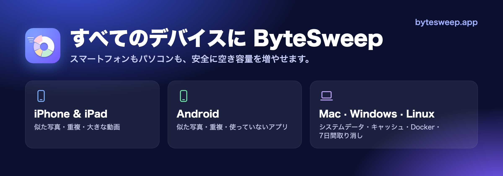

<p align="center">
  <a href="README.md">English</a> ·
  <a href="README.de.md">Deutsch</a> ·
  <a href="README.es.md">Español</a> ·
  <a href="README.fr.md">Français</a> ·
  <a href="README.it.md">Italiano</a> ·
  <a href="README.nl.md">Nederlands</a> ·
  <a href="README.pl.md">Polski</a> ·
  <a href="README.pt-BR.md">Português (Brasil)</a> ·
  <a href="README.ru.md">Русский</a> ·
  <a href="README.tr.md">Türkçe</a> ·
  <b>日本語</b> ·
  <a href="README.ko.md">한국어</a> ·
  <a href="README.zh-Hans.md">简体中文</a> ·
  <a href="README.zh-Hant.md">繁體中文</a>
</p>

<h1 align="center">ByteSweep CLI：Linux・Mac・Windows 向けディスク容量の分析・クリーンアップツール</h1>

<p align="center">
  <b>ディスク容量不足の原因を突き止め、どのターミナルでも安全に空き容量を増やせます。</b><br>
  Linuxサーバー、Mac、Windows、BSD に対応した、無料・オープンソースのディスク容量分析＆クリーンアップツールです。
</p>

<p align="center">
  <a href="https://bytesweep.app/cli"></a>
  <a href="https://github.com/bytesweepcleaner/bytesweep-cli/blob/main/LICENSE"></a>
  <a href="https://github.com/bytesweepcleaner/bytesweep-cli/actions/workflows/test.yml"></a>
  <a href="https://github.com/bytesweepcleaner/bytesweep-cli/blob/main/go.mod"></a>
  <a href="docs/platforms.md"></a>
  <a href="https://github.com/bytesweepcleaner/bytesweep/stargazers"></a>
</p>

<p align="center">
  
</p>

ByteSweep CLI（`bsweep`）は、**ディスクが満杯になった理由**を教え、**何も壊さずに**空き容量を確保します。
`df`、`du`、Docker、systemd ジャーナル、パッケージキャッシュ、古いカーネル、削除済みなのにまだ開かれているファイル、
inode、スナップショットを読み取り、その答えをわかりやすい言葉で説明します。どのクリーンアップも実行前に正確なコマンドを表示し、
リスクのあるものは確認を待ち、削除したファイルは 7 日間 Undo（元に戻す）に残ります。

単一の静的バイナリです。ランタイムもエージェントも不要で、常駐するものも残りません。**無料かつオープンソース（GPL-3.0）：
すべてのコマンドを、すべてのマシンで、ライセンスやキー、試用期間なしで使えます。**

## 主な機能

- **満杯の理由をひとつの答えで。** `bsweep why` が容量を占めているフォルダー、キャッシュ、ログを挙げ、`du` では見えない差分も示します。
- **空きがあるのに "No space left on device"（デバイスに空き領域がありません）。** ディスクごとの inode と、ファイル数が最も多いフォルダーを表示します。
- **`df` と `du` の結果が合わない。** Held 画面に、削除済みなのにまだ開かれているファイルと、それぞれを保持しているサービスを一覧表示します。
- **Docker のディスク使用量。** ビルドキャッシュ、未使用イメージ、停止中のコンテナ、コンテナログ。ボリュームは決して prune しません。
- **ログ。** systemd ジャーナルの vacuum、ローテート済みログの削除、巨大な稼働中ログのその場での空化。毎日・毎週・毎月のスケジュール実行も可能です。
- **いまディスクが満杯。** `bsweep rescue` が安全なものから順に必要な分だけ空け、満杯のディスクには何も書き込みません。
- **設計から安全。** 正確なコマンドを先に表示、すべてで `--dry-run` 対応、7 日間の Undo、データベースや稼働中のカーネルには一切触れません。
- **重複ファイル、大きなファイル、圧縮とアーカイブ。** 内容で重複を検出し、古いログを gzip し、古いプロジェクトを別ディスクへ移して、また戻せます。
- **ヘルス、アップデート、ポート、自動起動。** 失敗したサービス、メモリ不足による強制終了、故障しかけのディスク、期限切れの証明書、止まったバックアップ、各ポートで待ち受けているもの。
- **複数サーバー。** `bsweep fleet` は何もインストールせずに SSH 経由で動作し、`bsweep manage` ですべてのサーバーをひとつの画面で管理できます。
- **AI アシスタント。** `bsweep mcp` は Claude、Cursor、VS Code など、あらゆる MCP クライアント向けの Model Context Protocol サーバーです。
- **スクリプトと監視。** ほぼすべてのコマンドで `--json`、`bsweep check` の終了コード、Webhook に対応しています。

## インストール

Linux、macOS、BSD：

```sh
curl -fsSL https://bytesweep.app/install-cli.sh | sudo sh
```

または、同じスクリプトを GitHub から直接実行します：

```sh
curl -fsSL https://raw.githubusercontent.com/bytesweepcleaner/bytesweep/main/install-cli.sh | sudo sh
```

Windows（管理者として PowerShell を実行）：

```powershell
irm https://bytesweep.app/install-cli.ps1 | iex
```

どちらも、インストール前に署名付きチェックサムを検証します。Go 1.22 以降があれば、自分でビルドすることもできます：

```sh
go install github.com/bytesweepcleaner/bytesweep-cli/cmd/bsweep@latest
```

`sudo bsweep update` で次のリリースを取得できます。対応 OS とプロセッサーの一覧：[docs/platforms.md](docs/platforms.md)。

## 対応システム

システムとプロセッサごとに静的な `bsweep` ファイルが 1 つ、全 23 ビルドです。インストール用のコマンドが適切なものを選びます。

| システム | プロセッサ | バージョン |
|---|---|---|
| **Linux** | x86_64, ARM64, ARMv7, i386, RISC-V 64, ppc64le, s390x, LoongArch64 | すべてのディストリビューション：Ubuntu, Debian, Fedora, RHEL, CentOS, AlmaLinux, Rocky Linux, openSUSE, Arch, Alpine など |
| **Mac** | Apple silicon (ARM64), Intel (x86_64) | macOS 11 Big Sur 以降 |
| **Windows** | x64, ARM64, 32 ビット (i386) | Windows 10 / 11 |
| **FreeBSD** | x86_64, ARM64 |  |
| **OpenBSD** | x86_64, ARM64 |  |
| **NetBSD** | x86_64, ARM64 |  |
| **DragonFly BSD** | x86_64 |  |
| **Solaris** | x86_64 |  |
| **illumos** | x86_64 |  |
| **AIX** | ppc64 |  |
| **Android** (Termux) | ARM64 | Termux で Linux ARM64 ビルドを使用。Android では root 権限がないため閲覧のみ |

どのターミナルでも動作します：Terminal、iTerm2、Windows Terminal、PowerShell、GNOME Terminal、Konsole、xterm、Linux コンソール、tmux、screen、PuTTY、SSH 経由。システムごとの違い：[docs/platforms.md](docs/platforms.md)。

## クイックスタート

```sh
sudo bsweep                        # フルスクリーンのアプリ
bsweep why                         # ひとつの答え：このディスクが満杯な理由
sudo bsweep rescue                 # 使用率 100%：安全なものから必要な分だけ空ける
bsweep clean --list                # 削除できるものすべてを、グループ別に
sudo bsweep clean --safe --dry-run # 安全なクリーンで何が起きるかを、実行せずに確認
bsweep dupes /srv --dry-run        # 重複ファイルと、どのコピーが残るか
bsweep check                       # 監視や cron 向けの終了コード
```

## スマートフォンとパソコン向けの ByteSweep

<p align="center">
  <a href="https://bytesweep.app/?ref=github"></a>
</p>

<p align="center">
  <a href="https://apps.apple.com/us/app/bytesweep-storage-cleaner/id6811826959"></a>
  <a href="https://play.google.com/store/apps/details?id=com.bytesweep.app"></a>
  <a href="https://apps.microsoft.com/detail/9N7WMJS8QCQX"></a>
  <a href="https://bytesweep.app/mac.html?ref=github"></a>
  <a href="https://bytesweep.app/linux.html?ref=github"></a>
</p>

CLI は無料で、これからも無料です。ポケットのスマートフォンと机の上のパソコンには ByteSweep アプリがあります。ルールは同じです。消える前に、すべてを確認できます。

<table>
  <tr>
    <td><b>iPhone &amp; iPad</b></td>
    <td>似た写真や重複を見つけ、大きな動画を圧縮し、昔の月をスワイプで見直せます。最初の 1 GB と 30 項目まで無料、その後は買い切りです。</td>
    <td><a href="https://apps.apple.com/us/app/bytesweep-storage-cleaner/id6811826959"></a></td>
  </tr>
  <tr>
    <td><b>Android</b></td>
    <td>似た写真、重複、大きな動画、使っていないアプリを見つけます。最初の 1 GB と 30 項目まで無料、その後は買い切りでサブスクなしです。</td>
    <td><a href="https://play.google.com/store/apps/details?id=com.bytesweep.app"></a></td>
  </tr>
  <tr>
    <td><b>Mac</b></td>
    <td>システムデータから Docker、Xcode まで、Mac を埋めているものを見つけます。戻せるものは 7 日間取り消し可能です。3 日間無料で試せます。Mac App Store にもあります。</td>
    <td><a href="https://bytesweep.app/mac.html?ref=github"></a><br><a href="https://apps.apple.com/us/app/bytesweep-storage-transfer/id6822710125?mt=12"></a></td>
  </tr>
  <tr>
    <td><b>Windows</b></td>
    <td>Windows Update の残骸、一時ファイル、ブラウザやゲームのキャッシュを削除します。戻せるものは 7 日間取り消し可能です。3 日間無料で試せます。</td>
    <td><a href="https://apps.microsoft.com/detail/9N7WMJS8QCQX"></a></td>
  </tr>
  <tr>
    <td><b>Linux</b></td>
    <td>apt、dnf、pacman のキャッシュ、古い snap、使われていない Flatpak ランタイム、ジャーナルを削除し、重複や大きなファイルを見つけます。3 日間無料で試せます。</td>
    <td><a href="https://bytesweep.app/linux.html?ref=github"></a></td>
  </tr>
</table>

## 解決できるすべての問題

| 実際のサーバーで起きる問題 | ByteSweep の対処 |
|---|---|
| `df` は満杯、`du` は一致しない | Held タブ：削除済みで開かれたままのファイルと保持元。Overview はスキャンで見えない差分も明示 |
| 空きがあるのに "No space left" | ディスクごとの inode、Explore でファイル数順に並べ替え（`i`） |
| Docker がディスクを食いつぶした | ビルドキャッシュ、タグなし・未使用イメージ、停止中のコンテナ、`docker system df` に出ないコンテナログ。すべての VM（Colima、Lima、Podman、Multipass、Vagrant、minikube、Android エミュレーター…）を名前と取り戻せる容量つきで表示 |
| 不用意な prune でデータベースが消えた | ボリュームは決して prune しない。データベースと /var/lib/docker は手動でも削除不可 |
| ジャーナル、ローテート済みログ、巨大な稼働中ログ | journalctl で vacuum。稼働中ログはその場で空にし、サービスは書き込みを継続 |
| /boot が満杯でアップグレードが失敗 | 古いカーネルを削除、稼働中のものは対象外 |
| パッケージ・言語のキャッシュ、古い snap、クラッシュダンプ、古い /tmp | それぞれ専用ツール経由。正確なコマンドを先に表示 |
| プランは増やしたのにディスクが増えていない | どのパーティションにも属さない領域を検出 |
| ext4 の隠れた 5% | 予約領域と tune2fs のコマンドを明示 |
| 翌月また満杯になる | Prevent タブ：ジャーナル上限、Docker ログ制限、日次記録 |
| 「一晩で何が変わった？」 | 増えたものと、このペースでいつ満杯になるか |
| スキャンが本番環境を遅くする | 低 CPU・アイドル時のディスク優先度で実行、ひとつのディスク内に限定 |
| 使用率 100% ですべてが失敗している | `bsweep rescue` または `R`：安全なものから必要な分だけ空け、停止したサービスを明示。満杯のディスクには何も書き込まない |
| Podman や Kubernetes のノード | podman と crictl 経由で同じクリーンアップ。ボリュームには触れない |
| スナップショットが容量を占有 | `bsweep snapshots`：Time Machine、復元ポイント、シャドウコピー、Timeshift、Snapper、ZFS、Btrfs、LVM を、ツールが報告できる範囲でサイズつき表示。選んだものだけ削除し、それぞれ最新のものは保持 |
| マウントの下に隠れたファイル | 読み取り専用の bind で各マウントの下を調べ、アクセス方法を表示 |
| 古いデプロイや Web アプリの残骸 | 古いリリース（稼働中 + 3 つを保持）、WordPress キャッシュ、Laravel ログ、PHP セッション |
| ログを定期的に削除したい | `bsweep logs clear`、または `bsweep schedule logs` で毎日・毎週・毎月 |
| どこもローテートしていないログ | Prevent が logrotate ルールを作成し、テストしてから適用 |
| 古いプロジェクトが忙しいディスクを圧迫 | `bsweep archive /srv/old --to /mnt/backup`：別ディスクへ移し、全ファイルをチェックサムで検証してから解放。外したままでも `where` が使え、`bring-back` で元に戻す |
| 古いログやダンプが容量を占有 | `bsweep compress /var/log --older 30d`：効果がある場合に gzip、読み戻して確認してから元ファイルを Undo へ。稼働中ログはそのまま |
| 同じファイルが 3 つも | `bsweep dupes`：内容で重複を検出、ハードリンクとクローンは 1 つとして計算。1 つを残し、残りは Undo へ |
| ダウンロードフォルダーが古いインストーラーや「(1)」付きコピーだらけ | `bsweep tidy`：デスクトップ版と同じルールで各ファイルを Undo へ。残りは `organize`、`rename`、`convert` で、いずれも先に表示し元に戻せる |
| 「ポート 3000 で何が動いている？」 | `bsweep ports`：プログラム、プロジェクト、コンテナ、ネットワークに公開されているかどうか。開発プロジェクトを一度に停止 |
| どのパッケージが巨大か、削除したアプリが何を残したか | `bsweep apps`：すべてのパッケージとアプリを大きい順に。apt、dnf、pacman、snap、flatpak、brew 自身の dry run の後に削除。システムに必要なものは対象外 |
| チャットアプリが知らぬ間にディスクを圧迫 | Chats and Mail グループ：Slack、Teams、Discord、Element、Thunderbird のキャッシュを確認対象に。Telegram のファイルと Zoom の録画は 1 つずつ Undo へ |
| カメラ、マイク、画面を使えるアプリは？ | `bsweep permissions`：許可・拒否、システムが記録している場合は最終使用と現在の使用状況（macOS TCC、Windows のプライバシー設定、Flatpak、Snap、開かれているデバイス）。読み取りのみで、それぞれのオフにする場所を案内 |
| コマンド履歴などの痕跡 | Privacy traces グループ：シェルや REPL の履歴、最近使ったファイル、プレビュー、エディターのバックアップ。常に確認対象で、各ファイルは Undo へ |
| 待機中のアップデートと、再起動が必要か | `bsweep updates`：セキュリティ修正を優先、apt、dnf、zypper、pacman、apk、snap、flatpak、Homebrew、winget、macOS のソフトウェアアップデート、Windows Update 経由。使用中のパッケージロックの保持元を明示。勝手に再起動しない |
| 終了しないプログラム | `bsweep stop PID\|NAME`、または Live で `s`：終了を要求し、保存のため 10 秒待つ。sshd、PID 1、自分のシェルは対象外で、サービスには `systemctl` コマンドを案内 |
| 「なぜ午前 3 時にスリープ解除された？」 | `bsweep sleep`：各スリープと解除の原因（蓋、USB、Bluetooth、ネットワーク、タイマー）、いまスリープを妨げているもの、予定されている解除。助言のみで電源設定は変更しない。スリープしないサーバーはそう表示 |
| 「他人から何が見える？」 | `bsweep sharesafe`：共有フォルダー（ゲスト可？ファイル変更可？）、ファイル共有と画面共有、SSH、リモートデスクトップ、開いているポート、Docker の公開ポート、ファイアウォール。それぞれのリスクとオフにする場所。読み取りのみ |
| 自動で起動するものと、失敗したもの | `bsweep startup`：systemd、cron @reboot、launchd、Windows サービス。システム自身のものは `--all` 指定時のみ。正確にオフ・オンを切り替え |
| 夜間にサービスが落ちた | Health タブ：メモリ不足による強制終了、失敗したサービス、クラッシュループ |
| 故障しかけのディスク | `bsweep drives`：すべての物理ディスクを Healthy、Worn、Failing で判定し、理由をわかりやすく表示。`check` と Health も警告。読み取りのみ |
| 「そもそもバックアップは動いている？」 | Health がツール（restic、borg、rsnapshot、duplicity、Timeshift、Snapper、vzdump、Time Machine、Windows Backup）と、最後に成功・失敗した日時を表示。リポジトリのパスワード不要 |
| 証明書がいつの間にか期限切れ | nginx、Apache、Caddy、Let's Encrypt の証明書を読み取り、更新の不具合を警告 |
| アップデート、SSH、ファイアウォール、バックアップ | macOS と Windows の Health はファイアウォール、FileVault または BitLocker、SIP と Gatekeeper またはウイルス対策も確認。正確なコマンドつきの助言。ByteSweep は SSH やファイアウォールを変更しない：締め出し事故の原因になるため |
| 複数サーバー | `bsweep fleet`：SSH 経由でひとつの表に、インストール不要 |
| scp の構文なしでファイルを移動 | ホストを一度保存すれば、あとは `bsweep copy-to office ./site /srv/site` |
| 途切れた転送が最初からやり直し | 止まった所から再開し、変更分だけ送信 |
| 同期で別のフォルダーが消えた | 先に変更内容を表示、削除したファイルは 7 日間保持、フォルダーを空にする操作は拒否 |
| ノート PC からサーバーを確認 | `bsweep connect office` でそのサーバー上のフルアプリを開く |
| サーバーが多すぎて把握できない | `bsweep manage`：すべてのサーバーをひとつの画面に、ライブ Monitor と一括操作つき |
| 監視の仕組みに組み込みたい | `bsweep check` の終了コード、Webhook、`report --json`、`clean --safe --yes` |

すべてのコマンドと終了コード：[docs/cli.md](docs/cli.md)。cron、Ansible、CI、fleet の例：[docs/recipes.md](docs/recipes.md)。

## Clean と Undo の仕組み

- Explore の **Clean**（削除）は、ファイルを `<disk>/.bytesweep-undo` に 7 日間移動します。同じディスク上での移動では
  容量は空かないため、容量が戻るのは Undo の期間が終わったときです。画面にもそう表示されます。
- **Remove now**（今すぐ削除）は Undo なしで即座に容量を戻します。アプリの確認画面では `F`、Undo を使う
  すべてのコマンド（rm、dupes、clean、apps、tidy、compress）では `--now` です。使用率 100% のディスクではこちらを
  選んでください。`bsweep undo free --all` で Undo 自体を空にできます。
- ルールによるクリーンアップは journalctl、docker、apt などを経由するため、元に戻せません。
  確認画面にすべてのコマンドが一覧表示されます。

## ホスト、転送、同期

ホストは `bsweep.yml` で一度設定すれば（`bsweep init` のあと `bsweep host add`）、以降はサーバーからでも、
Mac や Windows のコマンドラインからでも短い名前で使えます。[docs/transfer.md](docs/transfer.md) を参照してください。

## AI アシスタント（MCP）

`bsweep mcp` を使うと、Claude Desktop、Claude Code、Cursor、VS Code などの MCP クライアントがマシンを調べ、
コマンドラインと同じルールでクリーンアップを手伝えるようになります。[docs/mcp.md](docs/mcp.md) を参照してください。

## よくある質問

**Linux でディスク容量を使っているものを調べるには？**
`bsweep why` を実行すると 1 画面で答えがわかります。または `sudo bsweep` で Explore を開くと、大きい順にフォルダーをたどれます。
フォルダーをたどるだけでは数えられないもの（削除済みで開かれたままのファイル、Docker、スナップショット、予約領域）も計算します。

**`du` の合計は少ないのに、`df` がディスク満杯と表示するのはなぜ？**
多くの場合、プログラムが削除済みファイル（よくあるのはログ）をまだ開いたままにしています。Held 画面にそれぞれのファイルと
保持しているサービスが表示され、保持されたログをその場で空にするので、サービスは書き込みを続けられます。

**`df` に空きがあるのに "No space left on device" が出るときの対処法は？**
ディスクの inode が枯渇しています。小さなファイルが多すぎる状態です。ByteSweep はディスクごとの inode を表示し、Explore では
ファイル数順に並べ替えて（`i`）、それらを抱えているフォルダーを見つけられます。

**Docker のディスク容量を安全に空けるには？**
`bsweep clean --list --group containers` で、ビルドキャッシュ、未使用イメージ、停止中のコンテナ、
コンテナログが一覧表示されます。ボリュームはデータベースの可能性があるため、決して prune しません。

**サーバーのディスク使用率が 100% に。どうすればいい？**
`sudo bsweep rescue`、またはアプリで `R` を押してください。安全なものから必要な分だけ空け、満杯のディスクには
何も書き込まず、その後停止したサービスを表示します。

**本番サーバーで実行しても安全？**
どのクリーンアップも正確なコマンドを先に表示し、`--dry-run` で何でもプレビューでき、削除したファイルは 7 日間 Undo で
待機し、スキャンは低 CPU・アイドル時のディスク優先度で実行されます。データベース、Docker ボリューム、稼働中のカーネルは決して削除せず、
スナップショットを勝手に選ぶことも、SSH やファイアウォールの設定を変更することもありません。

**無料ですか？データをどこかに送信しますか？**
GPL-3.0 の無料オープンソースで、アカウント、アナリティクス、試用期間はありません。オンラインになるのは依頼したときだけです：
`bsweep update`、自分で追加した通知先へのアラート、fleet・copy・sync のための SSH。

## プライバシー

アナリティクスもアカウントもありません。あなたやあなたのファイルに関する情報がマシンの外に出ることはありません。bsweep が
オンラインになるのは依頼したときだけです。`bsweep update` は bytesweep.app からダウンロードし（先に署名を
検証します）、アラートは追加した通知先にのみ送られ、fleet・copy・sync は自分の SSH を使います。

## ビルドとテスト

Go 1.22 以降が必要です：`go test ./...`、次に `go build -o bsweep ./cmd/bsweep`。
`VERSION=1.0.1 ./build.sh` ですべてのリリースビルドを作成します。[bytesweep-cli](https://github.com/bytesweepcleaner/bytesweep-cli) と
[SECURITY.md](SECURITY.md) を参照してください。

## ライセンス

GPL-3.0：自由に使用、改変、共有できます。改変したものを他者に配布する場合は、同じライセンスの下で
オープンソースのままにする必要があります。[LICENSE](https://github.com/bytesweepcleaner/bytesweep-cli/blob/main/LICENSE) を参照してください。

---

ByteSweep には Mac、Windows、Linux 向けのデスクトップアプリもあります：[bytesweep.app](https://bytesweep.app/?ref=github)
