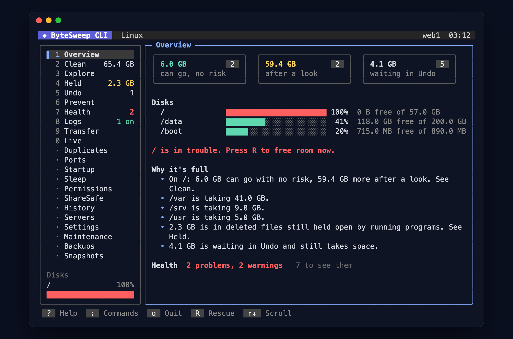
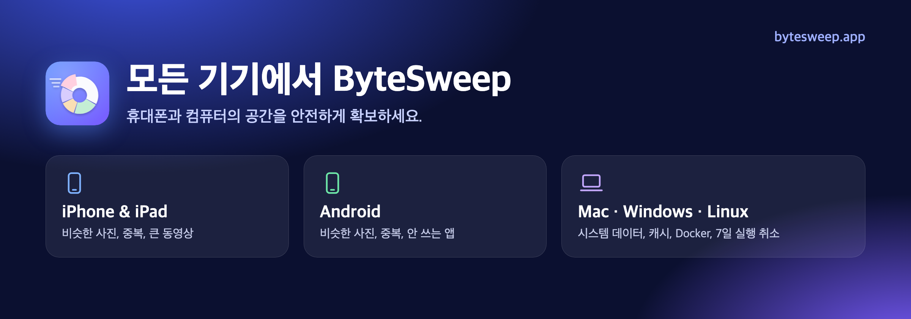

<p align="center">
  <a href="README.md">English</a> ·
  <a href="README.de.md">Deutsch</a> ·
  <a href="README.es.md">Español</a> ·
  <a href="README.fr.md">Français</a> ·
  <a href="README.it.md">Italiano</a> ·
  <a href="README.nl.md">Nederlands</a> ·
  <a href="README.pl.md">Polski</a> ·
  <a href="README.pt-BR.md">Português (Brasil)</a> ·
  <a href="README.ru.md">Русский</a> ·
  <a href="README.tr.md">Türkçe</a> ·
  <a href="README.ja.md">日本語</a> ·
  <b>한국어</b> ·
  <a href="README.zh-Hans.md">简体中文</a> ·
  <a href="README.zh-Hant.md">繁體中文</a>
</p>

<h1 align="center">ByteSweep CLI: Linux, Mac, Windows용 디스크 공간 분석 및 정리 도구</h1>

<p align="center">
  <b>디스크 용량 부족, 원인을 찾고 어떤 터미널에서든 안전하게 디스크 공간을 확보하세요.</b><br>
  리눅스 서버, Mac, Windows, BSD를 위한 무료 디스크 용량 분석 및 정리 도구입니다.
</p>

<p align="center">
  <a href="https://bytesweep.app/cli"></a>
  <a href="docs/platforms.md"></a>
  <a href="https://github.com/bytesweepcleaner/bytesweep/stargazers"></a>
</p>

<p align="center">
  
</p>

ByteSweep CLI(`bsweep`)는 **디스크가 가득 찬 이유**를 알려 주고, **아무것도 망가뜨리지 않고** 공간을 확보합니다.
`df`, `du`, Docker, systemd 저널, 패키지 캐시, 오래된 커널, 삭제됐지만 아직 열려 있는 파일, inode, 스냅샷을
읽어서 그 답을 쉬운 말로 설명합니다. 모든 정리 작업은 정확한 명령어를 먼저 보여 주고, 위험한 작업은 확인을 기다리며,
삭제한 파일은 7일 동안 Undo(되돌리기)에 보관됩니다.

정적 바이너리 파일 하나뿐입니다. 런타임도, 에이전트도 없고, 백그라운드에 남는 것도 없습니다. **무료:
모든 명령어를 모든 머신에서 라이선스, 키, 체험 기간 없이 사용할 수 있습니다.**

## 주요 기능

- **가득 찬 이유를 한 번에.** `bsweep why`가 공간을 차지하는 폴더, 캐시, 로그를 알려 주고, `du`로는 보이지 않는 차이도 보여 줍니다.
- **여유 공간이 있는데 "No space left on device"(장치에 남은 공간 없음).** 디스크별 inode와 파일 수가 가장 많은 폴더를 보여 줍니다.
- **`df`와 `du` 결과가 다를 때.** Held 화면에 삭제됐지만 아직 열려 있는 파일과 각 파일을 붙잡고 있는 서비스를 나열합니다.
- **Docker 디스크 사용량.** 빌드 캐시, 사용하지 않는 이미지, 중지된 컨테이너, 컨테이너 로그. 볼륨은 절대 prune하지 않습니다.
- **로그.** systemd 저널 vacuum, 순환된 로그 삭제, 거대한 실행 중 로그를 제자리에서 비우기. 매일, 매주, 매월 예약할 수 있습니다.
- **지금 디스크가 꽉 찼을 때.** `bsweep rescue`가 가장 안전한 것부터 필요한 만큼만 확보하며, 꽉 찬 디스크에는 아무것도 쓰지 않습니다.
- **설계부터 안전하게.** 정확한 명령어를 먼저 표시, 모든 곳에서 `--dry-run` 지원, 7일간 Undo, 데이터베이스나 실행 중인 커널은 절대 건드리지 않습니다.
- **중복 파일, 큰 파일, 압축과 아카이브.** 내용으로 사본을 찾고, 오래된 로그를 gzip하고, 오래된 프로젝트를 다른 디스크로 옮겼다가 다시 가져올 수 있습니다.
- **상태, 업데이트, 포트, 시작 프로그램.** 실패한 서비스, 메모리 부족(OOM)으로 종료된 프로세스, 고장 직전의 디스크, 만료된 인증서, 멈춘 백업, 각 포트에서 대기 중인 프로그램.
- **여러 서버.** `bsweep fleet`은 아무것도 설치하지 않고 SSH로 동작하며, `bsweep manage`로 모든 서버를 한 화면에서 관리합니다.
- **AI 어시스턴트.** `bsweep mcp`는 Claude, Cursor, VS Code 등 모든 MCP 클라이언트를 위한 Model Context Protocol 서버입니다.
- **스크립트와 모니터링.** 거의 모든 명령어에서 `--json`, `bsweep check`의 종료 코드, 웹훅을 지원합니다.

## 설치

Linux, macOS, BSD:

```sh
curl -fsSL https://bytesweep.app/install-cli.sh | sudo sh
```

또는 같은 스크립트를 GitHub에서 바로 실행합니다:

```sh
curl -fsSL https://raw.githubusercontent.com/bytesweepcleaner/bytesweep/main/install-cli.sh | sudo sh
```

Windows(관리자 권한 PowerShell):

```powershell
irm https://bytesweep.app/install-cli.ps1 | iex
```

두 방법 모두 설치 전에 서명된 체크섬을 확인합니다.

`sudo bsweep update`로 다음 릴리스를 받습니다. 지원하는 모든 시스템과 프로세서: [docs/platforms.md](docs/platforms.md).

## 지원 시스템

시스템과 프로세서마다 정적 `bsweep` 파일 하나, 모두 23개 빌드입니다. 설치 명령이 알맞은 것을 고릅니다.

| 시스템 | 프로세서 | 버전 |
|---|---|---|
| **Linux** | x86_64, ARM64, ARMv7, i386, RISC-V 64, ppc64le, s390x, LoongArch64 | 모든 배포판: Ubuntu, Debian, Fedora, RHEL, CentOS, AlmaLinux, Rocky Linux, openSUSE, Arch, Alpine 등 |
| **Mac** | Apple silicon (ARM64), Intel (x86_64) | macOS 11 Big Sur 이상 |
| **Windows** | x64, ARM64, 32비트 (i386) | Windows 10 및 11 |
| **FreeBSD** | x86_64, ARM64 |  |
| **OpenBSD** | x86_64, ARM64 |  |
| **NetBSD** | x86_64, ARM64 |  |
| **DragonFly BSD** | x86_64 |  |
| **Solaris** | x86_64 |  |
| **illumos** | x86_64 |  |
| **AIX** | ppc64 |  |
| **Android** (Termux) | ARM64 | Termux에서 Linux ARM64 빌드 사용. Android는 root 권한이 없어 보기만 가능 |

어떤 터미널에서도 동작합니다: Terminal, iTerm2, Windows Terminal, PowerShell, GNOME Terminal, Konsole, xterm, Linux 콘솔, tmux, screen, PuTTY, SSH. 시스템별 차이: [docs/platforms.md](docs/platforms.md).

## 빠른 시작

```sh
sudo bsweep                        # 전체 화면 앱
bsweep why                         # 한 번에 답: 이 디스크가 가득 찬 이유
sudo bsweep rescue                 # 사용률 100%: 가장 안전한 것부터 필요한 만큼만 확보
bsweep clean --list                # 정리할 수 있는 모든 항목을 그룹별로
sudo bsweep clean --safe --dry-run # 안전한 정리가 할 일을 실제로 실행하지 않고 확인
bsweep dupes /srv --dry-run        # 중복 파일과 어떤 사본이 남는지
bsweep check                       # 모니터링과 cron을 위한 종료 코드
```

## 휴대폰과 컴퓨터를 위한 ByteSweep

<p align="center">
  <a href="https://bytesweep.app/?ref=github"></a>
</p>

<p align="center">
  <a href="https://apps.apple.com/us/app/bytesweep-storage-cleaner/id6811826959"></a>
  <a href="https://play.google.com/store/apps/details?id=com.bytesweep.app"></a>
  <a href="https://apps.microsoft.com/detail/9N7WMJS8QCQX"></a>
  <a href="https://bytesweep.app/mac.html?ref=github"></a>
  <a href="https://bytesweep.app/linux.html?ref=github"></a>
</p>

CLI는 무료이며 앞으로도 무료입니다. 주머니 속 휴대폰과 책상 위 컴퓨터를 위한 ByteSweep 앱도 있습니다. 규칙은 같습니다. 지우기 전에 모든 것을 먼저 확인합니다.

<table>
  <tr>
    <td><b>iPhone &amp; iPad</b></td>
    <td>비슷한 사진과 중복 사진을 찾고, 큰 동영상을 줄이고, 지난 달들을 스와이프로 정리합니다. 처음 1GB와 30개 항목까지 무료, 이후 한 번만 결제합니다.</td>
    <td><a href="https://apps.apple.com/us/app/bytesweep-storage-cleaner/id6811826959"></a></td>
  </tr>
  <tr>
    <td><b>Android</b></td>
    <td>비슷한 사진, 중복 파일, 큰 동영상, 사용하지 않는 앱을 찾습니다. 처음 1GB와 30개 항목까지 무료, 이후 한 번만 결제하며 구독은 없습니다.</td>
    <td><a href="https://play.google.com/store/apps/details?id=com.bytesweep.app"></a></td>
  </tr>
  <tr>
    <td><b>Mac</b></td>
    <td>시스템 데이터부터 Docker, Xcode까지 Mac을 채운 것을 찾아냅니다. 되돌릴 수 있는 항목은 7일간 실행 취소할 수 있습니다. 3일 무료 체험. Mac App Store에도 있습니다.</td>
    <td><a href="https://bytesweep.app/mac.html?ref=github"></a><br><a href="https://apps.apple.com/us/app/bytesweep-storage-transfer/id6822710125?mt=12"></a></td>
  </tr>
  <tr>
    <td><b>Windows</b></td>
    <td>Windows 업데이트 잔여 파일, 임시 파일, 브라우저 및 게임 캐시를 정리합니다. 되돌릴 수 있는 항목은 7일간 실행 취소할 수 있습니다. 3일 무료 체험.</td>
    <td><a href="https://apps.microsoft.com/detail/9N7WMJS8QCQX"></a></td>
  </tr>
  <tr>
    <td><b>Linux</b></td>
    <td>apt, dnf, pacman 캐시, 오래된 snap, 사용하지 않는 Flatpak 런타임과 저널을 정리하고, 중복 파일과 큰 파일을 찾습니다. 3일 무료 체험.</td>
    <td><a href="https://bytesweep.app/linux.html?ref=github"></a></td>
  </tr>
</table>

## 해결할 수 있는 모든 문제

| 실제 서버에서 겪는 문제 | ByteSweep의 해결 방법 |
|---|---|
| `df`는 가득 찼다는데 `du`는 다름 | Held 탭: 삭제됐지만 열려 있는 파일과 붙잡고 있는 주체. Overview는 스캔으로 보이지 않는 차이도 알려 줌 |
| 여유 공간이 있는데 "No space left" | 디스크별 inode, Explore에서 파일 수 기준 정렬(`i`) |
| Docker가 디스크를 다 먹음 | 빌드 캐시, 태그 없는 이미지와 사용하지 않는 이미지, 중지된 컨테이너, `docker system df`에 안 나오는 컨테이너 로그. 모든 VM(Colima, Lima, Podman, Multipass, Vagrant, minikube, Android 에뮬레이터...)을 이름과 돌려받을 수 있는 공간과 함께 표시 |
| 무심코 한 prune으로 데이터베이스 삭제 | 볼륨은 절대 prune하지 않음. 데이터베이스와 /var/lib/docker는 수동으로도 정리 불가 |
| 저널, 순환된 로그, 거대한 실행 중 로그 | journalctl로 vacuum. 실행 중 로그는 제자리에서 비워 서비스가 계속 기록 |
| /boot가 가득 차 업그레이드 실패 | 오래된 커널 정리, 실행 중인 커널은 제외 |
| 패키지·언어 캐시, 오래된 snap, 크래시 덤프, 오래된 /tmp | 각각 전용 도구로 처리. 정확한 명령어를 먼저 표시 |
| 요금제는 올렸는데 디스크는 그대로 | 어떤 파티션에도 속하지 않은 디스크 공간을 찾음 |
| ext4의 숨은 5% | 예약 공간과 tune2fs 명령어를 알려 줌 |
| 다음 달에 또 가득 참 | Prevent 탭: 저널 상한, Docker 로그 제한, 일일 기록 |
| "밤사이 무엇이 바뀌었지?" | 무엇이 늘었는지, 이 속도라면 언제 가득 찰지 |
| 스캔이 운영 서버를 느리게 함 | 낮은 CPU와 유휴 디스크 우선순위로 실행, 하나의 디스크 안에서만 동작 |
| 디스크 100%, 모든 게 실패 중 | `bsweep rescue` 또는 `R`: 가장 안전한 것부터 필요한 만큼만 확보한 뒤 멈춘 서비스를 알려 줌. 꽉 찬 디스크에는 아무것도 쓰지 않음 |
| Podman 또는 Kubernetes 노드 | podman과 crictl로 같은 정리. 볼륨은 건드리지 않음 |
| 스냅샷이 공간을 차지 | `bsweep snapshots`: Time Machine, 복원 지점, 섀도 복사본, Timeshift, Snapper, ZFS, Btrfs, LVM을 도구가 알려 주는 범위에서 크기와 함께 표시. 선택한 것만 삭제하고 각각 최신 것은 유지 |
| 마운트 아래 숨은 파일 | 읽기 전용 bind로 모든 마운트 아래를 살펴보고 접근 방법을 보여 줌 |
| 오래된 배포본과 웹 앱 잔여물 | 오래된 릴리스(현재 버전 + 3개 유지), WordPress 캐시, Laravel 로그, PHP 세션 |
| 로그를 정기적으로 지워야 함 | `bsweep logs clear`, 또는 `bsweep schedule logs`로 매일, 매주, 매월 |
| 아무도 순환시키지 않는 로그 | Prevent가 logrotate 규칙을 작성하고, 테스트한 뒤에 적용 |
| 오래된 프로젝트가 바쁜 디스크를 채움 | `bsweep archive /srv/old --to /mnt/backup`: 다른 디스크로 옮기고 모든 파일을 체크섬으로 확인한 뒤 공간 확보. 분리된 상태에서도 `where`가 동작하고 `bring-back`으로 되돌림 |
| 오래된 로그와 덤프가 공간을 차지 | `bsweep compress /var/log --older 30d`: 절약되는 경우에만 gzip, 다시 읽어 확인한 뒤 원본을 Undo로. 실행 중 로그는 그대로 |
| 같은 파일이 세 벌씩 | `bsweep dupes`: 내용으로 사본을 찾고 하드 링크와 클론은 한 번만 계산. 하나만 남기고 나머지는 Undo로 |
| 다운로드 폴더가 오래된 설치 파일과 "(1)" 사본으로 가득 | `bsweep tidy`: 데스크톱 앱과 같은 규칙으로 각 파일을 Undo로. 나머지는 `organize`, `rename`, `convert`로, 모두 먼저 보여 주고 되돌릴 수 있음 |
| "포트 3000에서 뭐가 돌고 있지?" | `bsweep ports`: 프로그램, 프로젝트 또는 컨테이너, 네트워크에 열려 있는지 여부. 개발 프로젝트를 한 번에 중지 |
| 어떤 패키지가 거대한지, 삭제한 앱이 뭘 남겼는지 | `bsweep apps`: 모든 패키지와 앱을 큰 순서대로. apt, dnf, pacman, snap, flatpak, brew 자체의 dry run 후 삭제. 시스템에 필요한 것은 제외 |
| 채팅 앱이 조용히 디스크를 채움 | Chats and Mail 그룹: Slack, Teams, Discord, Element, Thunderbird 캐시를 검토 대상으로. Telegram 파일과 Zoom 녹화는 하나씩만 Undo로 |
| 카메라, 마이크, 화면을 쓸 수 있는 앱은? | `bsweep permissions`: 허용·거부 여부, 시스템이 기록하는 경우 마지막 사용과 현재 사용 중 여부(macOS TCC, Windows 개인 정보 설정, Flatpak, Snap, 열린 장치). 읽기만 하며 각각 끄는 위치를 안내 |
| 명령어 기록과 기타 흔적 | Privacy traces 그룹: 셸과 REPL 기록, 최근 파일, 미리 보기, 편집기 백업. 항상 검토 대상이며 각각 Undo로 |
| 대기 중인 업데이트, 재시작이 필요한가? | `bsweep updates`: 보안 수정 우선, apt, dnf, zypper, pacman, apk, snap, flatpak, Homebrew, winget, macOS 소프트웨어 업데이트, Windows Update 사용. 사용 중인 패키지 잠금을 누가 잡고 있는지 알려 줌. 스스로 재시작하지 않음 |
| 종료되지 않는 프로그램 | `bsweep stop PID\|NAME`, 또는 Live에서 `s`: 종료를 요청하고 저장할 10초를 줌. sshd, PID 1, 자신의 셸은 제외하며 서비스에는 `systemctl` 명령어를 대신 안내 |
| "왜 새벽 3시에 깨어났지?" | `bsweep sleep`: 각 절전과 깨운 원인(덮개, USB, Bluetooth, 네트워크, 타이머), 지금 절전을 막는 것, 예정된 깨우기. 조언만 하며 전원 설정은 바꾸지 않음. 절전하지 않는 서버는 그렇다고 알려 줌 |
| "다른 사람이 무엇을 볼 수 있지?" | `bsweep sharesafe`: 공유 폴더(게스트 허용? 파일 변경 가능?), 파일 및 화면 공유, SSH, 원격 데스크톱, 열린 포트, Docker의 게시된 포트, 방화벽. 각각의 위험과 끄는 위치. 읽기만 함 |
| 자동으로 시작되는 것과 실패한 것 | `bsweep startup`: systemd, cron @reboot, launchd, Windows 서비스. 시스템 자체 항목은 `--all`일 때만. 정확하게 끄고 다시 켬 |
| 밤사이 서비스가 죽음 | Health 탭: 메모리 부족(OOM) 종료, 실패한 서비스, 크래시 루프 |
| 곧 고장 날 디스크 | `bsweep drives`: 모든 물리 디스크를 Healthy, Worn, Failing으로 판정하고 이유를 쉬운 말로 설명. `check`와 Health도 경고. 읽기만 함 |
| "백업이 돌아가기는 하나?" | Health가 도구(restic, borg, rsnapshot, duplicity, Timeshift, Snapper, vzdump, Time Machine, Windows Backup)와 마지막 성공 또는 실패 시점을 알려 줌. 저장소 비밀번호 불필요 |
| 인증서가 갑자기 만료됨 | nginx, Apache, Caddy, Let's Encrypt 인증서를 읽고 갱신 오류를 경고 |
| 업데이트, SSH, 방화벽, 백업 | macOS와 Windows의 Health는 방화벽, FileVault 또는 BitLocker, SIP와 Gatekeeper 또는 백신도 확인. 정확한 명령어와 함께 조언. ByteSweep은 SSH나 방화벽을 변경하지 않음: 접속이 막히는 원인이 되기 때문 |
| 여러 서버 | `bsweep fleet`: SSH로 하나의 표, 설치 불필요 |
| scp 문법 없이 파일 옮기기 | 호스트를 한 번 저장하면 `bsweep copy-to office ./site /srv/site` |
| 끊긴 전송이 처음부터 다시 시작 | 멈춘 곳부터 이어서, 바뀐 것만 전송 |
| 동기화가 엉뚱한 폴더를 지움 | 변경 사항을 먼저 보여 주고 삭제된 파일은 7일간 보관하며, 폴더를 비우는 작업은 거부 |
| 노트북에서 서버 점검 | `bsweep connect office`로 해당 서버에서 전체 앱을 엶 |
| 관리할 서버가 너무 많음 | `bsweep manage`: 모든 서버를 한 화면에, 실시간 Monitor와 일괄 작업 지원 |
| 모니터링 체계의 일부로 | `bsweep check` 종료 코드, 웹훅, `report --json`, `clean --safe --yes` |

모든 명령어와 종료 코드: [docs/cli.md](docs/cli.md). cron, Ansible, CI, fleet 예제: [docs/recipes.md](docs/recipes.md).

## Clean과 Undo의 동작 방식

- Explore의 **Clean**(정리)은 파일을 7일 동안 `<disk>/.bytesweep-undo`로 옮깁니다. 같은 디스크 안에서의 이동은
  공간을 확보하지 않으므로, 공간은 Undo 기간이 끝날 때 돌아옵니다. 화면에도 이렇게 표시됩니다.
- **Remove now**(지금 삭제)는 Undo 없이 즉시 공간을 돌려줍니다. 앱의 확인 질문에서는 `F`, Undo를 사용하는
  모든 명령어(rm, dupes, clean, apps, tidy, compress)에서는 `--now`입니다. 사용률 100%인 디스크에서는 이 방법을
  선택하세요. `bsweep undo free --all`은 Undo 자체를 비웁니다.
- 규칙 기반 정리는 journalctl, docker, apt 등을 통해 실행되며 되돌릴 수 없습니다. 확인 화면에
  모든 명령어가 나열됩니다.

## 호스트, 전송, 동기화

`bsweep.yml`에 호스트를 한 번 설정하면(`bsweep init` 후 `bsweep host add`), 그 뒤로는 서버에서든 Mac이나
Windows 명령줄에서든 짧은 이름으로 사용할 수 있습니다. [docs/transfer.md](docs/transfer.md)를 참고하세요.

## AI 어시스턴트(MCP)

`bsweep mcp`를 사용하면 Claude Desktop, Claude Code, Cursor, VS Code 등 MCP 클라이언트가 머신을 살펴보고
명령줄과 같은 규칙으로 정리를 도울 수 있습니다. [docs/mcp.md](docs/mcp.md)를 참고하세요.

## 자주 묻는 질문

**리눅스에서 디스크 용량을 차지하는 것을 확인하려면?**
`bsweep why`를 실행하면 한 화면으로 답을 볼 수 있고, `sudo bsweep`에서 Explore를 열면 큰 순서대로 폴더를 살펴볼 수 있습니다.
폴더 탐색으로는 셀 수 없는 것, 즉 삭제됐지만 열려 있는 파일, Docker, 스냅샷, 예약 공간도 계산합니다.

**`du` 합계는 더 적은데 `df`는 왜 디스크가 가득 찼다고 하나요?**
대개 프로그램이 삭제된 파일(주로 로그)을 아직 열고 있기 때문입니다. Held 화면에서 각 파일과 이를 붙잡고 있는
서비스를 보여 주며, 붙잡힌 로그를 제자리에서 비워 서비스가 계속 기록할 수 있게 합니다.

**`df`에 여유 공간이 있는데 "No space left on device" 오류가 나면 어떻게 해결하나요?**
디스크의 inode가 바닥난 상태입니다. 작은 파일이 너무 많은 것입니다. ByteSweep은 디스크별 inode를 보여 주고, Explore에서
파일 수 기준으로 정렬(`i`)해 그 파일들이 있는 폴더를 찾을 수 있습니다.

**Docker 디스크 공간을 안전하게 확보하려면?**
`bsweep clean --list --group containers`가 빌드 캐시, 사용하지 않는 이미지, 중지된 컨테이너,
컨테이너 로그를 나열합니다. 볼륨은 데이터베이스일 수 있으므로 절대 prune하지 않습니다.

**서버 디스크 사용률이 100%입니다. 어떻게 해야 하나요?**
`sudo bsweep rescue`를 실행하거나 앱에서 `R`을 누르세요. 가장 안전한 것부터 필요한 만큼만 확보하고, 꽉 찬 디스크에는
아무것도 쓰지 않으며, 그다음 멈춘 서비스를 알려 줍니다.

**운영 서버에서 실행해도 안전한가요?**
모든 정리 작업은 정확한 명령어를 먼저 보여 주고, `--dry-run`으로 무엇이든 미리 볼 수 있으며, 삭제된 파일은 7일 동안 Undo에서
대기하고, 스캔은 낮은 CPU와 유휴 디스크 우선순위로 실행됩니다. 데이터베이스, Docker 볼륨, 실행 중인 커널은 절대 삭제하지 않고,
스냅샷을 대신 고르지 않으며, SSH나 방화벽 설정도 변경하지 않습니다.

**무료인가요? 데이터를 어딘가로 보내나요?**
무료이며, 계정, 분석 도구, 체험 기간이 없습니다. 요청할 때만 온라인에 연결합니다:
`bsweep update`, 직접 추가한 곳으로 보내는 알림, fleet·copy·sync를 위한 SSH.

## 개인정보 보호

분석 도구도 계정도 없습니다. 사용자나 사용자의 파일에 관한 어떤 정보도 머신 밖으로 나가지 않습니다. bsweep은
요청할 때만 온라인에 연결합니다. `bsweep update`는 bytesweep.app에서 다운로드하고(먼저 서명을
확인합니다), 알림은 직접 추가한 곳으로만 가며, fleet, copy, sync는 사용자 자신의 SSH를 사용합니다.

---

ByteSweep은 Mac, Windows, Linux용 데스크톱 앱으로도 제공됩니다: [bytesweep.app](https://bytesweep.app/?ref=github)
