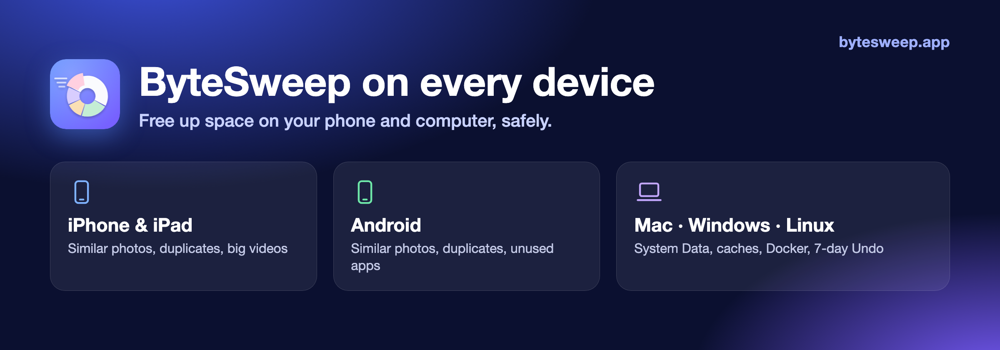

<p align="center">
  <a href="README.md"><strong>English</strong></a> ·
  <a href="README.de.md">Deutsch</a> ·
  <a href="README.es.md">Español</a> ·
  <a href="README.fr.md">Français</a> ·
  <a href="README.it.md">Italiano</a> ·
  <a href="README.nl.md">Nederlands</a> ·
  <a href="README.pl.md">Polski</a> ·
  <a href="README.pt-BR.md">Português (Brasil)</a> ·
  <a href="README.ru.md">Русский</a> ·
  <a href="README.tr.md">Türkçe</a> ·
  <a href="README.ja.md">日本語</a> ·
  <a href="README.ko.md">한국어</a> ·
  <a href="README.zh-Hans.md">简体中文</a> ·
  <a href="README.zh-Hant.md">繁體中文</a>
</p>

<h1 align="center">ByteSweep - CLI</h1>

<p align="center">
  <strong>STORAGE &amp; SYSTEMS MANAGEMENT</strong><br>
  Understand your storage. Manage your systems. Clean with confidence.
</p>

<p align="center">
  Cross-platform tools for storage analysis, safer cleanup, system diagnostics, and server operations.
</p>

<p align="center">
  <a href="https://bytesweep.app/cli"></a>
  <a href="docs/platforms.md"></a>
  <a href="https://github.com/bytesweepcleaner/bytesweep/stargazers"></a>
  <a href="https://bytesweep.app/"></a>
</p>

<p align="center">
  
</p>

---

## Overview

**ByteSweep CLI** (`bsweep`) is a free disk-space analyzer and cleanup tool for Linux, macOS, Windows, BSD, and other Unix-like systems.

It helps answer a practical question: **why is this disk full, and what can be safely reclaimed?**

ByteSweep examines filesystem usage, inodes, Docker storage, system logs, package caches, old kernels, deleted-but-open files, and snapshots. It brings the findings together and explains them in plain language. Before cleanup, it shows the commands it intends to run. Riskier actions require review, and supported file removals can be restored from Undo for seven days.

The CLI is distributed as a static executable. It requires no language runtime and leaves no background agent running. It is free to use on every supported machine, with no licence key or trial.

> **Repository focus:** This repository documents ByteSweep CLI (`bsweep`). ByteSweep is also available as desktop and mobile applications; see [ByteSweep applications](#bytesweep-applications).

## What ByteSweep provides

| Capability | What it helps you do |
|---|---|
| **Storage visibility** | Find large directories, caches, logs, snapshots, inode pressure, and space held by deleted-but-open files. |
| **Controlled cleanup** | Preview cleanup commands, review risky items, use dry runs, and restore supported file removals for seven days. |
| **Docker diagnostics** | Inspect build cache, unused images, stopped containers, and container logs without pruning volumes. |
| **System health** | Review failed services, out-of-memory kills, disk health, certificates, backups, ports, and startup entries. |
| **Server operations** | Inspect and manage multiple hosts over SSH, transfer files, and review fleet status. |
| **Automation and integration** | Use JSON output, exit codes, webhooks, scripts, monitoring, and the MCP server. |

## Designed around visibility and control

ByteSweep is built to make system maintenance reviewable rather than opaque.

- **See the proposed action first.** Cleanup screens show the commands that will be executed.
- **Preview before changing anything.** Use `--dry-run` on supported cleanup commands.
- **Keep a recovery window.** Supported file removals go to a local Undo area for seven days.
- **Protect critical data.** Docker volumes are not pruned. ByteSweep does not remove databases or the running kernel.
- **Keep server changes deliberate.** ByteSweep does not change SSH or firewall settings, and it does not restart the machine automatically.
- **Run without a resident agent.** The CLI is a static executable and does not leave a background process running.

The recovery model has important limits. See [How cleanup and Undo work](#how-cleanup-and-undo-work) before using cleanup commands on production systems.

## Install

### Linux, macOS, and BSD

Install using the official installer:

```sh
curl -fsSL https://bytesweep.app/install-cli.sh | sudo sh
```

Or run the installer directly from this repository:

```sh
curl -fsSL https://raw.githubusercontent.com/bytesweepcleaner/bytesweep/main/install-cli.sh | sudo sh
```

### Windows

Run PowerShell as Administrator:

```powershell
irm https://bytesweep.app/install-cli.ps1 | iex
```

The installers verify signed checksums before installing the executable.

Update an installed CLI with:

```sh
sudo bsweep update
```

For processor and operating-system details, see [Supported platforms](docs/platforms.md).

## Quick start

```sh
sudo bsweep                         # Open the full-screen interface
bsweep why                          # Explain why the disk is full
sudo bsweep rescue                  # Recover a critically full disk, safest actions first
bsweep clean --list                 # List cleanup opportunities by group
sudo bsweep clean --safe --dry-run  # Preview a safe cleanup without applying it
bsweep dupes /srv --dry-run         # Find duplicate files and preview the proposed action
bsweep check                        # Return a status code for monitoring and cron
```

### When a disk reaches 100%

Run the rescue workflow:

```sh
sudo bsweep rescue
```

`bsweep rescue` works through the safest recovery opportunities first and aims to free enough space to make the system usable. It is designed not to write to the full disk while performing the rescue operation.

## Core capabilities

### 1. Storage analysis and diagnostics

ByteSweep looks beyond a simple directory-size scan. It combines filesystem information with system-level sources that can explain why reported disk usage does not add up.

- **Disk overview:** Identify the directories, caches, and logs consuming space.
- **Filesystem and inode usage:** Inspect free bytes and inode availability per filesystem; locate directories containing large numbers of files.
- **Deleted files still held open:** Find deleted files that continue to consume disk space, and identify the process or service holding them.
- **Docker and virtualized environments:** Inspect build cache, unused images, stopped containers, and container logs across supported environments, including Docker, Colima, Lima, Podman, Multipass, Vagrant, minikube, and Android emulators.
- **Snapshots and restore points:** Review storage held by Time Machine, Windows restore points, Timeshift, Snapper, ZFS, Btrfs, and LVM where supported.
- **Reserved and hidden space:** Identify filesystem-reserved space, data outside a partition, and files hidden beneath mount points.
- **Disk growth:** Review what has changed and estimate when a disk may fill at the observed growth rate.
- **Large files and duplicates:** Find large files and identify duplicate content without counting hard links and clones as independent copies.

### 2. Cleanup and recovery

ByteSweep groups cleanup opportunities and shows the intended action before it runs.

- **Package and application data:** Review package-manager caches, old packages, old kernels, unused applications, and application leftovers.
- **Containers:** Review Docker and supported container-runtime data. Docker volumes are never pruned because they may contain databases.
- **System logs:** Vacuum the systemd journal, clear rotated logs, and empty supported large live logs in place so the service can continue writing.
- **Temporary and cached files:** Review temporary files, crash dumps, browser and application caches, old snaps, and other supported cleanup groups.
- **Application and web-project leftovers:** Review old application releases, WordPress caches, Laravel logs, and PHP sessions. The old-release workflow keeps the live release and the three most recent releases.
- **Snapshots:** Inspect supported snapshots and choose which items to remove. ByteSweep does not choose a snapshot on your behalf.
- **Duplicates:** Find copies by content and choose which copy to retain.
- **Tidy and organize:** Review desktop and download-folder clutter, including repeated downloads and old installers. Supported actions move files to Undo. Additional file workflows include organizing, renaming, and converting files, with the proposed action shown first.
- **Compress:** Compress eligible older files where compression saves space, then verify the result before the original is moved to Undo.
- **Archive:** Move older projects to another disk, verify files by checksum, and support bringing archived data back later.
- **Scheduled log maintenance:** Schedule supported log cleanup daily, weekly, or monthly.
- **Prevent recurring growth:** Configure supported journal limits and Docker log limits, record disk usage, and create a tested logrotate rule for logs that are not being rotated.

### 3. System health and security posture

The health and inspection tools surface operational issues without silently changing system configuration.

- **Disk health:** Read available drive-health information and classify drives as Healthy, Worn, or Failing where supported.
- **Service health:** Review failed services, crash loops, and out-of-memory events.
- **Backups:** Check supported tools including restic, Borg, rsnapshot, duplicity, Timeshift, Snapper, vzdump, Time Machine, and Windows Backup; report when a backup last worked or failed. Repository passwords are not required for these checks.
- **Certificates:** Inspect certificates used by nginx, Apache, Caddy, and Let's Encrypt renewal workflows.
- **Ports and listeners:** Identify what is listening on a port and whether it is exposed to the network.
- **Startup entries:** Review systemd, cron, launchd, and Windows services. Supported startup entries can be switched off and restored.
- **Application permissions:** Read recorded camera, microphone, and screen permissions on supported platforms and point to the relevant system setting.
- **Privacy traces:** Review shell and REPL history, recent files, previews, and editor backups. These items are presented for review.
- **Sharing and exposure:** Inspect shared folders, file and screen sharing, SSH, remote desktop, open ports, Docker-published ports, and firewall status.
- **Sleep and wake diagnostics:** Review sleep events, wake sources, and current wake blockers where supported.
- **Updates:** Inspect updates through supported package and system tools, including apt, dnf, zypper, pacman, apk, snap, Flatpak, Homebrew, winget, macOS Software Update, and Windows Update. Security updates are shown first; ByteSweep can report package-lock holders and whether a restart is needed, but it does not restart the system automatically.
- **Process control:** Request that a selected process close, allowing time for it to save. Protected processes such as PID 1, sshd, and the current shell are not stopped through this workflow; services are handled through their service manager.
- **Platform security status:** On macOS and Windows, inspect available information about the firewall, FileVault or BitLocker, SIP, Gatekeeper, and antivirus status. ByteSweep provides guidance and commands; it does not change SSH or firewall settings.

### 4. Server and fleet operations

ByteSweep can work across multiple machines using SSH. Fleet operations do not require a separate ByteSweep installation on every remote host for the fleet inspection workflow.

- **Fleet overview:** Use `bsweep fleet` to inspect multiple hosts over SSH.
- **Server management:** Use `bsweep manage` to review servers from one screen, including live monitoring and supported bulk actions.
- **Remote session:** Use `bsweep connect` to open the ByteSweep interface on a configured host.
- **File transfer:** Use saved host names with `bsweep copy-to` to transfer files without repeatedly entering SSH connection details.
- **Resumable transfer:** Resume interrupted transfers and send only changed data where supported.
- **Sync with review:** Preview sync changes before applying them, resume interrupted transfers where supported, send only changed data where supported, and retain removed files for seven days where the Undo workflow applies. Sync refuses to empty a folder.
- **Container environments:** Inspect supported Podman and Kubernetes node storage through the relevant container tooling.

### 5. Automation, monitoring, and integrations

ByteSweep supports operational workflows that need predictable command output.

- **JSON output:** Use `--json` on supported commands for structured output.
- **Exit codes:** Use `bsweep check` in monitoring, cron, CI, and automation workflows.
- **Webhooks:** Send alerts to destinations configured by the operator.
- **Scripts:** Use command-line options and explicit cleanup modes in scripts.
- **MCP server:** Run `bsweep mcp` to expose ByteSweep tools to compatible Model Context Protocol clients, including Claude, Cursor, and VS Code.
- **Remote workflows:** Combine SSH-based fleet inspection, transfer, and management commands.

See the [CLI reference](docs/cli.md), [recipes](docs/recipes.md), and [MCP documentation](docs/mcp.md) for command details and examples.

## Supported platforms

ByteSweep CLI provides 23 builds across the operating systems and processor architectures listed below. The installer selects the appropriate build for the current system.

| Operating system | Processor architectures | Notes |
|---|---|---|
| **Linux** | x86_64, ARM64, ARMv7, i386, RISC-V 64, ppc64le, s390x, LoongArch64 | Supports distributions including Ubuntu, Debian, Fedora, RHEL, CentOS, AlmaLinux, Rocky Linux, openSUSE, Arch, and Alpine. |
| **macOS** | Apple silicon (ARM64), Intel (x86_64) | macOS 11 Big Sur and later. |
| **Windows** | x64, ARM64, 32-bit (i386) | Windows 10 and 11. |
| **FreeBSD** | x86_64, ARM64 |  |
| **OpenBSD** | x86_64, ARM64 |  |
| **NetBSD** | x86_64, ARM64 |  |
| **DragonFly BSD** | x86_64 |  |
| **Solaris** | x86_64 |  |
| **illumos** | x86_64 |  |
| **AIX** | ppc64 |  |
| **Android (Termux)** | ARM64 | Read-only inspection; Android does not provide root access to the CLI. |

ByteSweep works in common terminal environments, including Terminal, iTerm2, Windows Terminal, PowerShell, GNOME Terminal, Konsole, xterm, the Linux console, tmux, screen, PuTTY, and SSH sessions.

See [platform details](docs/platforms.md) for platform-specific behavior.

## How cleanup and Undo work

ByteSweep distinguishes between file operations that can be staged for recovery and maintenance actions that must be performed through the operating system's own tools.

### File cleanup with Undo

- In the interactive Explore interface, supported file removals are moved to `<disk>/.bytesweep-undo` for seven days.
- A move to the Undo area on the same disk does **not** immediately free disk space. The space is reclaimed when the Undo period ends or when Undo is emptied.
- The interface explains this behavior.

### Immediate removal

- Immediate removal is available for supported commands and does not use Undo.
- Use the explicit `--now` option where supported, or select the immediate-removal action in the interactive interface.
- Immediate removal should be treated as permanent.

### System-tool cleanup

- Operations performed through tools such as `journalctl`, Docker, `apt`, and other package managers cannot be reversed through ByteSweep Undo.
- The confirmation screen lists the commands that will run.

**Operational guidance:** Use `--dry-run` where available, review every proposed command, and understand whether a cleanup action uses Undo before running it on an important system.

## ByteSweep applications

ByteSweep is also available as desktop and mobile applications. The CLI remains free; the applications have their own platform-specific features and trial or purchase terms.

<p align="center">
  <a href="https://bytesweep.app/?ref=github"></a>
</p>

| Platform | Product capabilities | Availability |
|---|---|---|
| **iPhone &amp; iPad** | Find similar photos and duplicates, shrink large videos, and review older items by month. | Free for the first 1 GB and 30 items, then pay once. [App Store](https://apps.apple.com/us/app/bytesweep-storage-cleaner/id6811826959) |
| **Android** | Find similar photos, duplicates, large videos, and unused apps. | Free for the first 1 GB and 30 items, then pay once. [Google Play](https://play.google.com/store/apps/details?id=com.bytesweep.app) |
| **Mac** | Analyze storage usage, including System Data, Docker, and Xcode, with a seven-day Undo for supported removals. | Free to try for three days. Available through [direct download](https://bytesweep.app/mac.html?ref=github) and the [Mac App Store](https://apps.apple.com/us/app/bytesweep-storage-transfer/id6822710125?mt=12). |
| **Windows** | Clean supported Windows Update leftovers, temporary files, browser caches, and game caches, with a seven-day Undo for supported removals. | Free to try for three days. [Microsoft Store](https://apps.microsoft.com/detail/9N7WMJS8QCQX) |
| **Linux** | Clean supported package caches, old snaps, unused Flatpak runtimes, and system journal data; find duplicates and large files. | Free to try for three days. [Download for Linux](https://bytesweep.app/linux.html?ref=github) |

For product details and downloads, visit [bytesweep.app](https://bytesweep.app/).

## Privacy

### ByteSweep CLI

The CLI does not require an account and does not include analytics. Information about the system and its files stays on the machine during local use.

The CLI connects to external services only when the operator requests an action that needs a connection, such as:

- `bsweep update` to download an update from `bytesweep.app` and verify its signature;
- sending alerts to destinations configured by the operator;
- SSH-based fleet, copy, and sync operations initiated by the operator.

## Documentation

| Resource | Description |
|---|---|
| [CLI command reference](docs/cli.md) | Commands, options, and exit codes. |
| [Platform support](docs/platforms.md) | Operating-system and processor support, including platform-specific differences. |
| [Recipes and automation](docs/recipes.md) | Examples for cron, Ansible, CI, and fleet workflows. |
| [File transfer](docs/transfer.md) | Host configuration, remote copy, and sync workflows. |
| [MCP integration](docs/mcp.md) | Connect ByteSweep to compatible MCP clients. |
| [Product website](https://bytesweep.app/) | ByteSweep products and downloads. |

## Frequently asked questions

### How do I find out what is using disk space on Linux?

Run `bsweep why` for a concise explanation, or launch `sudo bsweep` and use Explore to inspect directories from largest to smallest. ByteSweep can also report usage that a directory walk may not account for, including deleted files held open, Docker data, snapshots, and reserved space.

### Why does `df` report more usage than `du`?

A process may still hold a deleted file open. The Held view identifies the file and the process or service holding it.

### Why does a system report “No space left on device” when bytes are available?

The filesystem may have run out of inodes. ByteSweep displays inode usage per filesystem and can help locate directories containing large numbers of small files.

### How can I inspect Docker disk usage safely?

Use:

```sh
bsweep clean --list --group containers
```

This lists supported cleanup opportunities such as build cache, unused images, stopped containers, and container logs. **Docker volumes are not pruned.**

### Can I use ByteSweep on a production server?

ByteSweep includes review and dry-run workflows, runs scans at low CPU and idle disk priority, and does not remove databases, Docker volumes, or the running kernel. However, not every operation is reversible: system-tool cleanup and immediate removal do not use the seven-day Undo workflow. Review the exact commands and recovery behavior before applying changes on production systems.

### Does ByteSweep CLI require an account or licence?

No. ByteSweep CLI is free, with no account, licence key, or trial.

### Does ByteSweep run a background service?

No. The CLI is distributed as a static executable and does not leave a resident agent running.

## Contributing and support

For command usage and platform behavior, start with the [documentation](#documentation). Product information and application downloads are available at [bytesweep.app](https://bytesweep.app/).

---

<p align="center">
  <strong>ByteSweep</strong><br>
  <sub>Storage Management Toolkit</sub><br>
  <a href="https://bytesweep.app/">bytesweep.app</a>
</p>
