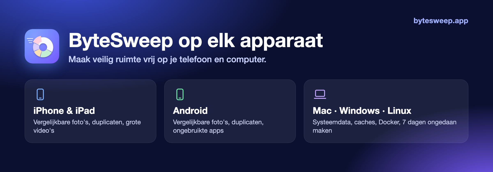

<p align="center">
  <a href="README.md">English</a> ·
  <a href="README.de.md">Deutsch</a> ·
  <a href="README.es.md">Español</a> ·
  <a href="README.fr.md">Français</a> ·
  <a href="README.it.md">Italiano</a> ·
  <b>Nederlands</b> ·
  <a href="README.pl.md">Polski</a> ·
  <a href="README.pt-BR.md">Português (Brasil)</a> ·
  <a href="README.ru.md">Русский</a> ·
  <a href="README.tr.md">Türkçe</a> ·
  <a href="README.ja.md">日本語</a> ·
  <a href="README.ko.md">한국어</a> ·
  <a href="README.zh-Hans.md">简体中文</a> ·
  <a href="README.zh-Hant.md">繁體中文</a>
</p>

<h1 align="center">ByteSweep CLI: schijfruimte analyseren en opruimen op Linux, Mac en Windows</h1>

<p align="center">
  <b>Waarom is mijn schijf vol? Zoek het uit en maak veilig schijfruimte vrij, in elke terminal.</b><br>
  Een gratis tool om schijfruimte te analyseren en op te schonen, voor Linux-servers, Mac, Windows en de BSD's.
</p>

<p align="center">
  <a href="https://bytesweep.app/cli"></a>
  <a href="docs/platforms.md"></a>
  <a href="https://github.com/bytesweepcleaner/bytesweep/stargazers"></a>
</p>

<p align="center">
  
</p>

ByteSweep CLI (`bsweep`) vertelt je **waarom een schijf vol is** en maakt de ruimte vrij **zonder iets kapot te maken**.
Het leest `df`, `du`, Docker, het systemd-journal, pakketcaches, oude kernels, verwijderde bestanden die nog
open staan, inodes en snapshots, en legt het antwoord in gewone taal uit. Elke opschoning toont eerst het exacte
commando, de riskante wachten tot je ze bekeken hebt, en bestanden die je verwijdert gaan 7 dagen naar Undo (ongedaan maken).

Het is één statisch bestand: geen runtime, geen agent, niets dat op de achtergrond blijft draaien. **Gratis:
elk commando, op elke machine, zonder licentie, sleutel of proefperiode.**

## Functies

- **Waarom de schijf vol is, in één antwoord.** `bsweep why` noemt de mappen, caches en logs die de ruimte innemen, en het gat dat `du` niet ziet.
- **"No space left on device" terwijl er nog bytes vrij zijn.** Inodes per schijf, en de mappen met de meeste bestanden.
- **`df` en `du` zijn het oneens.** Het Held-scherm toont verwijderde bestanden die nog open worden gehouden, en de service die elk ervan vasthoudt.
- **Docker-schijfgebruik.** Build-cache, ongebruikte images, gestopte containers en containerlogs; volumes worden nooit met prune opgeruimd.
- **Logs.** Het systemd-journal inkrimpen (vacuum), geroteerde logs wissen, enorme actieve logs ter plekke leegmaken; plan het dagelijks, wekelijks of maandelijks.
- **Een volle schijf, nu meteen.** `bsweep rescue` maakt net genoeg vrij, het veiligste eerst, en schrijft niets naar de volle schijf.
- **Veilig door ontwerp.** Exacte commando's worden eerst getoond, overal `--dry-run`, Undo voor 7 dagen, nooit je databases of de draaiende kernel.
- **Duplicaten, grote bestanden, comprimeren en archiveren.** Kopieën op inhoud vinden, oude logs gzippen, oude projecten naar een andere schijf verplaatsen en weer terugzetten.
- **Gezondheid, updates, poorten en opstarten.** Mislukte services, out-of-memory-kills, stervende schijven, verlopen certificaten, back-ups die gestopt zijn, wat er op elke poort luistert.
- **Veel servers.** `bsweep fleet` via SSH zonder iets te installeren, `bsweep manage` voor alle servers op één scherm.
- **AI-assistenten.** `bsweep mcp` is een Model Context Protocol-server voor Claude, Cursor, VS Code en elke MCP-client.
- **Scripts en monitoring.** `--json` bij bijna elk commando, exitcodes voor `bsweep check`, webhooks.

## Installeren

Linux, macOS en de BSD's:

```sh
curl -fsSL https://bytesweep.app/install-cli.sh | sudo sh
```

Of voer hetzelfde script direct vanaf GitHub uit:

```sh
curl -fsSL https://raw.githubusercontent.com/bytesweepcleaner/bytesweep/main/install-cli.sh | sudo sh
```

Windows (PowerShell als administrator):

```powershell
irm https://bytesweep.app/install-cli.ps1 | iex
```

Beide controleren de ondertekende checksums voordat er iets geïnstalleerd wordt.

`sudo bsweep update` haalt de volgende release op. Alle systemen en processors: [docs/platforms.md](docs/platforms.md).

## Ondersteunde systemen

Eén statisch `bsweep`-bestand per systeem en processor: 23 builds in totaal. De installatieregel kiest de juiste.

| Systeem | Processors | Versies |
|---|---|---|
| **Linux** | x86_64, ARM64, ARMv7, i386, RISC-V 64, ppc64le, s390x, LoongArch64 | Elke distributie: Ubuntu, Debian, Fedora, RHEL, CentOS, AlmaLinux, Rocky Linux, openSUSE, Arch, Alpine en meer |
| **Mac** | Apple silicon (ARM64), Intel (x86_64) | macOS 11 Big Sur en nieuwer |
| **Windows** | x64, ARM64, 32-bit (i386) | Windows 10 en 11 |
| **FreeBSD** | x86_64, ARM64 |  |
| **OpenBSD** | x86_64, ARM64 |  |
| **NetBSD** | x86_64, ARM64 |  |
| **DragonFly BSD** | x86_64 |  |
| **Solaris** | x86_64 |  |
| **illumos** | x86_64 |  |
| **AIX** | ppc64 |  |
| **Android** (Termux) | ARM64 | Linux-ARM64-build in Termux; alleen bekijken, want Android geeft geen root |

Werkt in elke terminal: Terminal, iTerm2, Windows Terminal, PowerShell, GNOME Terminal, Konsole, xterm, de Linux-console, tmux, screen, PuTTY en via SSH. Wat per systeem verschilt: [docs/platforms.md](docs/platforms.md).

## Snel aan de slag

```sh
sudo bsweep                        # de app op volledig scherm
bsweep why                         # één antwoord: waarom deze schijf vol is
sudo bsweep rescue                 # schijf op 100%: net genoeg vrijmaken, veiligste eerst
bsweep clean --list                # alles wat weg kan, per groep
sudo bsweep clean --safe --dry-run # wat een veilige opschoning zou doen, zonder het te doen
bsweep dupes /srv --dry-run        # dubbele bestanden, en welke kopie blijft
bsweep check                       # exitcode voor monitoring en cron
```

## ByteSweep voor je telefoon en computer

<p align="center">
  <a href="https://bytesweep.app/?ref=github"></a>
</p>

<p align="center">
  <a href="https://apps.apple.com/us/app/bytesweep-storage-cleaner/id6811826959"></a>
  <a href="https://play.google.com/store/apps/details?id=com.bytesweep.app"></a>
  <a href="https://apps.microsoft.com/detail/9N7WMJS8QCQX"></a>
  <a href="https://bytesweep.app/mac.html?ref=github"></a>
  <a href="https://bytesweep.app/linux.html?ref=github"></a>
</p>

De CLI is gratis en blijft dat. Voor de telefoon in je zak en de computer op je bureau zijn er de ByteSweep-apps, met dezelfde regel: je ziet alles voordat het weggaat.

<table>
  <tr>
    <td><b>iPhone &amp; iPad</b></td>
    <td>Vindt vergelijkbare foto's en duplicaten, verkleint grote video's en laat je door oude maanden swipen. Gratis voor je eerste 1 GB en 30 items, daarna één keer betalen.</td>
    <td><a href="https://apps.apple.com/us/app/bytesweep-storage-cleaner/id6811826959"></a></td>
  </tr>
  <tr>
    <td><b>Android</b></td>
    <td>Vindt vergelijkbare foto's, duplicaten, grote video's en ongebruikte apps. Gratis voor je eerste 1 GB en 30 items, daarna één keer betalen, geen abonnement.</td>
    <td><a href="https://play.google.com/store/apps/details?id=com.bytesweep.app"></a></td>
  </tr>
  <tr>
    <td><b>Mac</b></td>
    <td>Vindt wat je Mac vult, van Systeemdata tot Docker en Xcode, met 7 dagen ongedaan maken voor wat terug kan. 3 dagen gratis proberen. Ook in de Mac App Store.</td>
    <td><a href="https://bytesweep.app/mac.html?ref=github"></a><br><a href="https://apps.apple.com/us/app/bytesweep-storage-transfer/id6822710125?mt=12"></a></td>
  </tr>
  <tr>
    <td><b>Windows</b></td>
    <td>Ruimt restanten van Windows Update, tijdelijke bestanden en browser- en gamecaches op, met 7 dagen ongedaan maken voor wat terug kan. 3 dagen gratis proberen.</td>
    <td><a href="https://apps.microsoft.com/detail/9N7WMJS8QCQX"></a></td>
  </tr>
  <tr>
    <td><b>Linux</b></td>
    <td>Leegt de caches van apt, dnf en pacman, oude snaps, ongebruikte Flatpak-runtimes en het journal, en vindt duplicaten en grote bestanden. 3 dagen gratis proberen.</td>
    <td><a href="https://bytesweep.app/linux.html?ref=github"></a></td>
  </tr>
</table>

## Schijf vol op je Linux-server: elk probleem dat het oplost

| Probleem op een echte server | Wat ByteSweep doet |
|---|---|
| `df` zegt vol, `du` is het oneens | Held-tab: verwijderde bestanden die nog open staan, en wie ze vasthoudt. Overview (overzicht) noemt elk gat dat een scan niet ziet |
| "No space left" terwijl er bytes vrij zijn | Inodes per schijf, Explore sorteert op aantal bestanden (`i`) |
| Docker heeft de schijf opgevreten | Build-cache, ongetagde en ongebruikte images, gestopte containers, containerlogs die `docker system df` niet toont; elke VM (Colima, Lima, Podman, Multipass, Vagrant, minikube, Android-emulators...) bij naam, met de ruimte die hij kan teruggeven |
| Een blinde prune verwijderde een database | Volumes worden nooit met prune opgeruimd. Databases en /var/lib/docker kunnen ook niet met de hand worden opgeschoond |
| Journal, geroteerde logs, enorme actieve logs | Vacuum via journalctl; actieve logs worden ter plekke geleegd, zodat services blijven schrijven |
| /boot vol, upgrades mislukken | Oude kernels, nooit de draaiende |
| Pakket- en taalcaches, oude snaps, crashdumps, oude /tmp | Elk via een eigen tool; het exacte commando wordt eerst getoond |
| Het abonnement is opgewaardeerd, de schijf niet | Vindt schijfruimte buiten elke partitie |
| De verborgen 5% van ext4 | Noemt de gereserveerde ruimte en de tune2fs-regel |
| Volgende maand is hij weer vol | Prevent-tab: journallimiet, Docker-loglimiet, dagelijkse registratie |
| "Wat is er vannacht veranderd?" | Wat er gegroeid is, en wanneer de schijf in dit tempo vol is |
| De scan vertraagt productie | Draait met lage CPU-prioriteit en idle-schijfprioriteit; blijft op één schijf |
| Schijf op 100% en alles faalt | `bsweep rescue` of `R`: maakt net genoeg vrij, veiligste eerst, en noemt daarna de services die gestopt zijn. Schrijft niets naar de volle schijf |
| Podman- of Kubernetes-nodes | Dezelfde opschoning via podman en crictl; volumes blijven onaangeroerd |
| Snapshots die ruimte vasthouden | `bsweep snapshots`: Time Machine, herstelpunten, schaduwkopieën, Timeshift, Snapper, ZFS, Btrfs en LVM, met groottes waar de tool die kan geven. Verwijdert alleen wat je kiest en houdt van elk de nieuwste |
| Bestanden verborgen onder een mount | Kijkt onder elke mount via een alleen-lezen bind-mount en laat zien hoe je erbij komt |
| Oude deploys en restanten van webapps | Oude releases (houdt de actieve + 3), WordPress-cache, Laravel-logs, PHP-sessies |
| Logs moeten regelmatig gewist worden | `bsweep logs clear`, of `bsweep schedule logs` dagelijks, wekelijks of maandelijks |
| Een log dat door niets wordt geroteerd | Prevent schrijft een logrotate-regel, getest voordat hij blijft staan |
| Oude projecten vullen een drukke schijf | `bsweep archive /srv/old --to /mnt/backup`: naar een andere schijf, elk bestand gecontroleerd met een checksum, daarna vrijgemaakt; `where` werkt ook als die schijf losgekoppeld is, `bring-back` zet het terug |
| Oude logs en dumps nemen ruimte in | `bsweep compress /var/log --older 30d`: gzip waar het iets bespaart, teruggelezen voordat het origineel naar Undo gaat; actieve logs blijven |
| Dezelfde bestanden, drie keer | `bsweep dupes`: kopieën op inhoud, hardlinks en klonen één keer geteld; houd er één, de rest naar Undo |
| Downloads vol oude installers en "(1)"-kopieën | `bsweep tidy`: de regels van de desktop-app, elk bestand naar Undo; `organize`, `rename` en `convert` voor de rest, elk eerst getoond en ongedaan te maken |
| "Wat draait er op poort 3000?" | `bsweep ports`: programma, project of container, open voor het netwerk of niet; stop een dev-project in één keer |
| Welk pakket is enorm, en wat lieten verwijderde apps achter? | `bsweep apps`: elk pakket en elke app, grootste eerst; verwijderen via apt, dnf, pacman, snap, flatpak of brew na hun eigen dry run; nooit wat het systeem nodig heeft |
| Chat-apps die stilletjes de schijf vullen | Groep Chats and Mail: caches van Slack, Teams, Discord, Element en Thunderbird om te beoordelen; Telegram-bestanden en Zoom-opnames alleen één voor één, naar Undo |
| Welke apps mogen de camera, microfoon of het scherm gebruiken? | `bsweep permissions`: toegestaan en geweigerd, laatst gebruikt en nu in gebruik waar het systeem dat bijhoudt (macOS TCC, privacyinstellingen van Windows, Flatpak, Snap, geopende apparaten); leest alleen, zegt waar je elk ervan uitzet |
| Opdrachtgeschiedenis en andere sporen | Groep Privacy traces (privacysporen): shell- en REPL-geschiedenis, recente bestanden, voorvertoningen, back-ups van de editor; altijd om te beoordelen, elk naar Undo |
| Updates die klaarstaan, en is een herstart nodig? | `bsweep updates`: beveiligingsupdates eerst, via apt, dnf, zypper, pacman, apk, snap, flatpak, Homebrew, winget, Software Update van macOS of Windows Update; noemt wie een bezette pakketvergrendeling vasthoudt; herstart nooit uit zichzelf |
| Een programma dat niet wil afsluiten | `bsweep stop PID\|NAME`, of `s` op Live: vraagt het om te sluiten, 10 seconden om op te slaan; nooit sshd, PID 1 of je eigen shell, en voor een service krijg je in plaats daarvan het `systemctl`-commando |
| "Waarom werd hij om 3 uur 's nachts wakker?" | `bsweep sleep`: elke slaapstand en wat hem wekte (deksel, USB, Bluetooth, netwerk, een timer), wat hem nu wakker houdt, geplande wekmomenten; alleen advies, er wordt geen energie-instelling gewijzigd. Een server die nooit slaapt, zegt dat ook |
| "Wat kunnen anderen zien?" | `bsweep sharesafe`: gedeelde mappen (gasttoegang? mogen ze bestanden wijzigen?), bestands- en schermdeling, SSH, extern bureaublad, open poorten, gepubliceerde poorten van Docker, de firewall; voor elk een risico en waar je het uitzet. Leest alleen |
| Wat start vanzelf op, en wat is mislukt? | `bsweep startup`: systemd, cron @reboot, launchd, Windows-services; die van het systeem zelf alleen met `--all`; precies uit- en weer aanzetten |
| Service 's nachts gecrasht | Health-tab: out-of-memory-kills, mislukte services, crashloops |
| Een schijf die op het punt staat te sterven | `bsweep drives`: elke fysieke schijf als Healthy, Worn of Failing, en waarom, in gewone taal; `check` en Health waarschuwen ook. Leest alleen |
| "Draaien de back-ups eigenlijk wel?" | Health noemt de tool (restic, borg, rsnapshot, duplicity, Timeshift, Snapper, vzdump, Time Machine, Windows Backup) en wanneer die voor het laatst werkte of faalde. Geen repositorywachtwoord nodig |
| Certificaat onverwacht verlopen | Leest certificaten van nginx, Apache, Caddy en Let's Encrypt; signaleert een kapotte vernieuwing |
| Updates, SSH, firewall, back-ups | Health leest op macOS en Windows ook de firewall, FileVault of BitLocker, SIP en Gatekeeper of de antivirus. Advies met exacte commando's. ByteSweep verandert SSH of firewalls niet: zo sluiten mensen zichzelf buiten |
| Veel servers | `bsweep fleet`: één tabel via SSH, niets geïnstalleerd |
| Bestanden verplaatsen zonder scp-syntax | Sla een host één keer op, daarna `bsweep copy-to office ./site /srv/site` |
| Een afgebroken overdracht begint opnieuw | Gaat verder waar hij stopte en stuurt alleen wat veranderd is |
| Een sync wist de verkeerde map | Toont eerst de wijzigingen, bewaart verwijderde bestanden 7 dagen, weigert een map leeg te maken |
| Een server bekijken vanaf je laptop | `bsweep connect office` opent daar de volledige app |
| Te veel servers om bij te houden | `bsweep manage`: alle servers op één scherm, met live Monitor en bulkacties |
| Onderdeel van een monitoringopzet | `bsweep check`-exitcodes, webhook, `report --json`, `clean --safe --yes` |

Elk commando en elke exitcode: [docs/cli.md](docs/cli.md). Voorbeelden voor cron, Ansible, CI en fleet: [docs/recipes.md](docs/recipes.md).

## Hoe Clean en Undo werken

- **Clean** (opschonen) in Explore verplaatst het bestand 7 dagen naar `<disk>/.bytesweep-undo`. Verplaatsen op
  dezelfde schijf maakt niets vrij, dus de ruimte komt pas terug als Undo afloopt. Dat staat ook op het scherm.
- **Remove now** (nu verwijderen) geeft de ruimte meteen terug, zonder Undo: `F` in de vraag van de app, `--now` bij
  elk commando dat Undo zou gebruiken (rm, dupes, clean, apps, tidy, compress). Dat is de juiste keuze
  bij een schijf op 100%. `bsweep undo free --all` maakt Undo zelf leeg.
- Opschoningen volgens regels lopen via journalctl, docker, apt en dergelijke, en kunnen niet ongedaan worden gemaakt. Het
  bevestigingsscherm toont elk commando.

## Hosts, overdracht en sync

Stel een host één keer in in `bsweep.yml` (`bsweep init`, daarna `bsweep host add`) en gebruik vanaf dan de korte naam,
vanaf een server of vanaf de opdrachtregel op een Mac of Windows. Zie [docs/transfer.md](docs/transfer.md).

## AI-assistenten (MCP)

Met `bsweep mcp` kunnen Claude Desktop, Claude Code, Cursor, VS Code en andere MCP-clients een machine bekijken
en helpen die op te schonen, met dezelfde regels als op de opdrachtregel. Zie [docs/mcp.md](docs/mcp.md).

## Veelgestelde vragen (FAQ)

**Hoe zie ik wat er schijfruimte inneemt op Linux?**
Voer `bsweep why` uit voor een antwoord op één scherm, of `sudo bsweep` en open Explore om door de mappen te lopen,
grootste eerst. Het telt ook wat je bij het doorlopen van mappen niet ziet: verwijderde bestanden die nog open staan, Docker, snapshots en gereserveerde ruimte.

**Waarom zegt `df` dat de schijf vol is terwijl `du` op minder uitkomt?**
Meestal houdt een programma nog een verwijderd bestand open, vaak een log. Het Held-scherm toont elk ervan en de
service die het vasthoudt, en maakt een vastgehouden log ter plekke leeg zodat de service blijft schrijven.

**Hoe los ik "No space left on device" (geen ruimte meer op het apparaat) op als `df` vrije ruimte toont?**
De schijf heeft geen inodes meer: te veel kleine bestanden. ByteSweep toont inodes per schijf, en Explore sorteert op
aantal bestanden (`i`) om de map te vinden waar ze in staan.

**Hoe maak ik veilig Docker-schijfruimte vrij?**
`bsweep clean --list --group containers` toont build-cache, ongebruikte images, gestopte containers en
containerlogs. Volumes worden nooit met prune opgeruimd, omdat een volume een database kan zijn.

**De schijf van mijn server staat op 100%. Wat nu?**
`sudo bsweep rescue`, of `R` in de app. Het maakt net genoeg vrij, veiligste eerst, schrijft niets naar de volle
schijf, en noemt daarna de services die gestopt zijn.

**Is het veilig om te draaien op een productieserver?**
Elke opschoning toont eerst het exacte commando, `--dry-run` laat alles vooraf zien, verwijderde bestanden wachten 7 dagen in Undo,
en scans draaien met lage CPU-prioriteit en idle-schijfprioriteit. Het verwijdert nooit databases, Docker-volumes
of de draaiende kernel, kiest nooit een snapshot voor je, en verandert nooit SSH- of firewallinstellingen.

**Is het gratis? Stuurt het ergens gegevens naartoe?**
Gratis, zonder account, analytics of proefperiode. Het gaat alleen online als je daarom vraagt:
`bsweep update`, meldingen naar de plekken die je toevoegt, en SSH voor fleet, copy en sync.

## Privacy

Geen analytics en geen account. Niets over jou of je bestanden verlaat de machine. bsweep gaat alleen
online als je daarom vraagt: `bsweep update` downloadt van bytesweep.app (en controleert eerst de
handtekening), meldingen gaan alleen naar de plekken die je toevoegt, en fleet, copy en sync gebruiken je eigen SSH.

---

ByteSweep is er ook als desktop-app voor Mac, Windows en Linux: [bytesweep.app](https://bytesweep.app/?ref=github)
