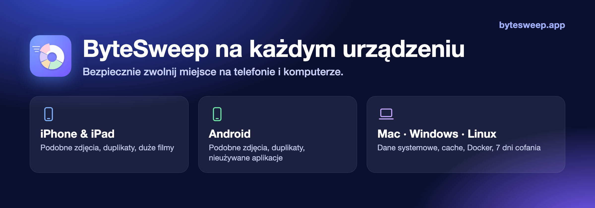

<p align="center">
  <a href="README.md">English</a> ·
  <a href="README.de.md">Deutsch</a> ·
  <a href="README.es.md">Español</a> ·
  <a href="README.fr.md">Français</a> ·
  <a href="README.it.md">Italiano</a> ·
  <a href="README.nl.md">Nederlands</a> ·
  <b>Polski</b> ·
  <a href="README.pt-BR.md">Português (Brasil)</a> ·
  <a href="README.ru.md">Русский</a> ·
  <a href="README.tr.md">Türkçe</a> ·
  <a href="README.ja.md">日本語</a> ·
  <a href="README.ko.md">한국어</a> ·
  <a href="README.zh-Hans.md">简体中文</a> ·
  <a href="README.zh-Hant.md">繁體中文</a>
</p>

<h1 align="center">ByteSweep CLI: analiza i czyszczenie miejsca na dysku na Linuksie, Macu i Windowsie</h1>

<p align="center">
  <b>Dlaczego dysk jest pełny? Sprawdź to i bezpiecznie zwolnij miejsce na dysku, w dowolnym terminalu.</b><br>
  Darmowy program do analizy i czyszczenia miejsca na dysku dla serwerów Linux, Maca, Windows i systemów BSD.
</p>

<p align="center">
  <a href="https://bytesweep.app/cli"></a>
  <a href="docs/platforms.md"></a>
  <a href="https://github.com/bytesweepcleaner/bytesweep/stargazers"></a>
</p>

<p align="center">
  
</p>

ByteSweep CLI (`bsweep`) mówi ci, **dlaczego dysk jest pełny**, i zwalnia miejsce **niczego nie psując**.
Odczytuje `df`, `du`, Dockera, dziennik systemd, cache pakietów, stare jądra, usunięte pliki, które wciąż
są otwarte, i-węzły (inodes) i snapshoty, a odpowiedź wyjaśnia prostymi słowami. Każde czyszczenie najpierw pokazuje
dokładne polecenie, ryzykowne czekają, aż je przejrzysz, a usunięte pliki trafiają na 7 dni do Undo (cofnij).

To jeden statyczny plik: bez środowiska uruchomieniowego, bez agenta, nic nie zostaje uruchomione w tle. **Darmowy:
każde polecenie, na każdej maszynie, bez licencji, klucza i okresu próbnego.**

## Funkcje

- **Dlaczego dysk jest pełny – w jednej odpowiedzi.** `bsweep why` wskazuje foldery, cache i logi, które zajmują miejsce, oraz lukę, której `du` nie widzi.
- **"No space left on device" mimo wolnych bajtów.** I-węzły na każdym dysku i foldery z największą liczbą plików.
- **`df` i `du` pokazują co innego.** Ekran Held wymienia usunięte pliki, które wciąż są otwarte, oraz usługę, która trzyma każdy z nich.
- **Miejsce zajęte przez Dockera.** Cache budowania, nieużywane obrazy, zatrzymane kontenery i logi kontenerów; woluminy nigdy nie są czyszczone przez prune.
- **Logi.** Zmniejszanie dziennika systemd (vacuum), usuwanie zrotowanych logów, opróżnianie ogromnych aktywnych logów w miejscu; z harmonogramem codziennym, cotygodniowym lub comiesięcznym.
- **Pełny dysk – teraz.** `bsweep rescue` zwalnia tylko tyle, ile trzeba, zaczynając od najbezpieczniejszego, i nic nie zapisuje na pełnym dysku.
- **Bezpieczny z założenia.** Dokładne polecenia pokazane najpierw, `--dry-run` wszędzie, Undo przez 7 dni, nigdy twoje bazy danych ani działające jądro.
- **Duplikaty, duże pliki, kompresja i archiwizacja.** Znajdowanie kopii po zawartości, pakowanie starych logów gzipem, przenoszenie starych projektów na inny dysk i ich przywracanie.
- **Stan systemu, aktualizacje, porty i autostart.** Usługi, które padły, procesy zabite z braku pamięci (OOM), umierające dyski, wygasłe certyfikaty, kopie zapasowe, które przestały działać, oraz co nasłuchuje na każdym porcie.
- **Wiele serwerów.** `bsweep fleet` przez SSH bez instalowania czegokolwiek, `bsweep manage` – wszystkie serwery na jednym ekranie.
- **Asystenci AI.** `bsweep mcp` to serwer Model Context Protocol dla Claude, Cursor, VS Code i każdego klienta MCP.
- **Skrypty i monitoring.** `--json` przy prawie każdym poleceniu, kody wyjścia dla `bsweep check`, webhooki.

## Instalacja

Linux, macOS i systemy BSD:

```sh
curl -fsSL https://bytesweep.app/install-cli.sh | sudo sh
```

Albo uruchom ten sam skrypt prosto z GitHuba:

```sh
curl -fsSL https://raw.githubusercontent.com/bytesweepcleaner/bytesweep/main/install-cli.sh | sudo sh
```

Windows (PowerShell jako administrator):

```powershell
irm https://bytesweep.app/install-cli.ps1 | iex
```

Oba skrypty sprawdzają podpisane sumy kontrolne, zanim cokolwiek zostanie zainstalowane.

`sudo bsweep update` pobiera kolejne wydanie. Wszystkie systemy i procesory: [docs/platforms.md](docs/platforms.md).

## Obsługiwane systemy

Jeden statyczny plik `bsweep` dla każdego systemu i procesora: łącznie 23 wersje. Polecenie instalacji wybiera właściwą.

| System | Procesory | Wersje |
|---|---|---|
| **Linux** | x86_64, ARM64, ARMv7, i386, RISC-V 64, ppc64le, s390x, LoongArch64 | Każda dystrybucja: Ubuntu, Debian, Fedora, RHEL, CentOS, AlmaLinux, Rocky Linux, openSUSE, Arch, Alpine i inne |
| **Mac** | Apple silicon (ARM64), Intel (x86_64) | macOS 11 Big Sur i nowsze |
| **Windows** | x64, ARM64, 32-bitowy (i386) | Windows 10 i 11 |
| **FreeBSD** | x86_64, ARM64 |  |
| **OpenBSD** | x86_64, ARM64 |  |
| **NetBSD** | x86_64, ARM64 |  |
| **DragonFly BSD** | x86_64 |  |
| **Solaris** | x86_64 |  |
| **illumos** | x86_64 |  |
| **AIX** | ppc64 |  |
| **Android** (Termux) | ARM64 | Wersja Linux ARM64 w Termux; tylko podgląd, bo Android nie daje uprawnień roota |

Działa w każdym terminalu: Terminal, iTerm2, Windows Terminal, PowerShell, GNOME Terminal, Konsole, xterm, konsola Linuksa, tmux, screen, PuTTY i przez SSH. Czym różnią się systemy: [docs/platforms.md](docs/platforms.md).

## Szybki start

```sh
sudo bsweep                        # aplikacja pełnoekranowa
bsweep why                         # jedna odpowiedź: dlaczego ten dysk jest pełny
sudo bsweep rescue                 # dysk w 100%: zwolnij tylko tyle, ile trzeba, najbezpieczniejsze najpierw
bsweep clean --list                # wszystko, co można usunąć, według grup
sudo bsweep clean --safe --dry-run # co zrobiłoby bezpieczne czyszczenie, bez wykonywania go
bsweep dupes /srv --dry-run        # zduplikowane pliki i która kopia zostanie
bsweep check                       # kod wyjścia dla monitoringu i crona
```

## ByteSweep na telefon i komputer

<p align="center">
  <a href="https://bytesweep.app/?ref=github"></a>
</p>

<p align="center">
  <a href="https://apps.apple.com/us/app/bytesweep-storage-cleaner/id6811826959"></a>
  <a href="https://play.google.com/store/apps/details?id=com.bytesweep.app"></a>
  <a href="https://apps.microsoft.com/detail/9N7WMJS8QCQX"></a>
  <a href="https://bytesweep.app/mac.html?ref=github"></a>
  <a href="https://bytesweep.app/linux.html?ref=github"></a>
</p>

CLI jest darmowe i takie zostanie. Na telefon w kieszeni i komputer na biurku są aplikacje ByteSweep, z tą samą zasadą: widzisz wszystko, zanim cokolwiek zniknie.

<table>
  <tr>
    <td><b>iPhone &amp; iPad</b></td>
    <td>Znajduje podobne zdjęcia i duplikaty, zmniejsza duże filmy i pozwala przeglądać stare miesiące jednym przesunięciem. Za darmo dla pierwszego 1 GB i 30 elementów, potem płacisz raz.</td>
    <td><a href="https://apps.apple.com/us/app/bytesweep-storage-cleaner/id6811826959"></a></td>
  </tr>
  <tr>
    <td><b>Android</b></td>
    <td>Znajduje podobne zdjęcia, duplikaty, duże filmy i nieużywane aplikacje. Za darmo dla pierwszego 1 GB i 30 elementów, potem płacisz raz, bez subskrypcji.</td>
    <td><a href="https://play.google.com/store/apps/details?id=com.bytesweep.app"></a></td>
  </tr>
  <tr>
    <td><b>Mac</b></td>
    <td>Znajduje to, co zapełnia Twojego Maca, od Danych systemowych po Dockera i Xcode, z 7 dniami cofania dla tego, co da się przywrócić. 3 dni za darmo. Także w Mac App Store.</td>
    <td><a href="https://bytesweep.app/mac.html?ref=github"></a><br><a href="https://apps.apple.com/us/app/bytesweep-storage-transfer/id6822710125?mt=12"></a></td>
  </tr>
  <tr>
    <td><b>Windows</b></td>
    <td>Usuwa pozostałości Windows Update, pliki tymczasowe oraz pamięć podręczną przeglądarek i gier, z 7 dniami cofania dla tego, co da się przywrócić. 3 dni za darmo.</td>
    <td><a href="https://apps.microsoft.com/detail/9N7WMJS8QCQX"></a></td>
  </tr>
  <tr>
    <td><b>Linux</b></td>
    <td>Czyści pamięć podręczną apt, dnf i pacmana, stare snapy, nieużywane środowiska Flatpak i dziennik systemowy oraz znajduje duplikaty i duże pliki. 3 dni za darmo.</td>
    <td><a href="https://bytesweep.app/linux.html?ref=github"></a></td>
  </tr>
</table>

## Brak miejsca na dysku serwera Linux: każdy problem, który rozwiązuje

| Problem na prawdziwym serwerze | Co robi ByteSweep |
|---|---|
| `df` mówi, że pełny, `du` się nie zgadza | Karta Held: usunięte pliki wciąż otwarte i kto je trzyma. Overview (przegląd) wskazuje każdą lukę, której skan nie widzi |
| "No space left" mimo wolnych bajtów | I-węzły na każdym dysku, Explore sortuje według liczby plików (`i`) |
| Docker zjadł dysk | Cache budowania, nieotagowane i nieużywane obrazy, zatrzymane kontenery, logi kontenerów, których `docker system df` nie pokazuje; każda maszyna wirtualna (Colima, Lima, Podman, Multipass, Vagrant, minikube, emulatory Androida...) z nazwy, z miejscem, które może oddać |
| Prune na ślepo usunął bazę danych | Woluminy nigdy nie są czyszczone przez prune. Baz danych i /var/lib/docker nie da się też wyczyścić ręcznie |
| Dziennik, zrotowane logi, ogromne aktywne logi | Vacuum przez journalctl; aktywne logi opróżniane w miejscu, więc usługi dalej do nich piszą |
| Pełny /boot, aktualizacje się nie udają | Stare jądra, nigdy to działające |
| Cache pakietów i języków, stare snapy, zrzuty awarii, stary /tmp | Każde przez własne narzędzie; dokładne polecenie jest pokazywane najpierw |
| Plan został powiększony, dysk nie | Znajduje miejsce na dysku poza wszystkimi partycjami |
| Ukryte 5% w ext4 | Wskazuje zarezerwowane miejsce i linię tune2fs |
| Za miesiąc znów się zapełni | Karta Prevent: limit dziennika, limit logów Dockera, codzienny zapis |
| "Co się zmieniło przez noc?" | Co urosło i kiedy dysk zapełni się w tym tempie |
| Skan spowalnia produkcję | Działa z niskim priorytetem CPU i priorytetem dysku idle; zostaje na jednym dysku |
| Dysk w 100% i wszystko się sypie | `bsweep rescue` lub `R`: zwalnia tylko tyle, ile trzeba, najbezpieczniejsze najpierw, a potem wskazuje usługi, które stanęły. Nic nie zapisuje na pełnym dysku |
| Węzły Podmana lub Kubernetesa | To samo czyszczenie przez podman i crictl; woluminy zostają nietknięte |
| Snapshoty zajmujące miejsce | `bsweep snapshots`: Time Machine, punkty przywracania, kopie w tle (shadow copies), Timeshift, Snapper, ZFS, Btrfs i LVM, z rozmiarami tam, gdzie narzędzie je podaje. Usuwa tylko to, co wybierzesz, i zachowuje najnowszy z każdego rodzaju |
| Pliki ukryte pod punktem montowania | Zagląda pod każdy punkt montowania przez bind tylko do odczytu i pokazuje, jak się do nich dostać |
| Stare wdrożenia i resztki aplikacji webowych | Stare wydania (zachowuje aktywne + 3), cache WordPressa, logi Laravela, sesje PHP |
| Logi trzeba regularnie czyścić | `bsweep logs clear` lub `bsweep schedule logs` codziennie, co tydzień lub co miesiąc |
| Log, którego nic nie rotuje | Prevent zapisuje regułę logrotate, przetestowaną, zanim zostanie na stałe |
| Stare projekty zapełniają obciążony dysk | `bsweep archive /srv/old --to /mnt/backup`: na inny dysk, każdy plik sprawdzony sumą kontrolną, potem zwolniony; `where` działa nawet przy odłączonym dysku, `bring-back` przywraca dane |
| Stare logi i zrzuty zajmują miejsce | `bsweep compress /var/log --older 30d`: gzip tam, gdzie to coś daje, ponownie odczytany, zanim oryginał trafi do Undo; aktywne logi zostają |
| Te same pliki, trzy razy | `bsweep dupes`: kopie po zawartości, twarde dowiązania i klony liczone raz; zachowaj jedną, reszta do Undo |
| Pobrane pełne starych instalatorów i kopii "(1)" | `bsweep tidy`: reguły aplikacji desktopowej, każdy plik do Undo; `organize`, `rename` i `convert` dla reszty, każde pokazane najpierw i do cofnięcia |
| "Co działa na porcie 3000?" | `bsweep ports`: program, projekt lub kontener, otwarty na sieć lub nie; zatrzymanie projektu deweloperskiego jednym ruchem |
| Który pakiet jest ogromny i co zostawiły usunięte aplikacje | `bsweep apps`: każdy pakiet i każda aplikacja, największe najpierw; usuwanie przez apt, dnf, pacman, snap, flatpak lub brew po ich własnym dry run; nigdy to, czego potrzebuje system |
| Komunikatory po cichu zapełniają dysk | Grupa Chats and Mail: cache Slacka, Teams, Discorda, Elementa i Thunderbirda do przejrzenia; pliki Telegrama i nagrania Zooma tylko pojedynczo, do Undo |
| Które aplikacje mogą używać kamery, mikrofonu lub ekranu? | `bsweep permissions`: dozwolone i odrzucone, ostatnio użyte i używane teraz, tam gdzie system to zapisuje (macOS TCC, ustawienia prywatności Windows, Flatpak, Snap, otwarte urządzenia); tylko odczytuje i mówi, gdzie każde z nich wyłączyć |
| Historia poleceń i inne ślady | Grupa Privacy traces (ślady prywatności): historia powłoki i REPL, ostatnie pliki, podglądy, kopie zapasowe edytora; zawsze do przejrzenia, każde do Undo |
| Czekające aktualizacje – i czy potrzebny jest restart? | `bsweep updates`: najpierw poprawki bezpieczeństwa, przez apt, dnf, zypper, pacman, apk, snap, flatpak, Homebrew, winget, Software Update w macOS lub Windows Update; wskazuje, kto trzyma zajętą blokadę pakietów; nigdy nie restartuje sam |
| Program, który nie chce się zamknąć | `bsweep stop PID\|NAME` lub `s` w Live: prosi o zamknięcie, daje 10 sekund na zapisanie; nigdy sshd, PID 1 ani twoja własna powłoka, a dla usługi dostajesz zamiast tego odpowiednie polecenie `systemctl` |
| "Dlaczego obudził się o 3 w nocy?" | `bsweep sleep`: każde uśpienie i co je przerwało (pokrywa, USB, Bluetooth, sieć, timer), co teraz nie pozwala mu zasnąć, zaplanowane wybudzenia; tylko porady, żadne ustawienie zasilania nie jest zmieniane. Serwer, który nigdy nie zasypia, mówi o tym |
| "Co mogą zobaczyć inni?" | `bsweep sharesafe`: udostępnione foldery (dostęp gościa? czy mogą zmieniać pliki?), udostępnianie plików i ekranu, SSH, pulpit zdalny, otwarte porty, opublikowane porty Dockera, zapora; ryzyko dla każdego i gdzie to wyłączyć. Tylko odczytuje |
| Co uruchamia się samo i co się nie powiodło | `bsweep startup`: systemd, cron @reboot, launchd, usługi Windows; systemowe tylko z `--all`; wyłączanie i ponowne włączanie dokładnie tak, jak było |
| Usługa padła w nocy | Karta Health: procesy zabite z braku pamięci (OOM), usługi, które padły, pętle awarii |
| Dysk, który zaraz padnie | `bsweep drives`: każdy fizyczny dysk jako Healthy, Worn lub Failing, i dlaczego, prostymi słowami; `check` i Health też ostrzegają. Tylko odczytuje |
| "Czy kopie zapasowe w ogóle działają?" | Health wskazuje narzędzie (restic, borg, rsnapshot, duplicity, Timeshift, Snapper, vzdump, Time Machine, Windows Backup) i kiedy ostatnio zadziałało lub zawiodło. Hasło do repozytorium nie jest potrzebne |
| Certyfikat niespodziewanie wygasł | Odczytuje certyfikaty nginx, Apache, Caddy i Let's Encrypt; oznacza zepsute odnawianie |
| Aktualizacje, SSH, zapora, kopie zapasowe | Health w macOS i Windows odczytuje też zaporę, FileVault lub BitLocker, SIP i Gatekeeper albo antywirusa. Porady z dokładnymi poleceniami. ByteSweep nie zmienia SSH ani zapór: właśnie tak ludzie odcinają sobie dostęp |
| Wiele serwerów | `bsweep fleet`: jedna tabela przez SSH, nic nie trzeba instalować |
| Przenoszenie plików bez składni scp | Zapisz host raz, potem `bsweep copy-to office ./site /srv/site` |
| Przerwany transfer zaczyna się od nowa | Wznawia tam, gdzie się zatrzymał, i wysyła tylko to, co się zmieniło |
| Synchronizacja kasuje nie ten folder | Najpierw pokazuje zmiany, przechowuje usunięte pliki 7 dni, odmawia opróżnienia folderu |
| Przegląd serwera z laptopa | `bsweep connect office` otwiera na nim pełną aplikację |
| Zbyt wiele serwerów, żeby nad nimi zapanować | `bsweep manage`: wszystkie serwery na jednym ekranie, z Monitorem na żywo i akcjami zbiorczymi |
| Część systemu monitoringu | Kody wyjścia `bsweep check`, webhook, `report --json`, `clean --safe --yes` |

Wszystkie polecenia i kody wyjścia: [docs/cli.md](docs/cli.md). Przykłady dla crona, Ansible, CI i fleet: [docs/recipes.md](docs/recipes.md).

## Jak działają Clean i Undo

- **Clean** (wyczyść) w Explore przenosi plik do `<disk>/.bytesweep-undo` na 7 dni. Przeniesienie w obrębie
  tego samego dysku niczego nie zwalnia, więc miejsce wraca dopiero, gdy Undo wygaśnie. Ekran o tym informuje.
- **Remove now** (usuń teraz) zwalnia miejsce od razu, bez Undo: `F` w pytaniu aplikacji, `--now` przy
  każdym poleceniu, które użyłoby Undo (rm, dupes, clean, apps, tidy, compress). To właściwy wybór
  przy dysku zapełnionym w 100%. `bsweep undo free --all` opróżnia samo Undo.
- Czyszczenia według reguł przechodzą przez journalctl, docker, apt i podobne narzędzia, i nie da się ich cofnąć.
  Ekran potwierdzenia wymienia każde polecenie.

## Hosty, transfer i synchronizacja

Skonfiguruj host raz w `bsweep.yml` (`bsweep init`, potem `bsweep host add`) i od tej pory używaj jego krótkiej nazwy,
z serwera albo z wiersza poleceń na Macu lub w Windows. Zobacz [docs/transfer.md](docs/transfer.md).

## Asystenci AI (MCP)

`bsweep mcp` pozwala Claude Desktop, Claude Code, Cursor, VS Code i innym klientom MCP przejrzeć maszynę
i pomóc ją wyczyścić, według tych samych reguł co wiersz poleceń. Zobacz [docs/mcp.md](docs/mcp.md).

## FAQ – najczęstsze pytania

**Jak sprawdzić, co zajmuje miejsce na dysku w Linuxie?**
Uruchom `bsweep why`, aby dostać odpowiedź na jednym ekranie, albo `sudo bsweep` i otwórz Explore, żeby przejść przez foldery,
od największych. Liczy też to, czego przeglądanie folderów nie wychwyci: usunięte pliki wciąż otwarte, Dockera, snapshoty i zarezerwowane miejsce.

**Dlaczego `df` pokazuje pełny dysk, skoro `du` sumuje się do mniej?**
Zwykle jakiś program wciąż trzyma otwarty usunięty plik, często log. Ekran Held wymienia każdy taki plik i
usługę, która go trzyma, i opróżnia trzymany log w miejscu, żeby usługa mogła dalej do niego pisać.

**Jak naprawić "No space left on device" (brak miejsca na urządzeniu), gdy `df` pokazuje wolne miejsce?**
Na dysku skończyły się i-węzły: za dużo małych plików. ByteSweep pokazuje i-węzły na każdym dysku, a Explore sortuje według
liczby plików (`i`), żeby znaleźć folder, który je zawiera.

**Jak bezpiecznie zwolnić miejsce na dysku zajęte przez Dockera?**
`bsweep clean --list --group containers` wymienia cache budowania, nieużywane obrazy, zatrzymane kontenery i
logi kontenerów. Woluminy nigdy nie są czyszczone przez prune, bo wolumin może być bazą danych.

**Dysk mojego serwera jest zapełniony w 100%. Co teraz?**
`sudo bsweep rescue` lub `R` w aplikacji. Zwalnia tylko tyle, ile trzeba, zaczynając od najbezpieczniejszego, nic nie zapisuje na pełnym
dysku, a potem wskazuje usługi, które stanęły.

**Czy można go bezpiecznie uruchomić na serwerze produkcyjnym?**
Każde czyszczenie najpierw pokazuje dokładne polecenie, `--dry-run` pozwala wszystko podejrzeć, usunięte pliki czekają 7 dni w Undo,
a skany działają z niskim priorytetem CPU i priorytetem dysku idle. Nigdy nie usuwa baz danych, woluminów Dockera
ani działającego jądra, nigdy nie wybiera za ciebie snapshotu i nigdy nie zmienia ustawień SSH ani zapory.

**Czy jest darmowy? Czy wysyła gdzieś dane?**
Darmowy, bez konta, analityki i okresu próbnego. Łączy się z internetem tylko wtedy, gdy o to poprosisz:
`bsweep update`, alerty do miejsc, które dodasz, oraz SSH dla fleet, copy i sync.

## Prywatność

Bez analityki i bez konta. Nic o tobie ani o twoich plikach nie opuszcza maszyny. bsweep łączy się z internetem
tylko wtedy, gdy o to poprosisz: `bsweep update` pobiera z bytesweep.app (i najpierw sprawdza
podpis), alerty trafiają tylko do miejsc, które dodasz, a fleet, copy i sync używają twojego własnego SSH.

---

ByteSweep jest też dostępny jako aplikacja desktopowa na Maca, Windows i Linuxa: [bytesweep.app](https://bytesweep.app/?ref=github)
