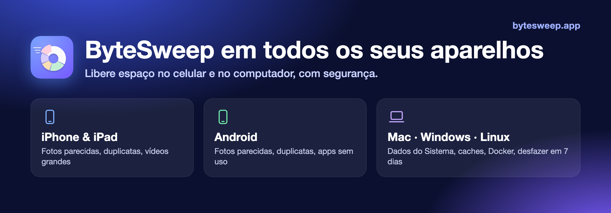

<p align="center">
  <a href="README.md">English</a> ·
  <a href="README.de.md">Deutsch</a> ·
  <a href="README.es.md">Español</a> ·
  <a href="README.fr.md">Français</a> ·
  <a href="README.it.md">Italiano</a> ·
  <a href="README.nl.md">Nederlands</a> ·
  <a href="README.pl.md">Polski</a> ·
  <b>Português (Brasil)</b> ·
  <a href="README.ru.md">Русский</a> ·
  <a href="README.tr.md">Türkçe</a> ·
  <a href="README.ja.md">日本語</a> ·
  <a href="README.ko.md">한국어</a> ·
  <a href="README.zh-Hans.md">简体中文</a> ·
  <a href="README.zh-Hant.md">繁體中文</a>
</p>

<h1 align="center">ByteSweep CLI: analisador e limpador de espaço em disco para Linux, Mac e Windows</h1>

<p align="center">
  <b>Por que o disco está cheio? Descubra e libere espaço com segurança, em qualquer terminal.</b><br>
  Um analisador de espaço em disco e limpador gratuito e de código aberto para servidores Linux, Mac, Windows e BSDs.
</p>

<p align="center">
  <a href="https://bytesweep.app/cli"></a>
  <a href="https://github.com/bytesweepcleaner/bytesweep-cli/blob/main/LICENSE"></a>
  <a href="https://github.com/bytesweepcleaner/bytesweep-cli/actions/workflows/test.yml"></a>
  <a href="https://github.com/bytesweepcleaner/bytesweep-cli/blob/main/go.mod"></a>
  <a href="docs/platforms.md"></a>
  <a href="https://github.com/bytesweepcleaner/bytesweep/stargazers"></a>
</p>

<p align="center">
  
</p>

O ByteSweep CLI (`bsweep`) mostra **por que o disco está cheio** e libera o espaço **sem quebrar nada**.
Ele lê `df`, `du`, Docker, o journal do systemd, caches de pacotes, kernels antigos, arquivos apagados que
ainda estão abertos, inodes e snapshots, e explica a resposta em linguagem simples. Toda limpeza mostra o comando
exato antes, as arriscadas esperam você conferir, e os arquivos removidos vão para o Undo (desfazer) por 7 dias.

É um único arquivo estático: sem runtime, sem agente, nada fica rodando. **Gratuito e de código aberto (GPL-3.0):
todos os comandos, em qualquer máquina, sem licença, chave ou período de teste.**

## Recursos

- **Por que o disco está cheio, em uma resposta.** `bsweep why` aponta as pastas, caches e logs que ocupam o espaço, e a diferença que o `du` não enxerga.
- **"No space left on device" (sem espaço no dispositivo) com bytes livres.** Inodes por disco e as pastas com mais arquivos.
- **`df` e `du` não batem.** A tela Held (retidos) lista os arquivos apagados que ainda estão abertos e o serviço que segura cada um.
- **Uso de disco do Docker.** Cache de build, imagens sem uso, containers parados e logs de containers; volumes nunca são removidos.
- **Logs.** Compacte o journal do systemd, apague logs rotacionados, esvazie logs ativos enormes no lugar; agende diariamente, semanalmente ou mensalmente.
- **Disco cheio agora.** `bsweep rescue` libera só o necessário, começando pelo mais seguro, e não grava nada no disco cheio.
- **Seguro por design.** Comandos exatos mostrados antes, `--dry-run` em tudo, Undo por 7 dias, nunca seus bancos de dados nem o kernel em execução.
- **Duplicados, arquivos grandes, compactar e arquivar.** Encontre cópias pelo conteúdo, compacte logs antigos com gzip, mova projetos antigos para outro disco e traga-os de volta.
- **Saúde, atualizações, portas e inicialização.** Serviços com falha, processos encerrados por falta de memória, discos morrendo, certificados expirados, backups que pararam, o que escuta em cada porta.
- **Vários servidores.** `bsweep fleet` via SSH sem instalar nada, `bsweep manage` para todos os servidores em uma tela.
- **Assistentes de IA.** `bsweep mcp` é um servidor Model Context Protocol para Claude, Cursor, VS Code e qualquer cliente MCP.
- **Scripts e monitoramento.** `--json` em quase todos os comandos, códigos de saída para `bsweep check`, webhooks.

## Instalação

Linux, macOS e BSDs:

```sh
curl -fsSL https://bytesweep.app/install-cli.sh | sudo sh
```

Windows (PowerShell como administrador):

```powershell
irm https://bytesweep.app/install-cli.ps1 | iex
```

Os dois verificam os checksums assinados antes de instalar qualquer coisa. Com Go 1.22 ou mais recente, você também pode compilar por conta própria:

```sh
go install github.com/bytesweepcleaner/bytesweep-cli/cmd/bsweep@latest
```

`sudo bsweep update` baixa a próxima versão. Todos os sistemas e processadores: [docs/platforms.md](docs/platforms.md).

## Sistemas compatíveis

Um único arquivo estático `bsweep` para cada sistema e processador: 23 builds no total. A linha de instalação escolhe o certo.

| Sistema | Processadores | Versões |
|---|---|---|
| **Linux** | x86_64, ARM64, ARMv7, i386, RISC-V 64, ppc64le, s390x, LoongArch64 | Qualquer distribuição: Ubuntu, Debian, Fedora, RHEL, CentOS, AlmaLinux, Rocky Linux, openSUSE, Arch, Alpine e outras |
| **Mac** | Apple silicon (ARM64), Intel (x86_64) | macOS 11 Big Sur e posteriores |
| **Windows** | x64, ARM64, 32 bits (i386) | Windows 10 e 11 |
| **FreeBSD** | x86_64, ARM64 |  |
| **OpenBSD** | x86_64, ARM64 |  |
| **NetBSD** | x86_64, ARM64 |  |
| **DragonFly BSD** | x86_64 |  |
| **Solaris** | x86_64 |  |
| **illumos** | x86_64 |  |
| **AIX** | ppc64 |  |
| **Android** (Termux) | ARM64 | Build Linux ARM64 no Termux; só para consulta, porque o Android não dá acesso root |

Funciona em qualquer terminal: Terminal, iTerm2, Windows Terminal, PowerShell, GNOME Terminal, Konsole, xterm, o console do Linux, tmux, screen, PuTTY e via SSH. O que muda em cada sistema: [docs/platforms.md](docs/platforms.md).

## Início rápido

```sh
sudo bsweep                        # o app em tela cheia
bsweep why                         # uma resposta: por que este disco está cheio
sudo bsweep rescue                 # disco em 100%: libera só o necessário, o mais seguro primeiro
bsweep clean --list                # tudo o que pode ser removido, por grupo
sudo bsweep clean --safe --dry-run # o que uma limpeza segura faria, sem fazer
bsweep dupes /srv --dry-run        # arquivos duplicados e qual cópia ficaria
bsweep check                       # código de saída para monitoramento e cron
```

## ByteSweep para seu celular e seu computador

<p align="center">
  <a href="https://bytesweep.app/?ref=github"></a>
</p>

<p align="center">
  <a href="https://apps.apple.com/us/app/bytesweep-storage-cleaner/id6811826959"></a>
  <a href="https://play.google.com/store/apps/details?id=com.bytesweep.app"></a>
  <a href="https://apps.microsoft.com/detail/9N7WMJS8QCQX"></a>
  <a href="https://bytesweep.app/mac.html?ref=github"></a>
  <a href="https://bytesweep.app/linux.html?ref=github"></a>
</p>

A CLI é gratuita e continuará assim. Para o celular no seu bolso e o computador na sua mesa, existem os apps ByteSweep, com a mesma regra: você vê tudo antes que algo seja apagado.

<table>
  <tr>
    <td><b>iPhone &amp; iPad</b></td>
    <td>Encontra fotos parecidas e duplicadas, reduz vídeos grandes e deixa você deslizar pelos meses antigos. Grátis para o seu primeiro 1 GB e 30 itens, depois você paga uma vez.</td>
    <td><a href="https://apps.apple.com/us/app/bytesweep-storage-cleaner/id6811826959"></a></td>
  </tr>
  <tr>
    <td><b>Android</b></td>
    <td>Encontra fotos parecidas, duplicatas, vídeos grandes e apps sem uso. Grátis para o seu primeiro 1 GB e 30 itens, depois você paga uma vez, sem assinatura.</td>
    <td><a href="https://play.google.com/store/apps/details?id=com.bytesweep.app"></a></td>
  </tr>
  <tr>
    <td><b>Mac</b></td>
    <td>Encontra o que encheu o seu Mac, de Dados do Sistema a Docker e Xcode, com 7 dias para desfazer o que pode voltar. Teste grátis por 3 dias. Também na Mac App Store.</td>
    <td><a href="https://bytesweep.app/mac.html?ref=github"></a><br><a href="https://apps.apple.com/us/app/bytesweep-storage-transfer/id6822710125?mt=12"></a></td>
  </tr>
  <tr>
    <td><b>Windows</b></td>
    <td>Limpa sobras do Windows Update, arquivos temporários e caches de navegadores e jogos, com 7 dias para desfazer o que pode voltar. Teste grátis por 3 dias.</td>
    <td><a href="https://apps.microsoft.com/detail/9N7WMJS8QCQX"></a></td>
  </tr>
  <tr>
    <td><b>Linux</b></td>
    <td>Limpa os caches do apt, dnf e pacman, snaps antigos, runtimes Flatpak sem uso e o journal, e encontra duplicatas e arquivos grandes. Teste grátis por 3 dias.</td>
    <td><a href="https://bytesweep.app/linux.html?ref=github"></a></td>
  </tr>
</table>

## Todos os problemas que ele resolve

| Problema em um servidor real | O que o ByteSweep faz |
|---|---|
| `df` diz cheio, `du` discorda | Aba Held: arquivos apagados ainda abertos e quem os segura. O Overview (visão geral) aponta qualquer diferença que uma varredura não enxerga |
| "No space left" com bytes livres | Inodes por disco, o Explore ordena por número de arquivos (`i`) |
| O Docker comeu o disco | Cache de build, imagens sem tag e sem uso, containers parados, logs de containers que o `docker system df` não mostra; cada VM (Colima, Lima, Podman, Multipass, Vagrant, minikube, emuladores Android...) pelo nome, com o espaço que pode devolver |
| Um prune às cegas apagou um banco de dados | Volumes nunca são removidos. Bancos de dados e /var/lib/docker também não podem ser limpos manualmente |
| Journal, logs rotacionados, logs ativos enormes | Compactação via journalctl; logs ativos esvaziados no lugar para os serviços continuarem gravando |
| /boot cheio, atualizações falham | Kernels antigos, nunca o que está em execução |
| Caches de pacotes e linguagens, snaps antigos, crash dumps, /tmp antigo | Cada um pela sua própria ferramenta; o comando exato é mostrado antes |
| O plano foi ampliado, o disco não | Encontra espaço em disco fora de qualquer partição |
| Os 5% ocultos do ext4 | Mostra o espaço reservado e a linha do tune2fs |
| Enche de novo no mês seguinte | Aba Prevent (prevenir): limite do journal, limite de logs do Docker, registro diário |
| "O que mudou durante a noite?" | O que cresceu e quando o disco vai encher nesse ritmo |
| A varredura deixa a produção lenta | Roda com CPU baixa e prioridade de disco ociosa; fica em um só disco |
| Disco em 100% e tudo falhando | `bsweep rescue` ou `R`: libera só o necessário, o mais seguro primeiro, e depois aponta os serviços que pararam. Não grava nada no disco cheio |
| Nós Podman ou Kubernetes | A mesma limpeza via podman e crictl; volumes ficam intactos |
| Snapshots ocupando espaço | `bsweep snapshots`: Time Machine, pontos de restauração, cópias de sombra, Timeshift, Snapper, ZFS, Btrfs e LVM, com tamanhos quando a ferramenta informa. Remove só o que você escolhe e mantém o mais recente de cada |
| Arquivos escondidos sob um ponto de montagem | Olha por baixo de cada ponto de montagem com um bind somente leitura e mostra como chegar até eles |
| Deploys antigos e restos de apps web | Releases antigas (mantém a ativa + 3), cache do WordPress, logs do Laravel, sessões PHP |
| Logs precisam ser limpos regularmente | `bsweep logs clear`, ou `bsweep schedule logs` diariamente, semanalmente ou mensalmente |
| Um log que nada rotaciona | O Prevent cria uma regra do logrotate, testada antes de ficar |
| Projetos antigos enchendo um disco movimentado | `bsweep archive /srv/old --to /mnt/backup`: para outro disco, cada arquivo conferido por checksum, depois liberado; `where` funciona com ele desconectado, `bring-back` coloca de volta |
| Logs e dumps antigos ocupando espaço | `bsweep compress /var/log --older 30d`: gzip onde economiza, relido antes de o original ir para o Undo; logs ativos ficam |
| Os mesmos arquivos, três vezes | `bsweep dupes`: cópias pelo conteúdo, hard links e clones contados uma vez; mantenha um, o resto vai para o Undo |
| Downloads cheios de instaladores antigos e cópias "(1)" | `bsweep tidy`: as regras do app de desktop, cada arquivo para o Undo; `organize`, `rename` e `convert` para o resto, cada um mostrado antes e reversível |
| "O que está na porta 3000?" | `bsweep ports`: programa, projeto ou container, aberto para a rede ou não; pare um projeto de desenvolvimento de uma vez |
| Qual pacote é enorme, e o que apps removidos deixaram | `bsweep apps`: todos os pacotes e apps, do maior para o menor; remova via apt, dnf, pacman, snap, flatpak ou brew depois do dry run deles; nunca o que o sistema precisa |
| Apps de chat enchendo o disco em silêncio | Grupo Chats and Mail: caches do Slack, Teams, Discord, Element e Thunderbird para revisão; arquivos do Telegram e gravações do Zoom só um por um, para o Undo |
| Quais apps podem usar a câmera, o microfone ou a tela? | `bsweep permissions`: permitidos e negados, último uso e em uso agora quando o sistema registra (macOS TCC, configurações de privacidade do Windows, Flatpak, Snap, dispositivos abertos); só lê, diz onde desativar cada um |
| Histórico de comandos e outros rastros | Grupo Privacy traces: histórico do shell e do REPL, arquivos recentes, pré-visualizações, backups do editor; sempre para revisão, cada um para o Undo |
| Atualizações pendentes, e precisa reiniciar? | `bsweep updates`: correções de segurança primeiro, via apt, dnf, zypper, pacman, apk, snap, flatpak, Homebrew, winget, Atualização de Software do macOS ou Windows Update; aponta quem segura um lock de pacote ocupado; nunca reinicia sozinho |
| Um programa que não fecha | `bsweep stop PID\|NAME`, ou `s` no Live: pede para fechar, 10 segundos para salvar; nunca o sshd, o PID 1 ou o seu próprio shell, e um serviço recebe o comando `systemctl` correspondente |
| "Por que ele acordou às 3 da manhã?" | `bsweep sleep`: cada suspensão e o que a acordou (tampa, USB, Bluetooth, rede, um timer), o que o mantém acordado agora, despertares agendados; só conselhos, nenhuma configuração de energia é alterada. Um servidor que nunca dorme avisa isso |
| "O que outras pessoas conseguem ver?" | `bsweep sharesafe`: pastas compartilhadas (convidado? podem alterar arquivos?), compartilhamento de arquivos e de tela, SSH, área de trabalho remota, portas abertas, portas publicadas do Docker, o firewall; um risco para cada um e onde desativá-lo. Só lê |
| O que inicia sozinho, e o que falhou | `bsweep startup`: systemd, cron @reboot, launchd, serviços do Windows; os do próprio sistema só com `--all`; desative e reative exatamente |
| Um serviço morreu durante a noite | Aba Health (saúde): processos encerrados por falta de memória, serviços com falha, loops de crash |
| Um disco prestes a morrer | `bsweep drives`: cada disco físico como Healthy, Worn ou Failing, e o porquê em linguagem simples; `check` e Health também avisam. Só lê |
| "Os backups estão rodando mesmo?" | O Health aponta a ferramenta (restic, borg, rsnapshot, duplicity, Timeshift, Snapper, vzdump, Time Machine, Windows Backup) e quando funcionou ou falhou pela última vez. Não precisa da senha do repositório |
| Certificado expirado de surpresa | Lê certificados do nginx, Apache, Caddy e Let's Encrypt; sinaliza renovação quebrada |
| Atualizações, SSH, firewall, backups | O Health no macOS e no Windows também lê o firewall, FileVault ou BitLocker, SIP e Gatekeeper ou o antivírus. Conselhos com comandos exatos. O ByteSweep não altera SSH nem firewalls: é assim que as pessoas ficam trancadas para fora |
| Vários servidores | `bsweep fleet`: uma tabela via SSH, nada instalado |
| Mover arquivos sem a sintaxe do scp | Salve um host uma vez e depois `bsweep copy-to office ./site /srv/site` |
| Uma transferência interrompida recomeça do zero | Continua de onde parou e envia só o que mudou |
| Uma sincronização apaga a pasta errada | Mostra as mudanças antes, guarda arquivos removidos por 7 dias, se recusa a esvaziar uma pasta |
| Revisar um servidor a partir do seu notebook | `bsweep connect office` abre o app completo nele |
| Servidores demais para acompanhar | `bsweep manage`: todos os servidores em uma tela, com Monitor ao vivo e ações em massa |
| Parte de uma estrutura de monitoramento | Códigos de saída do `bsweep check`, webhook, `report --json`, `clean --safe --yes` |

Todos os comandos e códigos de saída: [docs/cli.md](docs/cli.md). Exemplos de cron, Ansible, CI e fleet: [docs/recipes.md](docs/recipes.md).

## Como funcionam o Clean e o Undo

- **Clean** (limpar) no Explore move o arquivo para `<disk>/.bytesweep-undo` por 7 dias. Mover no
  mesmo disco não libera nada, então o espaço volta quando o Undo termina. A tela avisa isso.
- **Remove now** (remover agora) devolve o espaço na hora, sem Undo: `F` na pergunta do app, `--now` em
  todo comando que usaria o Undo (rm, dupes, clean, apps, tidy, compress). Essa é a escolha
  para um disco em 100%. `bsweep undo free --all` esvazia o próprio Undo.
- Limpezas por regra passam por journalctl, docker, apt e companhia, e não podem ser desfeitas. A
  tela de confirmação lista todos os comandos.

## Hosts, transferência e sincronização

Configure um host uma vez em `bsweep.yml` (`bsweep init`, depois `bsweep host add`) e use o nome curto dele a partir
daí, de um servidor ou da linha de comando de um Mac ou Windows. Veja [docs/transfer.md](docs/transfer.md).

## Assistentes de IA (MCP)

`bsweep mcp` permite que Claude Desktop, Claude Code, Cursor, VS Code e outros clientes MCP examinem uma máquina
e ajudem a limpá-la, com as mesmas regras da linha de comando. Veja [docs/mcp.md](docs/mcp.md).

## Perguntas frequentes

**Como descobrir o que está ocupando espaço em disco no Linux?**
Rode `bsweep why` para uma resposta em uma tela, ou `sudo bsweep` e abra o Explore para percorrer as pastas,
das maiores para as menores. Ele também conta o que percorrer pastas não mostra: arquivos apagados ainda abertos, Docker, snapshots e espaço reservado.

**Por que o `df` diz que o disco está cheio quando o `du` soma menos?**
Normalmente um programa ainda mantém aberto um arquivo apagado, muitas vezes um log. A tela Held lista cada um e o
serviço que o segura, e esvazia no lugar um log retido para o serviço continuar gravando.

**Como resolver "No space left on device" quando o `df` mostra espaço livre?**
O disco ficou sem inodes: arquivos pequenos demais. O ByteSweep mostra os inodes por disco, e o Explore ordena por
número de arquivos (`i`) para encontrar a pasta que os contém.

**Como liberar espaço em disco do Docker com segurança?**
`bsweep clean --list --group containers` lista cache de build, imagens sem uso, containers parados e
logs de containers. Volumes nunca são removidos, porque um volume pode ser um banco de dados.

**O disco do meu servidor está 100% cheio. E agora?**
`sudo bsweep rescue`, ou `R` no app. Ele libera só o necessário, o mais seguro primeiro, não grava nada no disco
cheio e depois aponta os serviços que pararam.

**É seguro rodar em um servidor de produção?**
Toda limpeza mostra o comando exato antes, `--dry-run` mostra uma prévia de tudo, arquivos removidos esperam no Undo
por 7 dias, e as varreduras rodam com CPU baixa e prioridade de disco ociosa. Ele nunca remove bancos de dados, volumes do Docker
nem o kernel em execução, nunca escolhe um snapshot por você e nunca altera configurações de SSH ou firewall.

**É gratuito? Ele envia dados para algum lugar?**
Gratuito e de código aberto sob a GPL-3.0, sem conta, analytics ou período de teste. Ele só acessa a internet quando você pede:
`bsweep update`, alertas para os destinos que você adicionar e SSH para fleet, cópia e sincronização.

## Privacidade

Sem analytics e sem conta. Nada sobre você ou seus arquivos sai da máquina. O bsweep só acessa a
internet quando você pede: `bsweep update` baixa de bytesweep.app (e confere a
assinatura antes), alertas vão só para os destinos que você adicionar, e fleet, cópia e sincronização usam o seu próprio SSH.

## Compilação e testes

Requer Go 1.22 ou mais recente: `go test ./...`, depois `go build -o bsweep ./cmd/bsweep`.
`VERSION=1.0.1 ./build.sh` gera todos os builds de release. Veja [bytesweep-cli](https://github.com/bytesweepcleaner/bytesweep-cli) e
[SECURITY.md](SECURITY.md).

## Licença

GPL-3.0: livre para usar, alterar e compartilhar. Uma cópia alterada que você distribuir precisa continuar aberta
sob a mesma licença. Veja [LICENSE](https://github.com/bytesweepcleaner/bytesweep-cli/blob/main/LICENSE).

---

O ByteSweep também existe como app de desktop para Mac, Windows e Linux: [bytesweep.app](https://bytesweep.app/?ref=github)
