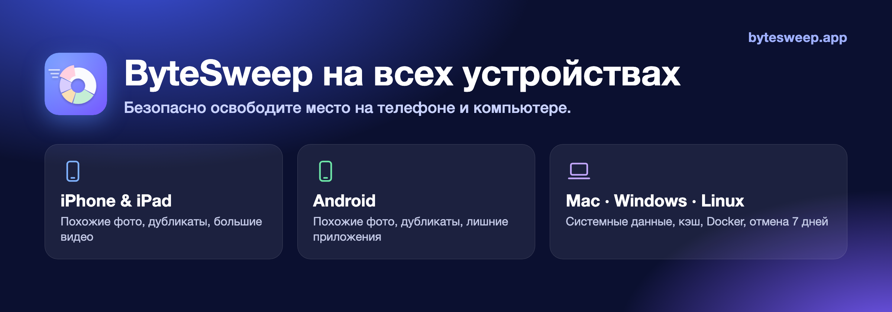

<p align="center">
  <a href="README.md">English</a> ·
  <a href="README.de.md">Deutsch</a> ·
  <a href="README.es.md">Español</a> ·
  <a href="README.fr.md">Français</a> ·
  <a href="README.it.md">Italiano</a> ·
  <a href="README.nl.md">Nederlands</a> ·
  <a href="README.pl.md">Polski</a> ·
  <a href="README.pt-BR.md">Português (Brasil)</a> ·
  <b>Русский</b> ·
  <a href="README.tr.md">Türkçe</a> ·
  <a href="README.ja.md">日本語</a> ·
  <a href="README.ko.md">한국어</a> ·
  <a href="README.zh-Hans.md">简体中文</a> ·
  <a href="README.zh-Hant.md">繁體中文</a>
</p>

<h1 align="center">ByteSweep CLI: анализ и очистка места на диске для Linux, Mac и Windows</h1>

<p align="center">
  <b>Почему диск заполнен? Узнайте причину и безопасно освободите место на диске в любом терминале.</b><br>
  Бесплатный анализатор дискового пространства и очистка диска для Linux-серверов, Mac, Windows и BSD.
</p>

<p align="center">
  <a href="https://bytesweep.app/cli"></a>
  <a href="docs/platforms.md"></a>
  <a href="https://github.com/bytesweepcleaner/bytesweep/stargazers"></a>
</p>

<p align="center">
  
</p>

ByteSweep CLI (`bsweep`) показывает, **почему диск заполнен**, и освобождает место **ничего не ломая**.
Он читает `df`, `du`, Docker, журнал systemd, кэши пакетов, старые ядра, удалённые файлы, которые
всё ещё открыты, иноды и снапшоты, и объясняет ответ простыми словами. Перед каждой очисткой показывается точная
команда, рискованные действия ждут вашей проверки, а удалённые файлы 7 дней лежат в Undo (отмена).

Это один статический файл: без среды выполнения, без агента, ничего не остаётся запущенным. **Бесплатно:
все команды, на любой машине, без лицензии, ключа и пробного периода.**

## Возможности

- **Почему диск заполнен — одним ответом.** `bsweep why` называет папки, кэши и логи, которые занимают место, и разницу, которую не видит `du`.
- **"No space left on device" (на устройстве не осталось места) при свободных байтах.** Иноды по каждому диску и папки с наибольшим числом файлов.
- **`df` и `du` не сходятся.** Экран Held (удерживаемые) показывает удалённые файлы, которые всё ещё открыты, и службу, которая держит каждый из них.
- **Сколько места занимает Docker.** Кэш сборки, неиспользуемые образы, остановленные контейнеры и логи контейнеров; тома никогда не удаляются.
- **Логи.** Сжатие журнала systemd (vacuum), удаление ротированных логов, очистка огромных активных логов на месте; по расписанию ежедневно, еженедельно или ежемесячно.
- **Диск заполнен прямо сейчас.** `bsweep rescue` освобождает ровно столько, сколько нужно, начиная с самого безопасного, и ничего не пишет на заполненный диск.
- **Безопасность заложена в основу.** Точные команды показываются заранее, `--dry-run` везде, Undo на 7 дней, никогда не трогает ваши базы данных и работающее ядро.
- **Дубликаты, большие файлы, сжатие и архивирование.** Поиск копий по содержимому, сжатие старых логов gzip, перенос старых проектов на другой диск и возврат обратно.
- **Состояние системы, обновления, порты и автозапуск.** Упавшие службы, процессы, убитые из-за нехватки памяти, умирающие диски, просроченные сертификаты, остановившиеся бэкапы, что слушает каждый порт.
- **Много серверов.** `bsweep fleet` по SSH без установки чего-либо, `bsweep manage` — все серверы на одном экране.
- **ИИ-ассистенты.** `bsweep mcp` — сервер Model Context Protocol для Claude, Cursor, VS Code и любого MCP-клиента.
- **Скрипты и мониторинг.** `--json` почти у каждой команды, коды возврата для `bsweep check`, вебхуки.

## Установка

Linux, macOS и BSD:

```sh
curl -fsSL https://bytesweep.app/install-cli.sh | sudo sh
```

Или запустите тот же скрипт прямо с GitHub:

```sh
curl -fsSL https://raw.githubusercontent.com/bytesweepcleaner/bytesweep/main/install-cli.sh | sudo sh
```

Windows (PowerShell от имени администратора):

```powershell
irm https://bytesweep.app/install-cli.ps1 | iex
```

Оба скрипта проверяют подписанные контрольные суммы до установки.

`sudo bsweep update` устанавливает следующий релиз. Все системы и процессоры: [docs/platforms.md](docs/platforms.md).

## Поддерживаемые системы

Один статический файл `bsweep` для каждой системы и процессора: всего 23 сборки. Команда установки сама выбирает нужную.

| Система | Процессоры | Версии |
|---|---|---|
| **Linux** | x86_64, ARM64, ARMv7, i386, RISC-V 64, ppc64le, s390x, LoongArch64 | Любой дистрибутив: Ubuntu, Debian, Fedora, RHEL, CentOS, AlmaLinux, Rocky Linux, openSUSE, Arch, Alpine и другие |
| **Mac** | Apple silicon (ARM64), Intel (x86_64) | macOS 11 Big Sur и новее |
| **Windows** | x64, ARM64, 32-битный (i386) | Windows 10 и 11 |
| **FreeBSD** | x86_64, ARM64 |  |
| **OpenBSD** | x86_64, ARM64 |  |
| **NetBSD** | x86_64, ARM64 |  |
| **DragonFly BSD** | x86_64 |  |
| **Solaris** | x86_64 |  |
| **illumos** | x86_64 |  |
| **AIX** | ppc64 |  |
| **Android** (Termux) | ARM64 | Сборка Linux ARM64 в Termux; только просмотр, так как Android не даёт root-доступа |

Работает в любом терминале: Terminal, iTerm2, Windows Terminal, PowerShell, GNOME Terminal, Konsole, xterm, консоль Linux, tmux, screen, PuTTY и по SSH. Чем отличаются системы: [docs/platforms.md](docs/platforms.md).

## Быстрый старт

```sh
sudo bsweep                        # полноэкранное приложение
bsweep why                         # один ответ: почему этот диск заполнен
sudo bsweep rescue                 # диск на 100%: освободить ровно столько, сколько нужно, сначала самое безопасное
bsweep clean --list                # всё, что можно удалить, по группам
sudo bsweep clean --safe --dry-run # что сделает безопасная очистка, ничего не выполняя
bsweep dupes /srv --dry-run        # дубликаты файлов и какая копия останется
bsweep check                       # код возврата для мониторинга и cron
```

## ByteSweep для телефона и компьютера

<p align="center">
  <a href="https://bytesweep.app/?ref=github"></a>
</p>

<p align="center">
  <a href="https://apps.apple.com/us/app/bytesweep-storage-cleaner/id6811826959"></a>
  <a href="https://play.google.com/store/apps/details?id=com.bytesweep.app"></a>
  <a href="https://apps.microsoft.com/detail/9N7WMJS8QCQX"></a>
  <a href="https://bytesweep.app/mac.html?ref=github"></a>
  <a href="https://bytesweep.app/linux.html?ref=github"></a>
</p>

CLI бесплатна и останется бесплатной. Для телефона в кармане и компьютера на столе есть приложения ByteSweep — с тем же правилом: вы видите всё, прежде чем что-то будет удалено.

<table>
  <tr>
    <td><b>iPhone &amp; iPad</b></td>
    <td>Находит похожие фото и дубликаты, сжимает большие видео и позволяет листать старые месяцы. Бесплатно для первого 1 ГБ и 30 объектов, затем один платёж.</td>
    <td><a href="https://apps.apple.com/us/app/bytesweep-storage-cleaner/id6811826959"></a></td>
  </tr>
  <tr>
    <td><b>Android</b></td>
    <td>Находит похожие фото, дубликаты, большие видео и неиспользуемые приложения. Бесплатно для первого 1 ГБ и 30 объектов, затем один платёж, без подписки.</td>
    <td><a href="https://play.google.com/store/apps/details?id=com.bytesweep.app"></a></td>
  </tr>
  <tr>
    <td><b>Mac</b></td>
    <td>Находит, чем заполнен ваш Mac, от «Системных данных» до Docker и Xcode, с отменой на 7 дней для того, что можно вернуть. 3 дня бесплатно. Также в Mac App Store.</td>
    <td><a href="https://bytesweep.app/mac.html?ref=github"></a><br><a href="https://apps.apple.com/us/app/bytesweep-storage-transfer/id6822710125?mt=12"></a></td>
  </tr>
  <tr>
    <td><b>Windows</b></td>
    <td>Удаляет остатки Windows Update, временные файлы и кэш браузеров и игр, с отменой на 7 дней для того, что можно вернуть. 3 дня бесплатно.</td>
    <td><a href="https://apps.microsoft.com/detail/9N7WMJS8QCQX"></a></td>
  </tr>
  <tr>
    <td><b>Linux</b></td>
    <td>Очищает кэш apt, dnf и pacman, старые snap-пакеты, неиспользуемые среды Flatpak и журнал, находит дубликаты и большие файлы. 3 дня бесплатно.</td>
    <td><a href="https://bytesweep.app/linux.html?ref=github"></a></td>
  </tr>
</table>

## Какие проблемы он решает

| Проблема на реальном сервере | Что делает ByteSweep |
|---|---|
| `df` говорит, что диск заполнен, `du` не согласен | Вкладка Held: удалённые файлы, которые всё ещё открыты, и кто их держит. Overview (обзор) называет любую разницу, которую не видит сканирование |
| "No space left" при свободных байтах | Иноды по каждому диску, Explore сортирует по количеству файлов (`i`) |
| Docker съел весь диск | Кэш сборки, образы без тегов и неиспользуемые образы, остановленные контейнеры, логи контейнеров, которые не показывает `docker system df`; каждая ВМ (Colima, Lima, Podman, Multipass, Vagrant, minikube, эмуляторы Android...) по имени, с местом, которое она может вернуть |
| Prune вслепую удалил базу данных | Тома никогда не удаляются. Базы данных и /var/lib/docker нельзя очистить и вручную |
| Журнал, ротированные логи, огромные активные логи | Vacuum через journalctl; активные логи очищаются на месте, и службы продолжают в них писать |
| /boot заполнен, обновления падают | Старые ядра, но никогда не работающее |
| Кэши пакетов и языков, старые snap-пакеты, аварийные дампы, старый /tmp | Каждое через свой собственный инструмент; точная команда показывается заранее |
| Тариф увеличили, а диск нет | Находит место на диске вне всех разделов |
| Скрытые 5% в ext4 | Показывает зарезервированное место и команду tune2fs |
| Через месяц диск снова заполнится | Вкладка Prevent (предотвращение): лимит журнала, лимит логов Docker, ежедневная запись |
| «Что изменилось за ночь?» | Что выросло и когда при таком темпе заполнится диск |
| Сканирование тормозит продакшен | Работает с низким приоритетом CPU и idle-приоритетом диска; остаётся в пределах одного диска |
| Диск на 100%, и всё падает | `bsweep rescue` или `R`: освобождает ровно столько, сколько нужно, начиная с самого безопасного, затем называет остановившиеся службы. Ничего не пишет на заполненный диск |
| Узлы Podman или Kubernetes | Та же очистка через podman и crictl; тома остаются нетронутыми |
| Снапшоты занимают место | `bsweep snapshots`: Time Machine, точки восстановления, теневые копии, Timeshift, Snapper, ZFS, Btrfs и LVM, с размерами, если инструмент их сообщает. Удаляет только то, что вы выбрали, и оставляет самый новый из каждого |
| Файлы, спрятанные под точкой монтирования | Заглядывает под каждую точку монтирования через bind только для чтения и показывает, как до них добраться |
| Старые деплои и остатки веб-приложений | Старые релизы (оставляет текущий + 3), кэш WordPress, логи Laravel, сессии PHP |
| Логи нужно регулярно чистить | `bsweep logs clear` или `bsweep schedule logs` ежедневно, еженедельно или ежемесячно |
| Лог, который никто не ротирует | Prevent создаёт правило logrotate и проверяет его, прежде чем оставить |
| Старые проекты забивают нагруженный диск | `bsweep archive /srv/old --to /mnt/backup`: на другой диск, каждый файл сверяется по контрольной сумме, затем место освобождается; `where` работает даже при отключённом диске, `bring-back` возвращает всё обратно |
| Старые логи и дампы занимают место | `bsweep compress /var/log --older 30d`: gzip там, где это даёт выигрыш, проверка чтением перед тем, как оригинал уйдёт в Undo; активные логи остаются |
| Одни и те же файлы по три раза | `bsweep dupes`: копии по содержимому, жёсткие ссылки и клоны считаются один раз; оставьте одну копию, остальные — в Undo |
| Загрузки забиты старыми установщиками и копиями «(1)» | `bsweep tidy`: правила из настольного приложения, каждый файл — в Undo; `organize`, `rename` и `convert` для остального, всё показывается заранее и отменяется |
| «Что висит на порту 3000?» | `bsweep ports`: программа, проект или контейнер, открыт ли порт в сеть; остановка dev-проекта одним действием |
| Какой пакет огромный и что оставили удалённые приложения | `bsweep apps`: все пакеты и приложения, от самых больших; удаление через apt, dnf, pacman, snap, flatpak или brew после их собственного dry run; никогда не трогает то, что нужно системе |
| Мессенджеры незаметно забивают диск | Группа Chats and Mail: кэши Slack, Teams, Discord, Element и Thunderbird для просмотра; файлы Telegram и записи Zoom только по одному, в Undo |
| Какие приложения могут использовать камеру, микрофон или экран? | `bsweep permissions`: разрешённые и запрещённые, последнее использование и использование прямо сейчас, если система это записывает (macOS TCC, параметры конфиденциальности Windows, Flatpak, Snap, открытые устройства); только читает и подсказывает, где отключить каждое |
| История команд и другие следы | Группа Privacy traces: история shell и REPL, недавние файлы, превью, резервные копии редактора; всегда на просмотр, каждое — в Undo |
| Ждут обновления — нужна ли перезагрузка? | `bsweep updates`: сначала исправления безопасности, через apt, dnf, zypper, pacman, apk, snap, flatpak, Homebrew, winget, «Обновление ПО» macOS или Windows Update; называет того, кто держит занятую блокировку пакетов; никогда не перезагружает сам |
| Программа, которая не закрывается | `bsweep stop PID\|NAME` или `s` в Live: просит её закрыться, 10 секунд на сохранение; никогда не трогает sshd, PID 1 и ваш собственный shell, а для службы выдаёт соответствующую команду `systemctl` |
| «Почему он проснулся в 3 часа ночи?» | `bsweep sleep`: каждый сон и что его разбудило (крышка, USB, Bluetooth, сеть, таймер), что не даёт уснуть сейчас, запланированные пробуждения; только советы, настройки питания не меняются. Сервер, который никогда не спит, так и скажет |
| «Что видят другие?» | `bsweep sharesafe`: общие папки (гостевой доступ? можно ли менять файлы?), общий доступ к файлам и экрану, SSH, удалённый рабочий стол, открытые порты, опубликованные порты Docker, файрвол; риск для каждого и где его отключить. Только читает |
| Что запускается само и что упало | `bsweep startup`: systemd, cron @reboot, launchd, службы Windows; системные — только с `--all`; точное отключение и включение обратно |
| Служба умерла ночью | Вкладка Health (состояние): процессы, убитые из-за нехватки памяти, упавшие службы, циклы падений |
| Диск, который вот-вот умрёт | `bsweep drives`: каждый физический диск — Healthy, Worn или Failing, и почему, простыми словами; `check` и Health тоже предупреждают. Только читает |
| «Бэкапы вообще работают?» | Health называет инструмент (restic, borg, rsnapshot, duplicity, Timeshift, Snapper, vzdump, Time Machine, Windows Backup) и когда он в последний раз сработал или упал. Пароль от репозитория не нужен |
| Сертификат внезапно истёк | Читает сертификаты nginx, Apache, Caddy и Let's Encrypt; отмечает сломанное продление |
| Обновления, SSH, файрвол, бэкапы | Health на macOS и Windows также проверяет файрвол, FileVault или BitLocker, SIP и Gatekeeper или антивирус. Советы с точными командами. ByteSweep не меняет SSH и файрволы: именно так люди теряют доступ к серверу |
| Много серверов | `bsweep fleet`: одна таблица по SSH, ничего не устанавливается |
| Перенос файлов без синтаксиса scp | Сохраните хост один раз, затем `bsweep copy-to office ./site /srv/site` |
| Оборванная передача начинается заново | Продолжает с места остановки и отправляет только изменённое |
| Синхронизация стирает не ту папку | Сначала показывает изменения, хранит удалённые файлы 7 дней, отказывается опустошать папку |
| Проверка сервера с ноутбука | `bsweep connect office` открывает на нём полное приложение |
| Слишком много серверов, чтобы уследить | `bsweep manage`: все серверы на одном экране, с живым Monitor и массовыми действиями |
| Часть системы мониторинга | Коды возврата `bsweep check`, вебхук, `report --json`, `clean --safe --yes` |

Все команды и коды возврата: [docs/cli.md](docs/cli.md). Примеры для cron, Ansible, CI и fleet: [docs/recipes.md](docs/recipes.md).

## Как работают Clean и Undo

- **Clean** (очистить) в Explore перемещает файл в `<disk>/.bytesweep-undo` на 7 дней. Перемещение в пределах
  одного диска ничего не освобождает, поэтому место вернётся, когда закончится срок Undo. Экран об этом предупреждает.
- **Remove now** (удалить сейчас) возвращает место сразу, без Undo: `F` в вопросе приложения, `--now` у
  каждой команды, которая использовала бы Undo (rm, dupes, clean, apps, tidy, compress). Это правильный выбор
  для диска на 100%. `bsweep undo free --all` очищает сам Undo.
- Очистка по правилам идёт через journalctl, docker, apt и подобные инструменты, и её нельзя отменить.
  Экран подтверждения перечисляет каждую команду.

## Хосты, передача файлов и синхронизация

Настройте хост один раз в `bsweep.yml` (`bsweep init`, затем `bsweep host add`) и дальше используйте его короткое имя —
на сервере или в командной строке Mac или Windows. См. [docs/transfer.md](docs/transfer.md).

## ИИ-ассистенты (MCP)

`bsweep mcp` позволяет Claude Desktop, Claude Code, Cursor, VS Code и другим MCP-клиентам осмотреть машину
и помочь её очистить по тем же правилам, что и в командной строке. См. [docs/mcp.md](docs/mcp.md).

## Частые вопросы

**Как узнать, чем занято место на диске в Linux?**
Запустите `bsweep why`, чтобы получить ответ на одном экране, или `sudo bsweep` и откройте Explore, чтобы пройтись по папкам,
начиная с самых больших. Он также учитывает то, что не видно при обходе папок: удалённые, но всё ещё открытые файлы, Docker, снапшоты и зарезервированное место.

**Почему `df` показывает, что диск заполнен, а `du` насчитывает меньше?**
Обычно какая-то программа всё ещё держит открытым удалённый файл, чаще всего лог. Экран Held показывает каждый такой файл и
службу, которая его держит, и очищает удерживаемый лог на месте, чтобы служба продолжала писать.

**Как исправить "No space left on device", если `df` показывает свободное место?**
На диске закончились иноды: слишком много мелких файлов. ByteSweep показывает иноды по каждому диску, а Explore сортирует по
количеству файлов (`i`), чтобы найти папку, где они лежат.

**Как безопасно освободить место, занятое Docker?**
`bsweep clean --list --group containers` показывает кэш сборки, неиспользуемые образы, остановленные контейнеры и
логи контейнеров. Тома никогда не удаляются, потому что том может быть базой данных.

**Диск на сервере заполнен на 100%. Что делать?**
`sudo bsweep rescue` или `R` в приложении. Он освобождает ровно столько, сколько нужно, начиная с самого безопасного, ничего не пишет на заполненный
диск, а затем называет остановившиеся службы.

**Безопасно ли запускать его на продакшен-сервере?**
Перед каждой очисткой показывается точная команда, `--dry-run` позволяет посмотреть всё заранее, удалённые файлы ждут в Undo
7 дней, а сканирование идёт с низким приоритетом CPU и idle-приоритетом диска. Он никогда не удаляет базы данных, тома Docker
и работающее ядро, никогда не выбирает снапшот за вас и никогда не меняет настройки SSH или файрвола.

**Это бесплатно? Он куда-нибудь отправляет данные?**
Бесплатно, без аккаунта, аналитики и пробного периода. В сеть он выходит, только когда вы просите:
`bsweep update`, оповещения в добавленные вами места и SSH для fleet, копирования и синхронизации.

## Конфиденциальность

Никакой аналитики и никакого аккаунта. Ничего о вас и ваших файлах не покидает машину. bsweep выходит
в сеть, только когда вы просите: `bsweep update` скачивает с bytesweep.app (и сначала проверяет
подпись), оповещения отправляются только в добавленные вами места, а fleet, копирование и синхронизация используют ваш собственный SSH.

---

ByteSweep также доступен как настольное приложение для Mac, Windows и Linux: [bytesweep.app](https://bytesweep.app/?ref=github)
