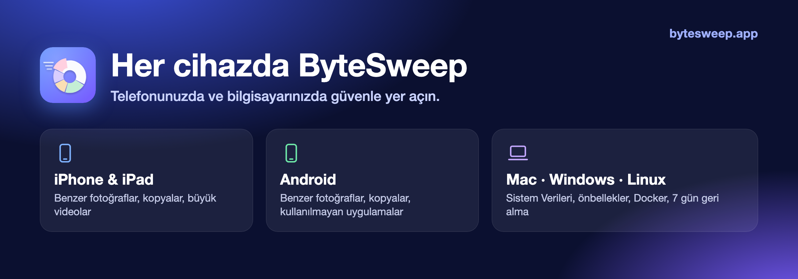

<p align="center">
  <a href="README.md">English</a> ·
  <a href="README.de.md">Deutsch</a> ·
  <a href="README.es.md">Español</a> ·
  <a href="README.fr.md">Français</a> ·
  <a href="README.it.md">Italiano</a> ·
  <a href="README.nl.md">Nederlands</a> ·
  <a href="README.pl.md">Polski</a> ·
  <a href="README.pt-BR.md">Português (Brasil)</a> ·
  <a href="README.ru.md">Русский</a> ·
  <b>Türkçe</b> ·
  <a href="README.ja.md">日本語</a> ·
  <a href="README.ko.md">한국어</a> ·
  <a href="README.zh-Hans.md">简体中文</a> ·
  <a href="README.zh-Hant.md">繁體中文</a>
</p>

<h1 align="center">ByteSweep CLI: Linux, Mac ve Windows için disk alanı analizi ve temizleme aracı</h1>

<p align="center">
  <b>Disk neden dolu? Nedenini öğrenin ve disk alanını her terminalde güvenle boşaltın.</b><br>
  Linux sunucular, Mac, Windows ve BSD'ler için ücretsiz, açık kaynaklı bir disk alanı analiz ve temizleme aracı.
</p>

<p align="center">
  <a href="https://bytesweep.app/cli"></a>
  <a href="https://github.com/bytesweepcleaner/bytesweep-cli/blob/main/LICENSE"></a>
  <a href="https://github.com/bytesweepcleaner/bytesweep-cli/actions/workflows/test.yml"></a>
  <a href="https://github.com/bytesweepcleaner/bytesweep-cli/blob/main/go.mod"></a>
  <a href="docs/platforms.md"></a>
  <a href="https://github.com/bytesweepcleaner/bytesweep/stargazers"></a>
</p>

<p align="center">
  
</p>

ByteSweep CLI (`bsweep`) size **diskin neden dolu olduğunu** söyler ve alanı **hiçbir şeyi bozmadan** boşaltır.
`df`, `du`, Docker, systemd journal, paket önbellekleri, eski çekirdekler, silinmiş ama hâlâ açık tutulan
dosyalar, inode'lar ve snapshot'ları okur ve cevabı sade bir dille açıklar. Her temizlik önce tam komutu
gösterir, riskli olanlar sizin göz atmanızı bekler ve kaldırdığınız dosyalar 7 gün boyunca Undo'ya (geri al) gider.

Tek bir statik dosyadır: runtime yok, ajan yok, arkada çalışan hiçbir şey kalmaz. **Ücretsiz ve açık kaynak (GPL-3.0):
her komut, her makinede, lisans, anahtar veya deneme süresi olmadan.**

## Özellikler

- **Disk neden dolu, tek cevapta.** `bsweep why` alanı kaplayan klasörleri, önbellekleri ve logları, ayrıca `du`'nun göremediği farkı gösterir.
- **Boş bayt varken "No space left on device" (aygıtta yer kalmadı).** Disk başına inode'lar ve en çok dosya içeren klasörler.
- **`df` ve `du` tutmuyor.** Held (tutulanlar) ekranı, silinmiş ama hâlâ açık tutulan dosyaları ve her birini tutan servisi listeler.
- **Docker disk kullanımı.** Build önbelleği, kullanılmayan imajlar, durdurulmuş container'lar ve container logları; volume'lar asla silinmez.
- **Loglar.** systemd journal'ı küçültün, rotate edilmiş logları silin, devasa canlı logları yerinde boşaltın; günlük, haftalık veya aylık zamanlayın.
- **Disk şu anda dolu.** `bsweep rescue` en güvenli olandan başlayarak yalnızca yetecek kadar alan açar ve dolu diske hiçbir şey yazmaz.
- **Tasarımı gereği güvenli.** Tam komutlar önce gösterilir, her yerde `--dry-run`, 7 günlük Undo, veritabanlarınıza ve çalışan çekirdeğe asla dokunmaz.
- **Kopyalar, büyük dosyalar, sıkıştırma ve arşivleme.** Kopyaları içeriğe göre bulun, eski logları gzip ile sıkıştırın, eski projeleri başka bir diske taşıyın ve geri getirin.
- **Sağlık, güncellemeler, portlar ve başlangıç.** Başarısız servisler, bellek yetersizliğinden öldürülen süreçler, ölmek üzere olan diskler, süresi dolmuş sertifikalar, durmuş yedeklemeler, hangi portu neyin dinlediği.
- **Çok sayıda sunucu.** `bsweep fleet` hiçbir şey kurmadan SSH üzerinden, `bsweep manage` tüm sunucular tek ekranda.
- **Yapay zekâ asistanları.** `bsweep mcp`; Claude, Cursor, VS Code ve her MCP istemcisi için bir Model Context Protocol sunucusudur.
- **Betikler ve izleme.** Neredeyse her komutta `--json`, `bsweep check` için çıkış kodları, webhook'lar.

## Kurulum

Linux, macOS ve BSD'ler:

```sh
curl -fsSL https://bytesweep.app/install-cli.sh | sudo sh
```

Ya da aynı betiği doğrudan GitHub'dan çalıştırın:

```sh
curl -fsSL https://raw.githubusercontent.com/bytesweepcleaner/bytesweep/main/install-cli.sh | sudo sh
```

Windows (yönetici olarak PowerShell):

```powershell
irm https://bytesweep.app/install-cli.ps1 | iex
```

İkisi de herhangi bir şey kurmadan önce imzalı checksum'ları doğrular. Go 1.22 veya daha yenisiyle kendiniz de derleyebilirsiniz:

```sh
go install github.com/bytesweepcleaner/bytesweep-cli/cmd/bsweep@latest
```

`sudo bsweep update` bir sonraki sürümü getirir. Tüm sistemler ve işlemciler: [docs/platforms.md](docs/platforms.md).

## Desteklenen sistemler

Her sistem ve işlemci için tek bir statik `bsweep` dosyası: toplam 23 derleme. Kurulum satırı doğru olanı seçer.

| Sistem | İşlemciler | Sürümler |
|---|---|---|
| **Linux** | x86_64, ARM64, ARMv7, i386, RISC-V 64, ppc64le, s390x, LoongArch64 | Her dağıtım: Ubuntu, Debian, Fedora, RHEL, CentOS, AlmaLinux, Rocky Linux, openSUSE, Arch, Alpine ve diğerleri |
| **Mac** | Apple silicon (ARM64), Intel (x86_64) | macOS 11 Big Sur ve sonrası |
| **Windows** | x64, ARM64, 32 bit (i386) | Windows 10 ve 11 |
| **FreeBSD** | x86_64, ARM64 |  |
| **OpenBSD** | x86_64, ARM64 |  |
| **NetBSD** | x86_64, ARM64 |  |
| **DragonFly BSD** | x86_64 |  |
| **Solaris** | x86_64 |  |
| **illumos** | x86_64 |  |
| **AIX** | ppc64 |  |
| **Android** (Termux) | ARM64 | Termux'ta Linux ARM64 derlemesi; Android root vermediği için yalnızca görüntüleme |

Her terminalde çalışır: Terminal, iTerm2, Windows Terminal, PowerShell, GNOME Terminal, Konsole, xterm, Linux konsolu, tmux, screen, PuTTY ve SSH üzerinden. Sistemler arasındaki farklar: [docs/platforms.md](docs/platforms.md).

## Hızlı başlangıç

```sh
sudo bsweep                        # tam ekran uygulama
bsweep why                         # tek cevap: bu disk neden dolu
sudo bsweep rescue                 # disk %100: yetecek kadar alan aç, en güvenlisi önce
bsweep clean --list                # silinebilecek her şey, gruplara göre
sudo bsweep clean --safe --dry-run # güvenli bir temizliğin ne yapacağı, yapmadan
bsweep dupes /srv --dry-run        # kopya dosyalar ve hangi kopyanın kalacağı
bsweep check                       # izleme ve cron için çıkış kodu
```

## Telefonunuz ve bilgisayarınız için ByteSweep

<p align="center">
  <a href="https://bytesweep.app/?ref=github"></a>
</p>

<p align="center">
  <a href="https://apps.apple.com/us/app/bytesweep-storage-cleaner/id6811826959"></a>
  <a href="https://play.google.com/store/apps/details?id=com.bytesweep.app"></a>
  <a href="https://apps.microsoft.com/detail/9N7WMJS8QCQX"></a>
  <a href="https://bytesweep.app/mac.html?ref=github"></a>
  <a href="https://bytesweep.app/linux.html?ref=github"></a>
</p>

CLI ücretsizdir ve öyle kalacak. Cebinizdeki telefon ve masanızdaki bilgisayar için ByteSweep uygulamaları var, aynı kuralla: bir şey silinmeden önce her şeyi görürsünüz.

<table>
  <tr>
    <td><b>iPhone &amp; iPad</b></td>
    <td>Benzer fotoğrafları ve kopyaları bulur, büyük videoları küçültür ve eski aylarda kaydırarak gezinmenizi sağlar. İlk 1 GB ve 30 öğe ücretsiz, sonra tek seferlik ödeme.</td>
    <td><a href="https://apps.apple.com/us/app/bytesweep-storage-cleaner/id6811826959"></a></td>
  </tr>
  <tr>
    <td><b>Android</b></td>
    <td>Benzer fotoğrafları, kopyaları, büyük videoları ve kullanılmayan uygulamaları bulur. İlk 1 GB ve 30 öğe ücretsiz, sonra tek seferlik ödeme, abonelik yok.</td>
    <td><a href="https://play.google.com/store/apps/details?id=com.bytesweep.app"></a></td>
  </tr>
  <tr>
    <td><b>Mac</b></td>
    <td>Mac'inizi neyin doldurduğunu bulur; Sistem Verileri'nden Docker ve Xcode'a kadar. Geri alınabilenler için 7 gün geri alma. 3 gün ücretsiz deneyin. Mac App Store'da da var.</td>
    <td><a href="https://bytesweep.app/mac.html?ref=github"></a><br><a href="https://apps.apple.com/us/app/bytesweep-storage-transfer/id6822710125?mt=12"></a></td>
  </tr>
  <tr>
    <td><b>Windows</b></td>
    <td>Windows Update artıklarını, geçici dosyaları, tarayıcı ve oyun önbelleklerini temizler; geri alınabilenler için 7 gün geri alma. 3 gün ücretsiz deneyin.</td>
    <td><a href="https://apps.microsoft.com/detail/9N7WMJS8QCQX"></a></td>
  </tr>
  <tr>
    <td><b>Linux</b></td>
    <td>apt, dnf ve pacman önbelleklerini, eski snap'leri, kullanılmayan Flatpak çalışma ortamlarını ve journal'ı temizler; kopyaları ve büyük dosyaları bulur. 3 gün ücretsiz deneyin.</td>
    <td><a href="https://bytesweep.app/linux.html?ref=github"></a></td>
  </tr>
</table>

## Çözdüğü tüm sorunlar

| Gerçek bir sunucudaki sorun | ByteSweep ne yapar |
|---|---|
| `df` dolu diyor, `du` aynı fikirde değil | Held sekmesi: silinmiş ama hâlâ açık dosyalar ve onları kimin tuttuğu. Overview (genel bakış), taramanın göremediği her farkı belirtir |
| Boş bayt varken "No space left" | Disk başına inode'lar, Explore dosya sayısına göre sıralar (`i`) |
| Docker diski yedi bitirdi | Build önbelleği, etiketsiz ve kullanılmayan imajlar, durdurulmuş container'lar, `docker system df`'nin göstermediği container logları; her VM (Colima, Lima, Podman, Multipass, Vagrant, minikube, Android emülatörleri...) adıyla ve geri verebileceği alanla |
| Körlemesine bir prune veritabanını sildi | Volume'lar asla silinmez. Veritabanları ve /var/lib/docker elle de temizlenemez |
| Journal, rotate edilmiş loglar, devasa canlı loglar | journalctl ile vacuum; canlı loglar yerinde boşaltılır, böylece servisler yazmaya devam eder |
| /boot dolu, güncellemeler başarısız | Eski çekirdekler, çalışan çekirdek asla |
| Paket ve dil önbellekleri, eski snap'ler, çökme dökümleri, eski /tmp | Her biri kendi aracıyla; tam komut önce gösterilir |
| Paket yükseltildi, disk büyümedi | Hiçbir bölümün dışında kalan disk alanını bulur |
| ext4'ün gizli %5'i | Ayrılmış alanı ve tune2fs satırını gösterir |
| Gelecek ay yine doluyor | Prevent (önleme) sekmesi: journal sınırı, Docker log sınırı, günlük kayıt |
| "Gece ne değişti?" | Ne büyüdü ve bu hızla disk ne zaman dolacak |
| Tarama production'ı yavaşlatıyor | Düşük CPU ve boşta disk önceliğiyle çalışır; tek diskte kalır |
| Disk %100 ve her şey çöküyor | `bsweep rescue` veya `R`: en güvenli olandan başlayarak yalnızca yetecek kadar alan açar, ardından duran servisleri belirtir. Dolu diske hiçbir şey yazmaz |
| Podman veya Kubernetes düğümleri | podman ve crictl ile aynı temizlik; volume'lara dokunulmaz |
| Alan kaplayan snapshot'lar | `bsweep snapshots`: Time Machine, geri yükleme noktaları, gölge kopyalar, Timeshift, Snapper, ZFS, Btrfs ve LVM, aracın bildirdiği yerlerde boyutlarıyla. Yalnızca sizin seçtiklerinizi siler ve her birinin en yenisini tutar |
| Bir bağlama noktasının altında gizli dosyalar | Her bağlama noktasının altına salt okunur bir bind ile bakar ve onlara nasıl ulaşılacağını gösterir |
| Eski deploy'lar ve web uygulaması artıkları | Eski sürümler (canlı + 3'ü tutar), WordPress önbelleği, Laravel logları, PHP oturumları |
| Logların düzenli temizlenmesi gerekiyor | `bsweep logs clear` veya günlük, haftalık ya da aylık `bsweep schedule logs` |
| Hiçbir şeyin rotate etmediği bir log | Prevent bir logrotate kuralı yazar ve kalıcı olmadan önce test eder |
| Yoğun bir diski dolduran eski projeler | `bsweep archive /srv/old --to /mnt/backup`: başka bir diske, her dosya checksum ile doğrulanır, sonra alan boşaltılır; `where` disk takılı değilken de çalışır, `bring-back` geri koyar |
| Alan kaplayan eski loglar ve dökümler | `bsweep compress /var/log --older 30d`: kazanç sağladığı yerde gzip, orijinal Undo'ya gitmeden önce geri okunarak doğrulanır; canlı loglar kalır |
| Aynı dosyalar, üçer kez | `bsweep dupes`: içeriğe göre kopyalar, hard link'ler ve klonlar bir kez sayılır; birini tutun, gerisi Undo'ya |
| Eski kurulum dosyaları ve "(1)" kopyalarıyla dolu İndirilenler | `bsweep tidy`: masaüstü uygulamasının kuralları, her dosya Undo'ya; geri kalanı için `organize`, `rename` ve `convert`, her biri önce gösterilir ve geri alınabilir |
| "3000 portunda ne var?" | `bsweep ports`: program, proje veya container, ağa açık mı değil mi; bir geliştirme projesini tek seferde durdurun |
| Hangi paket devasa, kaldırılan uygulamalar geride ne bıraktı | `bsweep apps`: tüm paketler ve uygulamalar, en büyükten başlayarak; kendi dry run'larından sonra apt, dnf, pacman, snap, flatpak veya brew ile kaldırın; sistemin ihtiyaç duyduğu şeyler asla |
| Diski sessizce dolduran sohbet uygulamaları | Chats and Mail grubu: inceleme için Slack, Teams, Discord, Element ve Thunderbird önbellekleri; Telegram dosyaları ve Zoom kayıtları yalnızca tek tek, Undo'ya |
| Hangi uygulamalar kamerayı, mikrofonu veya ekranı kullanabilir? | `bsweep permissions`: izin verilenler ve reddedilenler, sistemin kaydettiği yerlerde son kullanım ve şu anki kullanım (macOS TCC, Windows gizlilik ayarları, Flatpak, Snap, açık aygıtlar); yalnızca okur, her birinin nereden kapatılacağını söyler |
| Komut geçmişi ve diğer izler | Privacy traces grubu: shell ve REPL geçmişi, son dosyalar, önizlemeler, editör yedekleri; her zaman inceleme için, her biri Undo'ya |
| Bekleyen güncellemeler var, yeniden başlatma gerekiyor mu? | `bsweep updates`: önce güvenlik düzeltmeleri; apt, dnf, zypper, pacman, apk, snap, flatpak, Homebrew, winget, macOS Yazılım Güncelleme veya Windows Update ile; meşgul bir paket kilidini kimin tuttuğunu belirtir; asla kendi kendine yeniden başlatmaz |
| Kapanmayan bir program | `bsweep stop PID\|NAME` veya Live'da `s`: kapanmasını ister, kaydetmek için 10 saniye; sshd, PID 1 veya kendi shell'iniz asla, bir servis için ise ilgili `systemctl` komutu verilir |
| "Gece 3'te neden uyandı?" | `bsweep sleep`: her uyku ve onu neyin uyandırdığı (kapak, USB, Bluetooth, ağ, bir zamanlayıcı), şu anda onu neyin uyanık tuttuğu, planlanmış uyanmalar; yalnızca tavsiye, hiçbir güç ayarı değiştirilmez. Hiç uyumayan bir sunucu bunu söyler |
| "Başkaları neyi görebiliyor?" | `bsweep sharesafe`: paylaşılan klasörler (misafir erişimi? dosyaları değiştirebilirler mi?), dosya ve ekran paylaşımı, SSH, uzak masaüstü, açık portlar, Docker'ın yayınlanmış portları, güvenlik duvarı; her biri için bir risk ve nereden kapatılacağı. Yalnızca okur |
| Kendiliğinden ne başlıyor ve ne başarısız oldu | `bsweep startup`: systemd, cron @reboot, launchd, Windows servisleri; sistemin kendi öğeleri yalnızca `--all` ile; tam olarak kapatın ve yeniden açın |
| Servis gece çöktü | Health (sağlık) sekmesi: bellek yetersizliğinden öldürülen süreçler, başarısız servisler, çökme döngüleri |
| Ölmek üzere olan bir disk | `bsweep drives`: her fiziksel disk Healthy, Worn veya Failing, ve nedeni sade bir dille; `check` ve Health de uyarır. Yalnızca okur |
| "Yedeklemeler gerçekten çalışıyor mu?" | Health aracı (restic, borg, rsnapshot, duplicity, Timeshift, Snapper, vzdump, Time Machine, Windows Backup) ve en son ne zaman çalıştığını veya başarısız olduğunu belirtir. Depo parolası gerekmez |
| Sertifikanın süresi habersizce doldu | nginx, Apache, Caddy ve Let's Encrypt sertifikalarını okur; bozuk yenilemeyi işaretler |
| Güncellemeler, SSH, güvenlik duvarı, yedeklemeler | macOS ve Windows'ta Health ayrıca güvenlik duvarını, FileVault veya BitLocker'ı, SIP ve Gatekeeper'ı ya da antivirüsü okur. Tam komutlarla tavsiye. ByteSweep SSH'ı veya güvenlik duvarlarını değiştirmez: insanlar sunucunun dışında böyle kalır |
| Çok sayıda sunucu | `bsweep fleet`: SSH üzerinden tek tablo, hiçbir şey kurulmaz |
| scp sözdizimi olmadan dosya taşıma | Bir host'u bir kez kaydedin, ardından `bsweep copy-to office ./site /srv/site` |
| Kesilen bir aktarım baştan başlıyor | Kaldığı yerden devam eder ve yalnızca değişeni gönderir |
| Bir senkronizasyon yanlış klasörü siliyor | Önce değişiklikleri gösterir, silinen dosyaları 7 gün tutar, bir klasörü boşaltmayı reddeder |
| Bir sunucuyu dizüstü bilgisayarınızdan incelemek | `bsweep connect office` tam uygulamayı o sunucuda açar |
| Takip edilemeyecek kadar çok sunucu | `bsweep manage`: tüm sunucular tek ekranda, canlı Monitor ve toplu işlemlerle |
| Bir izleme altyapısının parçası | `bsweep check` çıkış kodları, webhook, `report --json`, `clean --safe --yes` |

Tüm komutlar ve çıkış kodları: [docs/cli.md](docs/cli.md). Cron, Ansible, CI ve fleet örnekleri: [docs/recipes.md](docs/recipes.md).

## Clean ve Undo nasıl çalışır

- Explore'daki **Clean** (temizle), dosyayı 7 günlüğüne `<disk>/.bytesweep-undo` konumuna taşır. Aynı disk
  üzerinde taşımak hiçbir alan açmaz, bu yüzden alan Undo süresi bittiğinde geri gelir. Ekran bunu söyler.
- **Remove now** (şimdi kaldır) alanı Undo olmadan hemen geri verir: uygulamanın sorusunda `F`, Undo kullanacak
  her komutta `--now` (rm, dupes, clean, apps, tidy, compress). %100 dolu bir diskte doğru seçim
  budur. `bsweep undo free --all` Undo'nun kendisini boşaltır.
- Kurala dayalı temizlikler journalctl, docker, apt ve benzerleri üzerinden yapılır ve geri alınamaz.
  Onay ekranı her komutu listeler.

## Host'lar, aktarım ve senkronizasyon

Bir host'u `bsweep.yml` içinde bir kez tanımlayın (`bsweep init`, ardından `bsweep host add`) ve sonrasında kısa adını
kullanın; ister bir sunucudan, ister bir Mac veya Windows komut satırından. Bkz. [docs/transfer.md](docs/transfer.md).

## Yapay zekâ asistanları (MCP)

`bsweep mcp`; Claude Desktop, Claude Code, Cursor, VS Code ve diğer MCP istemcilerinin bir makineye bakmasını
ve onu komut satırıyla aynı kurallarla temizlemeye yardım etmesini sağlar. Bkz. [docs/mcp.md](docs/mcp.md).

## SSS

**Linux'ta disk alanını neyin kapladığını nasıl bulurum?**
Tek ekranlık bir cevap için `bsweep why` çalıştırın ya da `sudo bsweep` çalıştırıp klasörleri en büyükten başlayarak
gezmek için Explore'u açın. Klasör taramasının göremediklerini de sayar: hâlâ açık tutulan silinmiş dosyalar, Docker, snapshot'lar ve ayrılmış alan.

**`du` daha az tutarken `df` neden diskin dolu olduğunu söylüyor?**
Genellikle bir program silinmiş bir dosyayı, çoğu zaman bir logu, hâlâ açık tutuyordur. Held ekranı her birini ve onu tutan
servisi listeler, tutulan bir logu yerinde boşaltır, böylece servis yazmaya devam eder.

**`df` boş alan gösterirken "No space left on device" hatası nasıl düzeltilir?**
Diskte inode kalmamıştır: çok fazla küçük dosya var. ByteSweep disk başına inode'ları gösterir, Explore ise dosya
sayısına göre sıralayarak (`i`) onları barındıran klasörü bulur.

**Docker disk alanı güvenle nasıl boşaltılır?**
`bsweep clean --list --group containers` build önbelleğini, kullanılmayan imajları, durdurulmuş container'ları ve
container loglarını listeler. Volume'lar asla silinmez, çünkü bir volume bir veritabanı olabilir.

**Sunucumun diski %100 dolu. Şimdi ne yapmalıyım?**
`sudo bsweep rescue` ya da uygulamada `R`. En güvenli olandan başlayarak yalnızca yetecek kadar alan açar, dolu diske
hiçbir şey yazmaz, ardından duran servisleri belirtir.

**Production sunucusunda çalıştırmak güvenli mi?**
Her temizlik önce tam komutunu gösterir, `--dry-run` her şeyin önizlemesini sunar, silinen dosyalar 7 gün boyunca Undo'da
bekler ve taramalar düşük CPU ve boşta disk önceliğiyle çalışır. Veritabanlarını, Docker volume'larını
veya çalışan çekirdeği asla silmez, sizin yerinize asla snapshot seçmez ve SSH ya da güvenlik duvarı ayarlarını asla değiştirmez.

**Ücretsiz mi? Bir yere veri gönderiyor mu?**
GPL-3.0 altında ücretsiz ve açık kaynak; hesap, analitik veya deneme süresi yok. Yalnızca siz istediğinizde internete çıkar:
`bsweep update`, eklediğiniz yerlere giden uyarılar ve fleet, kopyalama ve senkronizasyon için SSH.

## Gizlilik

Analitik yok, hesap yok. Sizinle veya dosyalarınızla ilgili hiçbir şey makineden çıkmaz. bsweep yalnızca siz
istediğinizde internete çıkar: `bsweep update` bytesweep.app'ten indirir (ve önce imzayı
doğrular), uyarılar yalnızca eklediğiniz yerlere gider; fleet, kopyalama ve senkronizasyon kendi SSH'ınızı kullanır.

## Derleme ve test

Go 1.22 veya daha yenisi gerekir: `go test ./...`, ardından `go build -o bsweep ./cmd/bsweep`.
`VERSION=1.0.1 ./build.sh` tüm sürüm derlemelerini üretir. Bkz. [bytesweep-cli](https://github.com/bytesweepcleaner/bytesweep-cli) ve
[SECURITY.md](SECURITY.md).

## Lisans

GPL-3.0: kullanmak, değiştirmek ve paylaşmak serbesttir. Başkalarına verdiğiniz değiştirilmiş bir kopya aynı lisans
altında açık kalmalıdır. Bkz. [LICENSE](https://github.com/bytesweepcleaner/bytesweep-cli/blob/main/LICENSE).

---

ByteSweep; Mac, Windows ve Linux için masaüstü uygulaması olarak da sunulur: [bytesweep.app](https://bytesweep.app/?ref=github)
