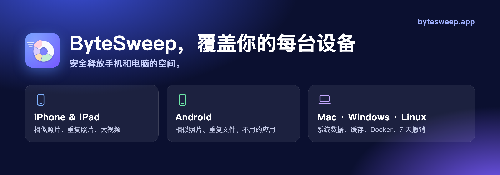

<p align="center">
  <a href="README.md">English</a> ·
  <a href="README.de.md">Deutsch</a> ·
  <a href="README.es.md">Español</a> ·
  <a href="README.fr.md">Français</a> ·
  <a href="README.it.md">Italiano</a> ·
  <a href="README.nl.md">Nederlands</a> ·
  <a href="README.pl.md">Polski</a> ·
  <a href="README.pt-BR.md">Português (Brasil)</a> ·
  <a href="README.ru.md">Русский</a> ·
  <a href="README.tr.md">Türkçe</a> ·
  <a href="README.ja.md">日本語</a> ·
  <a href="README.ko.md">한국어</a> ·
  <b>简体中文</b> ·
  <a href="README.zh-Hant.md">繁體中文</a>
</p>

<h1 align="center">ByteSweep CLI：适用于 Linux、Mac 和 Windows 的磁盘空间分析与清理工具</h1>

<p align="center">
  <b>磁盘空间不足？磁盘为什么满了？在任何终端里找出原因，并安全地清理磁盘空间。</b><br>
  一款免费、开源的磁盘空间分析与清理工具，适用于 Linux 服务器、Mac、Windows 和 BSD 系统。
</p>

<p align="center">
  <a href="https://bytesweep.app/cli"></a>
  <a href="https://github.com/bytesweepcleaner/bytesweep-cli/blob/main/LICENSE"></a>
  <a href="https://github.com/bytesweepcleaner/bytesweep-cli/actions/workflows/test.yml"></a>
  <a href="https://github.com/bytesweepcleaner/bytesweep-cli/blob/main/go.mod"></a>
  <a href="docs/platforms.md"></a>
  <a href="https://github.com/bytesweepcleaner/bytesweep/stargazers"></a>
</p>

<p align="center">
  
</p>

ByteSweep CLI（`bsweep`）告诉你**磁盘为什么满了**，并在**不破坏任何东西**的前提下释放空间。
它会读取 `df`、`du`、Docker、systemd 日志（journal）、软件包缓存、旧内核、已删除但仍被打开的文件、
inode 和快照，再用通俗易懂的话解释原因。每次清理都会先显示确切的命令，有风险的项目会等你先看过，
你删除的文件会进入 Undo（撤销）保留 7 天。

它只是一个静态文件：不需要运行时，没有代理程序，也不会留下任何常驻进程。**免费且开源（GPL-3.0）：
每条命令、每台机器都能用，无需许可证、密钥或试用。**

## 功能

- **一个答案说清磁盘为什么满了。** `bsweep why` 列出占用空间的文件夹、缓存和日志，以及 `du` 看不到的差额。
- **明明有剩余空间，却报 "No space left on device"（设备上没有剩余空间）。** 按磁盘显示 inode 用量，以及文件数最多的文件夹。
- **`df` 和 `du` 对不上。** Held（被占用）界面列出已删除但仍被打开的文件，以及占用每个文件的服务。
- **Docker 磁盘占用。** 构建缓存、未使用的镜像、已停止的容器和容器日志；卷（volume）永远不会被清理。
- **日志。** 对 systemd 日志执行 vacuum，清除已轮转的日志，原地清空巨大的活动日志；可按每天、每周或每月定时执行。
- **磁盘此刻已满。** `bsweep rescue` 只释放刚好够用的空间，最安全的先清理，并且不向已满的磁盘写入任何内容。
- **安全是设计出来的。** 先显示确切命令，处处支持 `--dry-run`，Undo 保留 7 天，绝不碰你的数据库或正在运行的内核。
- **重复文件、大文件、压缩与归档。** 按内容查找副本，用 gzip 压缩旧日志，把旧项目移到另一块磁盘，需要时再取回。
- **健康状况、更新、端口与开机启动。** 失败的服务、因内存不足（OOM）被杀的进程、快要坏的磁盘、过期的证书、已停止的备份，以及每个端口上在监听的程序。
- **多台服务器。** `bsweep fleet` 通过 SSH 运行，无需在服务器上安装任何东西；`bsweep manage` 在一个界面上查看所有服务器。
- **AI 助手。** `bsweep mcp` 是一个 Model Context Protocol（MCP）服务器，可用于 Claude、Cursor、VS Code 以及任何 MCP 客户端。
- **脚本与监控。** 几乎每条命令都支持 `--json`，`bsweep check` 提供退出码，还支持 webhook。

## 安装

Linux、macOS 和 BSD：

```sh
curl -fsSL https://bytesweep.app/install-cli.sh | sudo sh
```

Windows（以管理员身份运行 PowerShell）：

```powershell
irm https://bytesweep.app/install-cli.ps1 | iex
```

两种方式都会在安装任何东西之前校验已签名的校验和。如果你有 Go 1.22 或更新版本，也可以自己构建：

```sh
go install github.com/bytesweepcleaner/bytesweep-cli/cmd/bsweep@latest
```

`sudo bsweep update` 用于获取下一个版本。支持的所有系统和处理器：[docs/platforms.md](docs/platforms.md)。

## 支持的系统

每种系统和处理器各有一个静态 `bsweep` 文件，共 23 个版本。安装命令会自动选择合适的版本。

| 系统 | 处理器 | 版本 |
|---|---|---|
| **Linux** | x86_64, ARM64, ARMv7, i386, RISC-V 64, ppc64le, s390x, LoongArch64 | 任意发行版：Ubuntu, Debian, Fedora, RHEL, CentOS, AlmaLinux, Rocky Linux, openSUSE, Arch, Alpine 等 |
| **Mac** | Apple silicon (ARM64), Intel (x86_64) | macOS 11 Big Sur 及更高版本 |
| **Windows** | x64, ARM64, 32 位 (i386) | Windows 10 和 11 |
| **FreeBSD** | x86_64, ARM64 |  |
| **OpenBSD** | x86_64, ARM64 |  |
| **NetBSD** | x86_64, ARM64 |  |
| **DragonFly BSD** | x86_64 |  |
| **Solaris** | x86_64 |  |
| **illumos** | x86_64 |  |
| **AIX** | ppc64 |  |
| **Android** (Termux) | ARM64 | 在 Termux 中使用 Linux ARM64 版本；Android 不提供 root 权限，因此只能查看 |

可在任何终端中运行：Terminal、iTerm2、Windows Terminal、PowerShell、GNOME Terminal、Konsole、xterm、Linux 控制台、tmux、screen、PuTTY 以及通过 SSH。各系统的差异：[docs/platforms.md](docs/platforms.md)。

## 快速上手

```sh
sudo bsweep                        # 全屏应用
bsweep why                         # 一个答案：这块磁盘为什么满了
sudo bsweep rescue                 # 磁盘已到 100%：只释放刚好够用的空间，最安全的先清理
bsweep clean --list                # 所有可以清理的内容，按分组列出
sudo bsweep clean --safe --dry-run # 安全清理会做什么，但不真正执行
bsweep dupes /srv --dry-run        # 重复文件，以及会保留哪一份
bsweep check                       # 供监控和 cron 使用的退出码
```

## 适用于手机和电脑的 ByteSweep

<p align="center">
  <a href="https://bytesweep.app/?ref=github"></a>
</p>

<p align="center">
  <a href="https://apps.apple.com/us/app/bytesweep-storage-cleaner/id6811826959"></a>
  <a href="https://play.google.com/store/apps/details?id=com.bytesweep.app"></a>
  <a href="https://apps.microsoft.com/detail/9N7WMJS8QCQX"></a>
  <a href="https://bytesweep.app/mac.html?ref=github"></a>
  <a href="https://bytesweep.app/linux.html?ref=github"></a>
</p>

CLI 免费，并且会一直免费。口袋里的手机和桌上的电脑，也有 ByteSweep 应用，规则相同：删除之前，一切都先给你看。

<table>
  <tr>
    <td><b>iPhone &amp; iPad</b></td>
    <td>找出相似照片和重复照片，压缩大视频，滑动浏览过去的月份。前 1 GB 和 30 个项目免费，之后一次性付费。</td>
    <td><a href="https://apps.apple.com/us/app/bytesweep-storage-cleaner/id6811826959"></a></td>
  </tr>
  <tr>
    <td><b>Android</b></td>
    <td>找出相似照片、重复文件、大视频和不用的应用。前 1 GB 和 30 个项目免费，之后一次性付费，无需订阅。</td>
    <td><a href="https://play.google.com/store/apps/details?id=com.bytesweep.app"></a></td>
  </tr>
  <tr>
    <td><b>Mac</b></td>
    <td>找出占满 Mac 的东西，从系统数据到 Docker 和 Xcode。可恢复的内容 7 天内可撤销。免费试用 3 天。Mac App Store 也有。</td>
    <td><a href="https://bytesweep.app/mac.html?ref=github"></a><br><a href="https://apps.apple.com/us/app/bytesweep-storage-transfer/id6822710125?mt=12"></a></td>
  </tr>
  <tr>
    <td><b>Windows</b></td>
    <td>清理 Windows 更新残留、临时文件以及浏览器和游戏缓存，可恢复的内容 7 天内可撤销。免费试用 3 天。</td>
    <td><a href="https://apps.microsoft.com/detail/9N7WMJS8QCQX"></a></td>
  </tr>
  <tr>
    <td><b>Linux</b></td>
    <td>清理 apt、dnf 和 pacman 缓存、旧 snap、未使用的 Flatpak 运行时和日志，并找出重复文件和大文件。免费试用 3 天。</td>
    <td><a href="https://bytesweep.app/linux.html?ref=github"></a></td>
  </tr>
</table>

## 它能解决的所有磁盘问题

| 真实服务器上的痛点 | ByteSweep 怎么做 |
|---|---|
| `df` 说满了，`du` 却对不上 | Held 标签页：已删除但仍被打开的文件，以及是谁占用着它们。Overview（概览）会指出扫描看不到的任何差额 |
| 有剩余空间却报 "No space left" | 按磁盘显示 inode，Explore（浏览）可按文件数排序（`i`） |
| Docker 吃光了磁盘 | 构建缓存、无标签和未使用的镜像、已停止的容器、`docker system df` 不显示的容器日志；每个虚拟机（Colima、Lima、Podman、Multipass、Vagrant、minikube、Android 模拟器……）按名称列出，并显示它能归还的空间 |
| 一次盲目的 prune 删掉了数据库 | 卷永远不会被清理。数据库和 /var/lib/docker 也无法被手动清理 |
| journal、已轮转的日志、巨大的活动日志 | 通过 journalctl 执行 vacuum；活动日志原地清空，服务可以继续写入 |
| /boot 满了，升级失败 | 清理旧内核，绝不动正在运行的那个 |
| 软件包和语言缓存、旧 snap、崩溃转储、旧的 /tmp 文件 | 每一项都通过它自己的工具清理；先显示确切命令 |
| 云主机套餐升级了，磁盘却没变大 | 找出不属于任何分区的磁盘空间 |
| ext4 隐藏的 5% | 指出保留空间，并给出对应的 tune2fs 命令 |
| 下个月又满了 | Prevent（预防）标签页：journal 上限、Docker 日志限制、每日记录 |
| “一夜之间变了什么？” | 哪些在增长，以及按这个速度磁盘何时会满 |
| 扫描拖慢了生产环境 | 以低 CPU 和空闲磁盘 I/O 优先级运行；只停留在一块磁盘上 |
| 磁盘到了 100%，什么都在报错 | `bsweep rescue` 或 `R`：只释放刚好够用的空间，最安全的先清理，然后列出已停止的服务。不向已满的磁盘写入任何内容 |
| Podman 或 Kubernetes 节点 | 通过 podman 和 crictl 做同样的清理；卷保持不动 |
| 快照占着空间 | `bsweep snapshots`：Time Machine、还原点、卷影副本、Timeshift、Snapper、ZFS、Btrfs 和 LVM，工具能报告时会显示大小。只删除你选中的，并保留每一类中最新的一个 |
| 被挂载点遮住的文件 | 通过只读 bind 挂载查看每个挂载点下面的内容，并告诉你如何访问它们 |
| 旧部署和 Web 应用残留 | 旧发布版本（保留当前版本 + 3 个）、WordPress 缓存、Laravel 日志、PHP 会话 |
| 日志需要定期清理 | `bsweep logs clear`，或用 `bsweep schedule logs` 每天、每周或每月执行 |
| 没有任何工具轮转的日志 | Prevent 会写一条 logrotate 规则，测试通过后才保留 |
| 旧项目塞满了繁忙的磁盘 | `bsweep archive /srv/old --to /mnt/backup`：移到另一块磁盘，每个文件都用校验和核对后再释放空间；那块磁盘拔掉后 `where` 依然可用，`bring-back` 可以放回原处 |
| 旧日志和转储占着空间 | `bsweep compress /var/log --older 30d`：在能省空间的地方用 gzip 压缩，回读确认后原文件才进入 Undo；活动日志不动 |
| 同样的文件存了三份 | `bsweep dupes`：按内容查找副本，硬链接和克隆只计一次；保留一份，其余进入 Undo |
| 下载文件夹里满是旧安装包和 "(1)" 副本 | `bsweep tidy`：沿用桌面版的规则，每个文件都进入 Undo；其余交给 `organize`、`rename` 和 `convert`，每项都先预览、可撤销 |
| “3000 端口上跑的是什么？” | `bsweep ports`：程序、项目或容器，是否对网络开放；一步停掉一个开发项目 |
| 哪个软件包特别大，卸载的应用留下了什么 | `bsweep apps`：所有软件包和应用，从大到小排列；先用各自的 dry run 预演，再通过 apt、dnf、pacman、snap、flatpak 或 brew 卸载；绝不动系统需要的东西 |
| 聊天应用悄悄占满磁盘 | Chats and Mail（聊天与邮件）分组：Slack、Teams、Discord、Element 和 Thunderbird 缓存供你审查；Telegram 文件和 Zoom 录像只能逐个处理，进入 Undo |
| 哪些应用能使用摄像头、麦克风或屏幕？ | `bsweep permissions`：已允许和已拒绝的权限，系统有记录时还显示上次使用时间和当前是否在使用（macOS TCC、Windows 隐私设置、Flatpak、Snap、已打开的设备）；只读取，并告诉你在哪里逐项关闭 |
| 命令历史和其他痕迹 | Privacy traces（隐私痕迹）分组：shell 和 REPL 历史、最近使用的文件、预览、编辑器备份；始终需要你审查，每项都进入 Undo |
| 有更新在等待，需要重启吗？ | `bsweep updates`：安全修复优先，通过 apt、dnf、zypper、pacman、apk、snap、flatpak、Homebrew、winget、macOS 的软件更新或 Windows 更新；指出是谁占用着繁忙的软件包锁；绝不自行重启 |
| 一个关不掉的程序 | `bsweep stop PID\|NAME`，或在 Live（实时）中按 `s`：请求它关闭，留 10 秒让它保存；绝不动 sshd、PID 1 或你自己的 shell，对服务则给出对应的 `systemctl` 命令 |
| “为什么它凌晨 3 点醒了？” | `bsweep sleep`：每次睡眠以及是什么唤醒了它（开合盖、USB、蓝牙、网络、定时器），现在是什么让它保持唤醒，以及计划中的唤醒；只给建议，不更改任何电源设置。从不睡眠的服务器会如实说明 |
| “别人能看到什么？” | `bsweep sharesafe`：共享文件夹（允许访客吗？能修改文件吗？）、文件和屏幕共享、SSH、远程桌面、开放的端口、Docker 发布的端口、防火墙；每项都标明风险以及在哪里关闭。只读取 |
| 什么会自动启动，什么启动失败了 | `bsweep startup`：systemd、cron @reboot、launchd、Windows 服务；系统自带的项目只在加 `--all` 时显示；可以精确地关闭，再原样开启 |
| 服务半夜挂了 | Health（健康）标签页：因内存不足被杀的进程、失败的服务、崩溃循环 |
| 一块快要坏的磁盘 | `bsweep drives`：每块物理磁盘标为 Healthy（健康）、Worn（磨损）或 Failing（即将故障），并用通俗的话说明原因；`check` 和 Health 也会发出警告。只读取 |
| “备份到底有没有在跑？” | Health 会指出所用的工具（restic、borg、rsnapshot、duplicity、Timeshift、Snapper、vzdump、Time Machine、Windows Backup），以及它上次成功或失败的时间。不需要仓库密码 |
| 证书突然过期 | 读取 nginx、Apache、Caddy 和 Let's Encrypt 证书；标记续期失败的情况 |
| 更新、SSH、防火墙、备份 | 在 macOS 和 Windows 上，Health 还会读取防火墙、FileVault 或 BitLocker、SIP 和 Gatekeeper 或杀毒软件。给出建议和确切命令。ByteSweep 不会更改 SSH 或防火墙：很多人就是这样把自己锁在外面的 |
| 多台服务器 | `bsweep fleet`：通过 SSH 汇总成一张表，无需安装任何东西 |
| 不想记 scp 语法也能传文件 | 保存一次主机，之后就用 `bsweep copy-to office ./site /srv/site` |
| 传输中断后只能从头再来 | 从中断处继续，只发送有变化的部分 |
| 同步清空了错误的文件夹 | 先显示变更，删除的文件保留 7 天，拒绝把文件夹清空 |
| 在自己的笔记本上检查服务器 | `bsweep connect office` 在那台服务器上打开完整的应用 |
| 服务器太多，管不过来 | `bsweep manage`：所有服务器都在一个界面上，带实时 Monitor（监控）和批量操作 |
| 作为监控体系的一部分 | `bsweep check` 退出码、webhook、`report --json`、`clean --safe --yes` |

所有命令和退出码：[docs/cli.md](docs/cli.md)。Cron、Ansible、CI 和 fleet 示例：[docs/recipes.md](docs/recipes.md)。

## Clean 和 Undo 如何工作

- 在 Explore 中，**Clean**（清理）会把文件移到 `<disk>/.bytesweep-undo` 并保留 7 天。在同一块磁盘上
  移动不会释放任何空间，所以要等 Undo 期结束，空间才会回来。界面上会说明这一点。
- **Remove now**（立即删除）会马上归还空间，但没有 Undo：在应用的询问中按 `F`，或在每个会用到 Undo 的
  命令（rm、dupes、clean、apps、tidy、compress）上加 `--now`。磁盘到了 100% 时就该这样选。
  `bsweep undo free --all` 会清空 Undo 本身。
- 规则类清理通过 journalctl、docker、apt 等工具完成，无法撤销。确认界面会列出每一条命令。

## 主机、传输与同步

在 `bsweep.yml` 中设置一次主机（先 `bsweep init`，再 `bsweep host add`），之后就可以直接用它的短名称，
无论是在服务器上，还是在 Mac 或 Windows 的命令行里。参见 [docs/transfer.md](docs/transfer.md)。

## AI 助手（MCP）

`bsweep mcp` 让 Claude Desktop、Claude Code、Cursor、VS Code 和其他 MCP 客户端查看一台机器并帮忙清理，
遵循与命令行相同的规则。参见 [docs/mcp.md](docs/mcp.md)。

## 常见问题

**如何查看 Linux 上是什么占用了磁盘空间？**
运行 `bsweep why` 获得一屏就能看完的答案，或者运行 `sudo bsweep` 并打开 Explore，从大到小逐个浏览文件夹。
它还会统计逐个遍历文件夹时看不到的内容：仍被打开的已删除文件、Docker、快照和保留空间。

**为什么 `df` 显示磁盘已满，而 `du` 加起来却更少？**
通常是某个程序仍打开着一个已删除的文件，往往是日志。Held 界面会列出每一个这样的文件以及占用它的
服务，并能原地清空被占用的日志，让服务继续写入。

**`df` 显示还有空间，却报 "No space left on device"（磁盘空间不足），怎么解决？**
磁盘的 inode 用完了：小文件太多。ByteSweep 按磁盘显示 inode，Explore 可按文件数排序（`i`），
找到存放这些文件的文件夹。

**如何安全地清理 Docker 磁盘空间？**
`bsweep clean --list --group containers` 列出构建缓存、未使用的镜像、已停止的容器和容器日志。
卷永远不会被清理，因为一个卷可能就是一个数据库。

**服务器磁盘满了，已用到 100%，怎么办？**
运行 `sudo bsweep rescue`，或在应用中按 `R`。它只释放刚好够用的空间，最安全的先清理，不向已满的
磁盘写入任何内容，然后列出已停止的服务。

**在生产服务器上运行安全吗？**
每次清理都会先显示确切命令，`--dry-run` 可以预览任何操作，删除的文件在 Undo 中保留 7 天，
扫描以低 CPU 和空闲磁盘优先级运行。它绝不删除数据库、Docker 卷或正在运行的内核，绝不替你挑选快照，
也绝不更改 SSH 或防火墙设置。

**它免费吗？会把数据发送到别处吗？**
免费且开源，采用 GPL-3.0 许可证，无需账号，没有统计分析，也没有试用期。只有在你要求时它才会联网：
`bsweep update`、发往你所添加位置的提醒，以及 fleet、copy 和 sync 所用的 SSH。

## 隐私

没有统计分析，也不需要账号。关于你和你的文件的任何信息都不会离开这台机器。bsweep 只在你要求时
才联网：`bsweep update` 从 bytesweep.app 下载（并先校验签名），提醒只发往你添加的位置，
fleet、copy 和 sync 使用你自己的 SSH。

## 构建与测试

需要 Go 1.22 或更新版本：先运行 `go test ./...`，再运行 `go build -o bsweep ./cmd/bsweep`。
`VERSION=1.0.1 ./build.sh` 会生成所有发布版本的构建。参见 [bytesweep-cli](https://github.com/bytesweepcleaner/bytesweep-cli) 和
[SECURITY.md](SECURITY.md)。

## 许可证

GPL-3.0：可以自由使用、修改和分享。你分发给他人的修改版本必须以同一许可证保持开源。
参见 [LICENSE](https://github.com/bytesweepcleaner/bytesweep-cli/blob/main/LICENSE)。

---

ByteSweep 也提供适用于 Mac、Windows 和 Linux 的桌面应用：[bytesweep.app](https://bytesweep.app/?ref=github)
