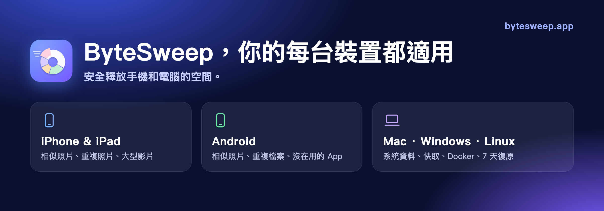

<p align="center">
  <a href="README.md">English</a> ·
  <a href="README.de.md">Deutsch</a> ·
  <a href="README.es.md">Español</a> ·
  <a href="README.fr.md">Français</a> ·
  <a href="README.it.md">Italiano</a> ·
  <a href="README.nl.md">Nederlands</a> ·
  <a href="README.pl.md">Polski</a> ·
  <a href="README.pt-BR.md">Português (Brasil)</a> ·
  <a href="README.ru.md">Русский</a> ·
  <a href="README.tr.md">Türkçe</a> ·
  <a href="README.ja.md">日本語</a> ·
  <a href="README.ko.md">한국어</a> ·
  <a href="README.zh-Hans.md">简体中文</a> ·
  <b>繁體中文</b>
</p>

<h1 align="center">ByteSweep CLI：適用於 Linux、Mac 和 Windows 的磁碟空間分析與清理工具</h1>

<p align="center">
  <b>磁碟空間不足？磁碟為什麼滿了？在任何終端機裡找出原因，並安全地清理磁碟空間。</b><br>
  一套免費、開放原始碼的磁碟空間分析與清理工具，適用於 Linux 伺服器、Mac、Windows 和 BSD 系統。
</p>

<p align="center">
  <a href="https://bytesweep.app/cli"></a>
  <a href="https://github.com/bytesweepcleaner/bytesweep-cli/blob/main/LICENSE"></a>
  <a href="https://github.com/bytesweepcleaner/bytesweep-cli/actions/workflows/test.yml"></a>
  <a href="https://github.com/bytesweepcleaner/bytesweep-cli/blob/main/go.mod"></a>
  <a href="docs/platforms.md"></a>
  <a href="https://github.com/bytesweepcleaner/bytesweep/stargazers"></a>
</p>

<p align="center">
  
</p>

ByteSweep CLI（`bsweep`）告訴你**磁碟為什麼滿了**，並在**不破壞任何東西**的前提下釋放空間。
它會讀取 `df`、`du`、Docker、systemd 日誌（journal）、套件快取、舊核心、已刪除但仍被開啟的檔案、
inode 和快照，再用淺顯易懂的話說明原因。每次清理都會先顯示確切的指令，有風險的項目會等你先看過，
你刪除的檔案會進入 Undo（復原）保留 7 天。

它只是一個靜態檔案：不需要執行環境，沒有代理程式，也不會留下任何常駐程式。**免費且開放原始碼（GPL-3.0）：
每個指令、每台電腦都能用，不需要授權、金鑰或試用。**

## 功能

- **一個答案說清楚磁碟為什麼滿了。** `bsweep why` 列出占用空間的資料夾、快取和日誌，以及 `du` 看不到的差額。
- **明明還有剩餘空間，卻出現 "No space left on device"（裝置上沒有剩餘空間）。** 依磁碟顯示 inode 用量，以及檔案數最多的資料夾。
- **`df` 和 `du` 對不起來。** Held（被占用）畫面列出已刪除但仍被開啟的檔案，以及占用每個檔案的服務。
- **Docker 磁碟用量。** 建置快取、未使用的映像檔、已停止的容器和容器日誌；volume 永遠不會被清除。
- **日誌。** 對 systemd 日誌執行 vacuum，清除已輪替的日誌，就地清空巨大的使用中日誌；可依每天、每週或每月排程執行。
- **磁碟現在就滿了。** `bsweep rescue` 只釋放剛好夠用的空間，最安全的先清，而且不會寫入任何東西到已滿的磁碟。
- **安全是設計出來的。** 先顯示確切指令，處處支援 `--dry-run`，Undo 保留 7 天，絕不碰你的資料庫或正在執行的核心。
- **重複檔案、大型檔案、壓縮與封存。** 依內容找出副本，用 gzip 壓縮舊日誌，把舊專案移到另一顆磁碟，需要時再取回。
- **健康狀態、更新、連接埠與開機啟動。** 失敗的服務、因記憶體不足（OOM）被終止的程序、快壞掉的磁碟、過期的憑證、已停止的備份，以及每個連接埠上正在監聽的程式。
- **多台伺服器。** `bsweep fleet` 透過 SSH 執行，不需在伺服器上安裝任何東西；`bsweep manage` 在同一個畫面上查看所有伺服器。
- **AI 助理。** `bsweep mcp` 是一個 Model Context Protocol（MCP）伺服器，可用於 Claude、Cursor、VS Code 以及任何 MCP 用戶端。
- **指令碼與監控。** 幾乎每個指令都支援 `--json`，`bsweep check` 提供結束代碼，還支援 webhook。

## 安裝

Linux、macOS 和 BSD：

```sh
curl -fsSL https://bytesweep.app/install-cli.sh | sudo sh
```

或者直接從 GitHub 執行同一個指令碼：

```sh
curl -fsSL https://raw.githubusercontent.com/bytesweepcleaner/bytesweep/main/install-cli.sh | sudo sh
```

Windows（以系統管理員身分執行 PowerShell）：

```powershell
irm https://bytesweep.app/install-cli.ps1 | iex
```

兩種方式都會在安裝任何東西之前驗證已簽章的檢查碼。如果你有 Go 1.22 或更新版本，也可以自行建置：

```sh
go install github.com/bytesweepcleaner/bytesweep-cli/cmd/bsweep@latest
```

`sudo bsweep update` 用來取得下一個版本。支援的所有系統和處理器：[docs/platforms.md](docs/platforms.md)。

## 支援的系統

每種系統和處理器各有一個靜態 `bsweep` 檔案，共 23 個版本。安裝指令會自動選擇合適的版本。

| 系統 | 處理器 | 版本 |
|---|---|---|
| **Linux** | x86_64, ARM64, ARMv7, i386, RISC-V 64, ppc64le, s390x, LoongArch64 | 任何發行版：Ubuntu, Debian, Fedora, RHEL, CentOS, AlmaLinux, Rocky Linux, openSUSE, Arch, Alpine 等 |
| **Mac** | Apple silicon (ARM64), Intel (x86_64) | macOS 11 Big Sur 及更新版本 |
| **Windows** | x64, ARM64, 32 位元 (i386) | Windows 10 和 11 |
| **FreeBSD** | x86_64, ARM64 |  |
| **OpenBSD** | x86_64, ARM64 |  |
| **NetBSD** | x86_64, ARM64 |  |
| **DragonFly BSD** | x86_64 |  |
| **Solaris** | x86_64 |  |
| **illumos** | x86_64 |  |
| **AIX** | ppc64 |  |
| **Android** (Termux) | ARM64 | 在 Termux 中使用 Linux ARM64 版本；Android 不提供 root 權限，因此只能檢視 |

可在任何終端機中執行：Terminal、iTerm2、Windows Terminal、PowerShell、GNOME Terminal、Konsole、xterm、Linux 主控台、tmux、screen、PuTTY 以及透過 SSH。各系統的差異：[docs/platforms.md](docs/platforms.md)。

## 快速上手

```sh
sudo bsweep                        # 全螢幕應用程式
bsweep why                         # 一個答案：這顆磁碟為什麼滿了
sudo bsweep rescue                 # 磁碟已到 100%：只釋放剛好夠用的空間，最安全的先清
bsweep clean --list                # 所有可以清掉的內容，依群組列出
sudo bsweep clean --safe --dry-run # 安全清理會做什麼，但不實際執行
bsweep dupes /srv --dry-run        # 重複檔案，以及會保留哪一份
bsweep check                       # 給監控和 cron 使用的結束代碼
```

## 適用於手機和電腦的 ByteSweep

<p align="center">
  <a href="https://bytesweep.app/?ref=github"></a>
</p>

<p align="center">
  <a href="https://apps.apple.com/us/app/bytesweep-storage-cleaner/id6811826959"></a>
  <a href="https://play.google.com/store/apps/details?id=com.bytesweep.app"></a>
  <a href="https://apps.microsoft.com/detail/9N7WMJS8QCQX"></a>
  <a href="https://bytesweep.app/mac.html?ref=github"></a>
  <a href="https://bytesweep.app/linux.html?ref=github"></a>
</p>

CLI 免費，而且會一直免費。口袋裡的手機和桌上的電腦，也有 ByteSweep App，規則相同：刪除之前，一切都先讓你看過。

<table>
  <tr>
    <td><b>iPhone &amp; iPad</b></td>
    <td>找出相似照片和重複照片，壓縮大型影片，滑動瀏覽過去的月份。前 1 GB 和 30 個項目免費，之後一次買斷。</td>
    <td><a href="https://apps.apple.com/us/app/bytesweep-storage-cleaner/id6811826959"></a></td>
  </tr>
  <tr>
    <td><b>Android</b></td>
    <td>找出相似照片、重複檔案、大型影片和沒在用的 App。前 1 GB 和 30 個項目免費，之後一次買斷，不用訂閱。</td>
    <td><a href="https://play.google.com/store/apps/details?id=com.bytesweep.app"></a></td>
  </tr>
  <tr>
    <td><b>Mac</b></td>
    <td>找出塞滿 Mac 的東西，從系統資料到 Docker 和 Xcode。可還原的內容 7 天內可復原。免費試用 3 天。Mac App Store 也有。</td>
    <td><a href="https://bytesweep.app/mac.html?ref=github"></a><br><a href="https://apps.apple.com/us/app/bytesweep-storage-transfer/id6822710125?mt=12"></a></td>
  </tr>
  <tr>
    <td><b>Windows</b></td>
    <td>清理 Windows Update 殘留、暫存檔以及瀏覽器和遊戲快取，可還原的內容 7 天內可復原。免費試用 3 天。</td>
    <td><a href="https://apps.microsoft.com/detail/9N7WMJS8QCQX"></a></td>
  </tr>
  <tr>
    <td><b>Linux</b></td>
    <td>清理 apt、dnf 和 pacman 快取、舊 snap、未使用的 Flatpak 執行環境和日誌，並找出重複檔案和大型檔案。免費試用 3 天。</td>
    <td><a href="https://bytesweep.app/linux.html?ref=github"></a></td>
  </tr>
</table>

## 它能解決的所有磁碟問題

| 真實伺服器上的痛點 | ByteSweep 怎麼做 |
|---|---|
| `df` 說滿了，`du` 卻對不起來 | Held 分頁：已刪除但仍被開啟的檔案，以及是誰占用著它們。Overview（總覽）會指出掃描看不到的任何差額 |
| 還有剩餘空間卻出現 "No space left" | 依磁碟顯示 inode，Explore（瀏覽）可依檔案數排序（`i`） |
| Docker 吃光了磁碟 | 建置快取、無標籤和未使用的映像檔、已停止的容器、`docker system df` 不會顯示的容器日誌；每台虛擬機器（Colima、Lima、Podman、Multipass、Vagrant、minikube、Android 模擬器……）依名稱列出，並顯示它能歸還的空間 |
| 一次盲目的 prune 刪掉了資料庫 | volume 永遠不會被清除。資料庫和 /var/lib/docker 也無法手動清理 |
| journal、已輪替的日誌、巨大的使用中日誌 | 透過 journalctl 執行 vacuum；使用中的日誌就地清空，服務可以繼續寫入 |
| /boot 滿了，升級失敗 | 清掉舊核心，絕不動正在執行的那一個 |
| 套件和程式語言快取、舊 snap、當機傾印、舊的 /tmp 檔案 | 每一項都透過它自己的工具清理；先顯示確切指令 |
| 主機方案升級了，磁碟卻沒變大 | 找出不屬於任何分割區的磁碟空間 |
| ext4 隱藏的 5% | 指出保留空間，並給出對應的 tune2fs 指令 |
| 下個月又滿了 | Prevent（預防）分頁：journal 上限、Docker 日誌限制、每日記錄 |
| 「一夜之間變了什麼？」 | 哪些在成長，以及照這個速度磁碟何時會滿 |
| 掃描拖慢了正式環境 | 以低 CPU 和閒置磁碟 I/O 優先順序執行；只停留在一顆磁碟上 |
| 磁碟到了 100%，什麼都在出錯 | `bsweep rescue` 或 `R`：只釋放剛好夠用的空間，最安全的先清，然後列出已停止的服務。不會寫入任何東西到已滿的磁碟 |
| Podman 或 Kubernetes 節點 | 透過 podman 和 crictl 做同樣的清理；volume 維持不動 |
| 快照占著空間 | `bsweep snapshots`：Time Machine、還原點、陰影複製、Timeshift、Snapper、ZFS、Btrfs 和 LVM，工具能回報時會顯示大小。只移除你選取的，並保留每一類中最新的一個 |
| 被掛載點遮住的檔案 | 透過唯讀 bind 掛載查看每個掛載點底下的內容，並告訴你如何存取它們 |
| 舊部署和 Web 應用程式殘留 | 舊發行版本（保留目前版本 + 3 個）、WordPress 快取、Laravel 日誌、PHP 工作階段 |
| 日誌需要定期清理 | `bsweep logs clear`，或用 `bsweep schedule logs` 每天、每週或每月執行 |
| 沒有任何工具輪替的日誌 | Prevent 會寫一條 logrotate 規則，測試通過後才保留 |
| 舊專案塞滿了忙碌的磁碟 | `bsweep archive /srv/old --to /mnt/backup`：移到另一顆磁碟，每個檔案都用檢查碼核對後再釋放空間；那顆磁碟拔掉後 `where` 依然可用，`bring-back` 可以放回原處 |
| 舊日誌和傾印檔占著空間 | `bsweep compress /var/log --older 30d`：在能省空間的地方用 gzip 壓縮，讀回確認後原檔才進入 Undo；使用中的日誌不動 |
| 同樣的檔案存了三份 | `bsweep dupes`：依內容找出副本，硬連結和複製檔只算一次；保留一份，其餘進入 Undo |
| 下載資料夾裡滿是舊安裝檔和 "(1)" 副本 | `bsweep tidy`：沿用桌面版的規則，每個檔案都進入 Undo；其餘交給 `organize`、`rename` 和 `convert`，每項都先預覽、可以復原 |
| 「3000 連接埠上跑的是什麼？」 | `bsweep ports`：程式、專案或容器，是否對網路開放；一步停掉一個開發專案 |
| 哪個套件特別大，移除的應用程式留下了什麼 | `bsweep apps`：所有套件和應用程式，由大到小排列；先用各自的 dry run 預演，再透過 apt、dnf、pacman、snap、flatpak 或 brew 移除；絕不動系統需要的東西 |
| 聊天軟體悄悄塞滿磁碟 | Chats and Mail（聊天與郵件）群組：Slack、Teams、Discord、Element 和 Thunderbird 快取供你檢視；Telegram 檔案和 Zoom 錄影只能逐一處理，進入 Undo |
| 哪些應用程式能使用相機、麥克風或螢幕？ | `bsweep permissions`：已允許和已拒絕的權限，系統有記錄時還會顯示上次使用時間和目前是否正在使用（macOS TCC、Windows 隱私權設定、Flatpak、Snap、已開啟的裝置）；只讀取，並告訴你在哪裡逐項關閉 |
| 指令歷史記錄和其他痕跡 | Privacy traces（隱私痕跡）群組：shell 和 REPL 歷史記錄、最近使用的檔案、預覽、編輯器備份；一律需要你檢視，每項都進入 Undo |
| 有更新在等待，需要重新開機嗎？ | `bsweep updates`：安全性修正優先，透過 apt、dnf、zypper、pacman、apk、snap、flatpak、Homebrew、winget、macOS 的軟體更新或 Windows Update；指出是誰占用著忙碌中的套件鎖；絕不自行重新開機 |
| 一個關不掉的程式 | `bsweep stop PID\|NAME`，或在 Live（即時）中按 `s`：要求它關閉，留 10 秒讓它存檔；絕不動 sshd、PID 1 或你自己的 shell，對服務則給出對應的 `systemctl` 指令 |
| 「為什麼它凌晨 3 點醒了？」 | `bsweep sleep`：每次睡眠以及是什麼喚醒了它（開闔螢幕、USB、藍牙、網路、計時器），現在是什麼讓它保持喚醒，以及排定的喚醒；只給建議，不變更任何電源設定。從不睡眠的伺服器會如實說明 |
| 「別人看得到什麼？」 | `bsweep sharesafe`：共用資料夾（允許訪客嗎？能修改檔案嗎？）、檔案和螢幕共享、SSH、遠端桌面、開放的連接埠、Docker 發布的連接埠、防火牆；每項都標明風險以及在哪裡關閉。只讀取 |
| 什麼會自動啟動，什麼啟動失敗了 | `bsweep startup`：systemd、cron @reboot、launchd、Windows 服務；系統內建的項目只在加上 `--all` 時顯示；可以精確地關閉，再原樣開啟 |
| 服務半夜掛了 | Health（健康）分頁：因記憶體不足被終止的程序、失敗的服務、當機循環 |
| 一顆快壞掉的磁碟 | `bsweep drives`：每顆實體磁碟標示為 Healthy（健康）、Worn（磨損）或 Failing（即將故障），並用淺白的話說明原因；`check` 和 Health 也會發出警告。只讀取 |
| 「備份到底有沒有在跑？」 | Health 會指出所用的工具（restic、borg、rsnapshot、duplicity、Timeshift、Snapper、vzdump、Time Machine、Windows Backup），以及它上次成功或失敗的時間。不需要儲存庫密碼 |
| 憑證突然過期 | 讀取 nginx、Apache、Caddy 和 Let's Encrypt 憑證；標示續約失敗的情況 |
| 更新、SSH、防火牆、備份 | 在 macOS 和 Windows 上，Health 還會讀取防火牆、FileVault 或 BitLocker、SIP 和 Gatekeeper 或防毒軟體。給出建議和確切指令。ByteSweep 不會變更 SSH 或防火牆：很多人就是這樣把自己鎖在外面的 |
| 多台伺服器 | `bsweep fleet`：透過 SSH 彙整成一張表，不需安裝任何東西 |
| 不想記 scp 語法也能傳檔案 | 儲存一次主機，之後就用 `bsweep copy-to office ./site /srv/site` |
| 傳輸中斷後只能從頭再來 | 從中斷處繼續，只傳送有變更的部分 |
| 同步清空了錯的資料夾 | 先顯示變更，移除的檔案保留 7 天，拒絕把資料夾清空 |
| 在自己的筆電上檢查伺服器 | `bsweep connect office` 在那台伺服器上開啟完整的應用程式 |
| 伺服器太多，管不過來 | `bsweep manage`：所有伺服器都在同一個畫面上，附即時 Monitor（監控）和批次操作 |
| 作為監控架構的一部分 | `bsweep check` 結束代碼、webhook、`report --json`、`clean --safe --yes` |

所有指令和結束代碼：[docs/cli.md](docs/cli.md)。Cron、Ansible、CI 和 fleet 範例：[docs/recipes.md](docs/recipes.md)。

## Clean 和 Undo 如何運作

- 在 Explore 中，**Clean**（清理）會把檔案移到 `<disk>/.bytesweep-undo` 並保留 7 天。在同一顆磁碟上
  搬移不會釋放任何空間，所以要等 Undo 期限結束，空間才會回來。畫面上會說明這一點。
- **Remove now**（立即移除）會馬上歸還空間，但沒有 Undo：在應用程式的詢問中按 `F`，或在每個會用到 Undo 的
  指令（rm、dupes、clean、apps、tidy、compress）加上 `--now`。磁碟到了 100% 時就該這樣選。
  `bsweep undo free --all` 會清空 Undo 本身。
- 規則類清理透過 journalctl、docker、apt 等工具完成，無法復原。確認畫面會列出每一個指令。

## 主機、傳輸與同步

在 `bsweep.yml` 中設定一次主機（先 `bsweep init`，再 `bsweep host add`），之後就能直接用它的短名稱，
不論是在伺服器上，還是在 Mac 或 Windows 的命令列裡。請參閱 [docs/transfer.md](docs/transfer.md)。

## AI 助理（MCP）

`bsweep mcp` 讓 Claude Desktop、Claude Code、Cursor、VS Code 和其他 MCP 用戶端查看一台電腦並協助清理，
遵循與命令列相同的規則。請參閱 [docs/mcp.md](docs/mcp.md)。

## 常見問題

**如何查看 Linux 上是什麼占用了磁碟空間？**
執行 `bsweep why` 取得一個畫面就能看完的答案，或者執行 `sudo bsweep` 並開啟 Explore，由大到小逐一瀏覽資料夾。
它還會計算逐一走訪資料夾時看不到的內容：仍被開啟的已刪除檔案、Docker、快照和保留空間。

**為什麼 `df` 顯示磁碟已滿，而 `du` 加起來卻比較少？**
通常是某個程式仍開著一個已刪除的檔案，往往是日誌。Held 畫面會列出每一個這樣的檔案以及占用它的
服務，並能就地清空被占用的日誌，讓服務繼續寫入。

**`df` 顯示還有空間，卻出現 "No space left on device"（磁碟空間不足），該怎麼解決？**
磁碟的 inode 用完了：小檔案太多。ByteSweep 依磁碟顯示 inode，Explore 可依檔案數排序（`i`），
找出存放這些檔案的資料夾。

**如何安全地清理 Docker 磁碟空間？**
`bsweep clean --list --group containers` 列出建置快取、未使用的映像檔、已停止的容器和容器日誌。
volume 永遠不會被清除，因為一個 volume 可能就是一個資料庫。

**伺服器磁碟滿了，已用到 100%，該怎麼辦？**
執行 `sudo bsweep rescue`，或在應用程式中按 `R`。它只釋放剛好夠用的空間，最安全的先清，不會寫入任何東西
到已滿的磁碟，然後列出已停止的服務。

**在正式環境的伺服器上執行安全嗎？**
每次清理都會先顯示確切指令，`--dry-run` 可以預覽任何操作，移除的檔案在 Undo 中保留 7 天，
掃描以低 CPU 和閒置磁碟優先順序執行。它絕不移除資料庫、Docker volume 或正在執行的核心，絕不替你挑選快照，
也絕不變更 SSH 或防火牆設定。

**它是免費的嗎？會把資料傳送到別處嗎？**
免費且開放原始碼，採用 GPL-3.0 授權，不需要帳號，沒有分析追蹤，也沒有試用期。只有在你要求時它才會連網：
`bsweep update`、傳送到你所新增位置的警示，以及 fleet、copy 和 sync 所用的 SSH。

## 隱私權

沒有分析追蹤，也不需要帳號。關於你和你的檔案的任何資訊都不會離開這台電腦。bsweep 只在你要求時
才連網：`bsweep update` 從 bytesweep.app 下載（並先驗證簽章），警示只傳送到你新增的位置，
fleet、copy 和 sync 使用你自己的 SSH。

## 建置與測試

需要 Go 1.22 或更新版本：先執行 `go test ./...`，再執行 `go build -o bsweep ./cmd/bsweep`。
`VERSION=1.0.1 ./build.sh` 會產生所有發行版本的建置。請參閱 [bytesweep-cli](https://github.com/bytesweepcleaner/bytesweep-cli) 和
[SECURITY.md](SECURITY.md)。

## 授權條款

GPL-3.0：可以自由使用、修改和分享。你提供給他人的修改版本必須以相同的授權條款維持開放原始碼。
請參閱 [LICENSE](https://github.com/bytesweepcleaner/bytesweep-cli/blob/main/LICENSE)。

---

ByteSweep 也提供適用於 Mac、Windows 和 Linux 的桌面應用程式：[bytesweep.app](https://bytesweep.app/?ref=github)
